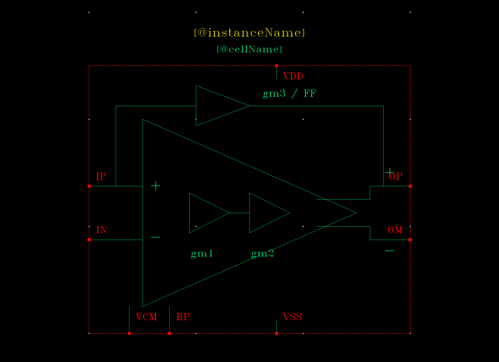
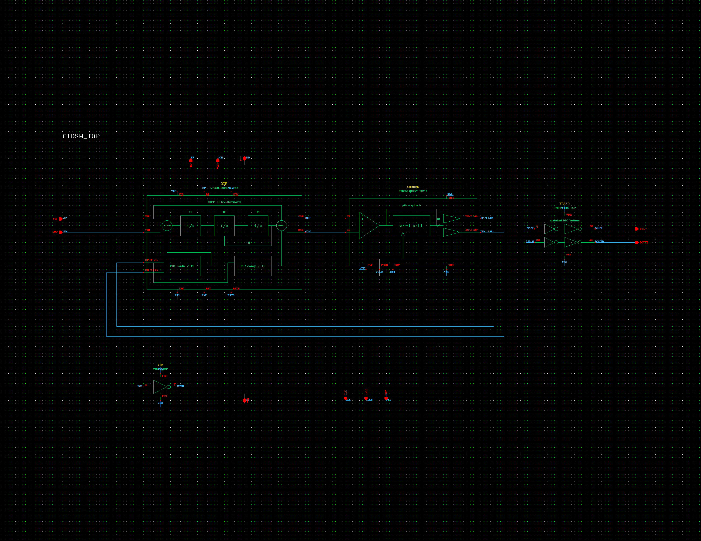

# 用 AI 搭建 Virtuoso 电路

把论文、工艺和本仓库链接交给 AI，按一套明确的规则搭建原理图、功能 symbol 和仿真环境：真实 PDK 器件、清楚的实体连线、紧凑的层次、可追溯的检查结果。

本仓库从已经完成并获得用户认可的 CTDSM18 工程中提炼。除了经验，还提供 **18 个 symbol 的确定性图形与接口数据、父级排布参考、原生 SKILL 生成器和电气一致性检查脚本**。



上图是实际 Virtuoso 导出的原生 symbol，包含级联增益、前馈路径、差分极性、供电与偏置。下图展示这些 symbol 在真实父级中的排列和连线。



## 把这段话和论文发给 AI

```text
请读取 https://github.com/w1213ph/virtuoso-circuit-skills 的 AGENTS.md
以及 skills/paper-to-virtuoso/SKILL.md，按照其中的工作流搭建我提供的论文电路。

先读取我的实际 PDK、现有工程和可用连接工具，再确定器件映射与测量条件。
原理图、功能 symbol、cell 命名和父级紧凑程度参照仓库的 CTDSM18 示例。
在独立库中完成；保留我的手工修改，不关闭现有 Virtuoso 会话。
完成后分别报告连接/参数回读、网表检查、仿真行为和 GUI 目视验收。
模型、目标指标、未实现部分及仿真条件必须明确，不把未运行写成通过。
```

随后补充：论文和图号、目标工艺、电源、主要指标、工程位置。如果只想整理已有图，直接说：**只改 schematic/symbol、迁移 Maestro，不重跑仿真，不改变器件参数和拓扑**。

[完整 AI 提示](docs/AI_START.md) · [连接与依赖](docs/SETUP.md) · [CTDSM18 案例](examples/ctdsm18/README.md) · [验收标准](skills/paper-to-virtuoso/references/acceptance.md)

## 具体做到什么

| 内容 | 要求 |
|---|---|
| 电气实现 | 使用实际 PDK 引脚、CDF 和回调；核对 W/L、指宽、指数量及 m |
| 原理图 | 主信号从左向右，差分支路对齐镜像，反馈和主要拓扑用实体导线 |
| Symbol | 表达最小可辨识功能；按内容定大小；移动 pin 后同步直接父级 |
| 命名 | `<项目>_<功能>[_特征]`；测试台 `TB_<被测CELL>[_用途]`；view 沿用原名 |
| 仿真环境 | 保存模型、corner、变量、分析、输出与测试绑定；迁移不冒充重新运行 |
| 交付 | Check & Save、连接回读、原生网表、全图/局部目视及可执行回退分别记录 |

## 先在没有 Cadence 的机器上试用

Python 3.9+，以下工具只用标准库：

```sh
git clone https://github.com/w1213ph/virtuoso-circuit-skills.git
cd virtuoso-circuit-skills
python scripts/check_repo.py
python skills/paper-to-virtuoso/scripts/render_symbols.py --out build/reference
python skills/paper-to-virtuoso/scripts/new_task.py --project AFE --mode paper --out work/afe
```

`build/reference` 生成与案例相同几何的 18 个 SVG。实际原生 symbol 的生成方法见 [SETUP.md](docs/SETUP.md)。SVG 是预览；它不代替 OA terminal、NLP label、选择框与父级连线。

公开生成器已在独立 Virtuoso IC6.1.8 测试库实际重放：18 个原生 symbol 的图元、标签、选择框、pin 坐标与方向均与认可版本一致。[验证记录](docs/VALIDATION.md)。

## “一样的效果”怎样验证

参考数据固定了 18 个 symbol 的图元、尺寸、pin 坐标、方向和端序；使用相同数据可以重复生成相同几何。对新电路，验收的是功能表达、连接正确性、可读性与工程组织。

实际 PDK、模型版本、Cadence/仿真器版本、论文缺失细节和设计目标仍需由使用者提供。仓库不会仅凭一个链接自动获得服务器访问或工艺许可，也不保证不同电路获得相同电气性能。新结果必须在使用者自己的环境验收。

## 来源与范围

CTDSM18 基准包括 22 张 schematic、18 个功能 symbol、6 项迁移的 Maestro 测试。重排当时参数、逐端网络和四对原生网表一致，画面已检查；**该轮没有运行新的仿真**。本仓库公开工作流、图形参考和工具，不发布 PDK 模型、原工程数据库、私人连接配置或旧仿真数据。

功能图表达参考 [JPWang-OvO/analog-artist-skills](https://github.com/JPWang-OvO/analog-artist-skills)。AI 连接 Virtuoso 可使用 [Arcadia-1/virtuoso-bridge-lite](https://github.com/Arcadia-1/virtuoso-bridge-lite)，也可使用已有的受控 SKILL/终端工具。两者均不由本仓库自动安装。出处与版本见 [NOTICE](NOTICE)，代码与文档采用 [GPL-3.0](LICENSE)。
