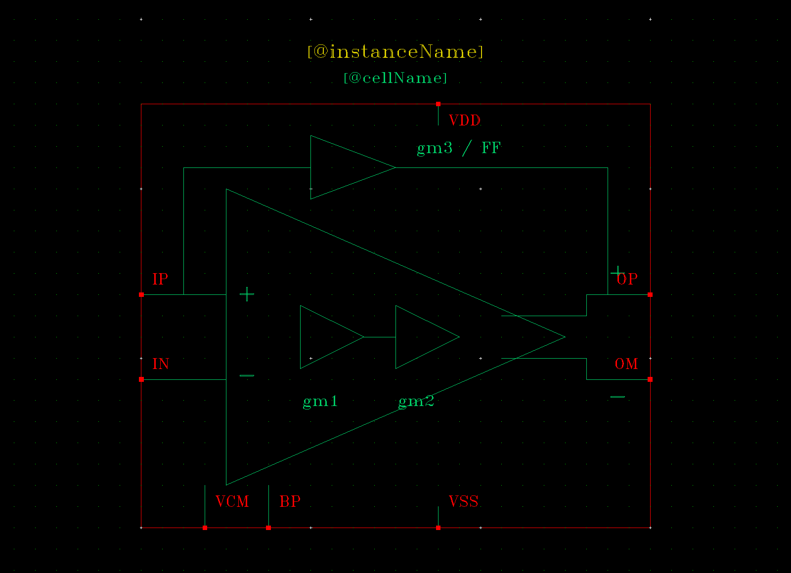
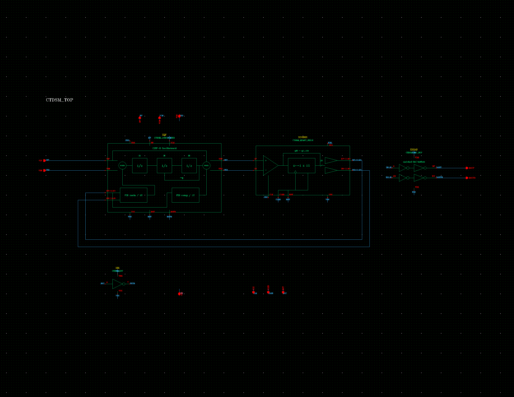

# 用 AI 搭建清楚、规范的 Virtuoso 电路

想让 AI 根据功能需求搭建电路工程、复现论文，或者继续设计已有电路？把这个仓库链接交给能操作你工程的 agent，再提供目标和工艺要求，就可以按这里的流程开始。

这里提供**搭建方法、绘图规则、功能 symbol 参考和检查工具**。AI 负责结合你的实际工艺完成设计；你可以用示例图和验收清单检查成果。

**第一次试用**，可以直接下载 8 µA、275 fF 的 ADC 偏置工程。解压后打开 `index.html` 看两种工艺的原理图、测试台和限制尺寸的波形。让 agent 在解压目录运行 `python bias.py`，解释哪个尺寸达标、要多少栅面积。想从一句话重新设计，可以从空目录领取同一题。[下载示例工程](https://github.com/w1213ph/virtuoso-circuit-skills/releases/download/adc-bias-first-use-v1/adc-bias-275ff.zip) · [领取设计题](docs/FIRST_USE_TRIAL.md)

**设计自己的电路**，在[新手入口](docs/BEGINNER.md)用一句话描述用途。Agent 从工程读取工艺和供电，与你确定指标，用器件实测表选择初始尺寸，再交付电路、功能 symbol、测试台和结果。已有电路也可以比较同条件下的候选。[性能优化流程](skills/paper-to-virtuoso/references/optimization.md)

想试试自己的指标，可以让 agent 给 ADC 复制 8 µA 外部偏置，参考端接 250 fF，40 ns 内稳定，并从达标方案中选栅面积较小的一版。报告会给出选中原理图、测试台和每个工况的实测值。另有一个 5 µA 案例保留了快角超差后重新选尺寸的过程。[8 µA 按需求选方案](examples/sky130-current-mirror/README.md#用一句-adc-偏置需求选方案) · [5 µA 超差后重选尺寸](examples/sky130-current-mirror/README.md#换成自己的需求)

## 你想做什么？

| 任务 | 可以让 AI 完成的工作 | 使用入口 |
|---|---|---|
| 按论文搭新电路 | 理解拓扑、映射工艺器件、建立分层电路和测试台、验证指标 | [新电路提示](docs/AI_START.md#搭建新论文电路) |
| 从需求搭建或继续工程 | 拆分模块、设计工程辅助电路、集成真实接口并验证 | [工程搭建提示](docs/AI_START.md#从功能需求搭建或继续工程) |
| 优化结构或参数 | 定位限制、筛选敏感变量、按成本验证候选与多指标取舍 | [优化提示](docs/AI_START.md#优化已有电路的性能) |
| 让放大器驱动 ADC | 按采样精度和负载选择镜像与开关尺寸，在选中电路上复算三工况误差，检查随机失配后还有多少样本达标 | [下载含 32 个失配样本的 8 位工程](https://github.com/w1213ph/virtuoso-circuit-skills/releases/download/adc-driver-8bit-mismatch-v1/adc-driver-8bit-mismatch.zip) · [按需求建图](examples/sky130-adc-driver/README.md) · [按失配改尺寸](examples/sky130-adc-driver/MATCHING.md) |
| 设计可编程增益级 | 从控制位追到传输门，在后级输入测四档增益和切码建立时间，同时比较电流和器件面积 | [可直接复跑的 SKY130 增益级](examples/sky130-programmable-gain/README.md) |
| 用开源工艺跑第一个工程 | 在 SKY130 建 10 µA 电流镜，从 gm/ID 表取尺寸，实测精度、输出电阻和稳定时间 | [Xschem + ngspice](examples/sky130-current-mirror/README.md) |
| 按自己的规格跨工艺选尺寸 | 给出参考电流、负载和时限，在 SKY130、GF180 分别测 gm/ID、选栅面积最小的达标者；可在线生成原理图与波形 | [按实际需求运行 ADC 偏置设计](examples/cross-pdk-current-mirror/README.md#用你自己的电流负载和时限选尺寸) |
| 用 Virtuoso 给 ADC 搭偏置支路 | 在 SMIC18 实测 gm/ID，保留建立时间超限的尺寸，打开达标电流镜的原理图和六个 Maestro 测试 | [SMIC18 偏置电流镜](examples/smic18-bias-mirror/README.md) |
| 搭一个低功耗两级全差分运放 | SMIC18 实测 gm/ID 后建图，带实际偏置、共模反馈、补偿和每侧 2 pF 负载，从八组尺寸中选出三工况达标的低功耗方案 | [可编辑原理图、双环稳定性与 Maestro](examples/smic18-ota-sizing/OTA.md) |
| 在已有 Cadence 环境复跑 | 在 SMIC18 建动态比较器，打开 Maestro 改测试条件，查看改尺寸后的延迟、能耗、反冲与慢角超限项 | [Virtuoso、Maestro 和 Spectre](examples/dynamic-comparator/README.md#打开和复跑可编辑的-ade-maestro-测试台) |
| 不熟悉电路设计 | 解释论文和指标，补齐偏置、参考、共模、时钟与控制，逐模块检查 | [新手入口](docs/BEGINNER.md) |
| 整理已有电路 | 紧凑排版、功能 symbol、规范命名、同步父级连线 | [整理电路提示](docs/AI_START.md#整理已有原理图和-symbol) |
| 搬迁仿真环境 | 迁移 Maestro 的测试、模型、变量、分析和输出 | [迁移环境提示](docs/AI_START.md#只迁移-maestro-环境) |
| 导出工程和历史结果 | 保存可交接的工程快照，分清旧结果与新验证 | [导出提示](docs/AI_START.md#只导出工程和历史结果) |

## 第一次使用，按这三步开始

### 1. 准备工程信息

- **搭新电路**：说明电路要做什么、接什么信号和负载。已知的工艺、电源和指标一并提供。按论文复现时附上论文和图号。
- **整理已有电路**：提供库名、cell 名称、工程位置，以及要改哪些图。
- **实际操作环境**：AI 需要能读取工程，并通过你已有的工具访问 Virtuoso。只有网页聊天和仓库链接时，可以先分析论文、制定方案；写入电路还需[接通环境](docs/SETUP.md)。

工艺、连接方式已经保存在你的项目里时，让 AI 先读取即可。新用户可直接填写[需求表](docs/AI_START.md#先说明你的任务)。

### 2. 把下面这段话发给 AI

```text
请使用 https://github.com/w1213ph/virtuoso-circuit-skills 帮我完成电路任务。
先读取仓库的 AGENTS.md 和 skills/paper-to-virtuoso/SKILL.md，
按 references/paper-reproduction.md 执行，再按任务读取相关参考文件。

我的用途：[描述输入、输出和它将接到哪里。按论文搭建时附图号或章节]
目标工艺：[实际 PDK 库名与版本，或先跑 SKY130 开源案例]
电源与主要指标：[填写，并说明优先级]
工程位置与连接方式：[填写，或读取我已有的项目配置]

原理图和 symbol 参照仓库 CTDSM18 示例：功能直观、尺寸紧凑、
主路径与反馈使用实体连线；保留我已有的手工修改和正在运行的会话。
检查论文省略的工程模块并解释设计依据；图面只写当前功能与实际参数，
迭代过程记录在变更文件中。
完成后告诉我从哪个库/cell/view 打开，并分别交付连接检查、
网表检查、实际仿真结果和全图/局部目视检查。未完成的项目明确说明。
```

如果只想改图，把“我的任务”改为：**只整理指定 schematic/symbol，迁移现有 Maestro；保持电气参数和拓扑，不重跑仿真。** 其他场景的完整提示见[使用示例](docs/AI_START.md)。

### 3. 按交付内容检查成果

让 AI 给出工程入口、改动说明、实际截图和检查结果。重点核对以下四项。

- **电路是否正确**：实际工艺器件、参数和端子连接已回读；纯重排前后网表一致。
- **图是否好读**：symbol 有明确边界和连贯功能图，主输入在左、输出在右，导线留出间隔，消除贴边绕线和异网交叉。
- **片内规模是否合理**：检查 MOS 与 C/R/L 的实际尺寸、阵列总量和面积依据；确需大器件时，要求说明必要性、代价及替代比较。
- **指标是否真的测过**：查看测试台、激励、负载、工况、目标和实际数值。设计或优化时可用[前仿计划](skills/paper-to-virtuoso/references/simulation.md#前仿计划与指标记录)查看每项结果对应的输入版本。

完整检查项见[验收清单](skills/paper-to-virtuoso/references/acceptance.md)。你不需要先读完仓库里的所有技术文件。

[走线图示](skills/paper-to-virtuoso/references/drawing.md#先定边界再安排走线)展示引脚引出与留白通道，[功能接口图示](skills/paper-to-virtuoso/references/symbols.md#偏置图应解释输出从哪里来)说明偏置和传输门怎样表达清楚。[片内尺寸规则](skills/paper-to-virtuoso/references/physical-sizing.md)用于选型、优化和交付时的规模检查。

## 画出来是什么样？

下面是已完成的 CTDSM18 案例在 **Virtuoso 中导出的真实画面**。



OTA symbol 表达差分极性、级联增益和前馈路径。其他模块按各自功能绘制，并按内容确定大小。



symbol 缩小后，父级实例和连线也同步收紧。[案例说明](examples/ctdsm18/README.md)包含这次整理的具体做法与完成范围。

晶体管级原理图还可采用[工程化排版与注释模板](skills/paper-to-virtuoso/references/engineering-schematic.md)：按偏置、输入、负载和尾电流分区，分别标出作用、设计目标与实测值，长绕线按需改为同名短线。查看[独立六管 OTA 验证示例](examples/engineering-ota/README.md)；现有 18 个 symbol 的图形基准保持不变。

## 没有 Cadence，也能先看参考图

电脑有 Git 和 Python 3.9+ 即可运行，脚本只用 Python 标准库：

```sh
git clone https://github.com/w1213ph/virtuoso-circuit-skills.git
cd virtuoso-circuit-skills
python skills/paper-to-virtuoso/scripts/render_symbols.py --out build/reference
```

打开 `build/reference/` 里的 SVG，就能查看 18 个参考 symbol。也可以用 GitHub 的 **Code → Download ZIP** 下载，解压后在仓库目录运行最后一条命令。系统只有 `python3` 时，将命令里的 `python` 换成 `python3`。

这一步生成预览文件。要在 Virtuoso 中生成可用的原生 symbol，继续阅读[环境准备](docs/SETUP.md)和[工具用法](docs/TOOLS.md)。

## 仓库里有什么？

| 文件或目录 | 什么时候看 |
|---|---|
| [docs/AI_START.md](docs/AI_START.md) | 填需求、复制适合自己任务的提示 |
| [docs/BEGINNER.md](docs/BEGINNER.md) | 不熟悉电路时，如何给 agent 任务和检查交付 |
| [论文复现流程](skills/paper-to-virtuoso/references/paper-reproduction.md) | agent 从读论文到交付工程的阶段、产物与通过条件 |
| [高效优化方法](skills/paper-to-virtuoso/references/optimization.md) | 结构/参数选择、有限候选、分级测试、预算与停止条件 |
| [常见失误与排错](skills/paper-to-virtuoso/references/lessons.md) | 查器件、模型、接口、测量、绘图和交付中的反复问题 |
| [docs/SETUP.md](docs/SETUP.md) | 准备 Python、连接 Virtuoso、让 AI 读取 Skill |
| [docs/TOOLS.md](docs/TOOLS.md) | 查命令、输入输出、原生 symbol 生成和常见问题 |
| [examples/ctdsm18](examples/ctdsm18/README.md) | 看效果、学习 symbol 与父级的排布 |
| [动态比较器前仿](examples/dynamic-comparator/README.md) | 重建统计器件原理图，在同一组失配下比较尺寸、慢角延迟、能耗和反冲，并[打开指定判错样本](examples/dynamic-comparator/SIZING_STUDY.md) |
| [AGENTS.md](AGENTS.md) 与 [SKILL.md](skills/paper-to-virtuoso/SKILL.md) | AI 的执行入口，按任务读取细则 |
| [docs/VALIDATION.md](docs/VALIDATION.md) | 查哪些工具和案例已经实际验证 |
| [工程能力与后续任务](docs/ENGINEERING_AUDIT.md) | 查本轮哪些能力有电路证据、哪些条件未达标，以及下一例的验收方法 |

## 能复现到什么程度？

仓库提供 18 个 symbol 的固定图形与接口数据，原生生成器已在独立 Virtuoso IC6.1.8 测试库重放，与认可版本的几何和接口一致。参考数据可重复生成同一组图形。

新论文可以沿用这里的搭建和绘图标准；电气设计与性能仍取决于实际 PDK、模型、论文细节和仿真。仓库不附带 PDK、完整模拟电路数据库或服务器访问配置。具体范围见[验证记录](docs/VALIDATION.md)。

功能图表达参考 [JPWang-OvO/analog-artist-skills](https://github.com/JPWang-OvO/analog-artist-skills)。可选连接工具为 [Arcadia-1/virtuoso-bridge-lite](https://github.com/Arcadia-1/virtuoso-bridge-lite)，安装入口见[环境准备](docs/SETUP.md)。出处与版本见 [NOTICE](NOTICE)，代码与文档采用 [GPL-3.0](LICENSE)。
