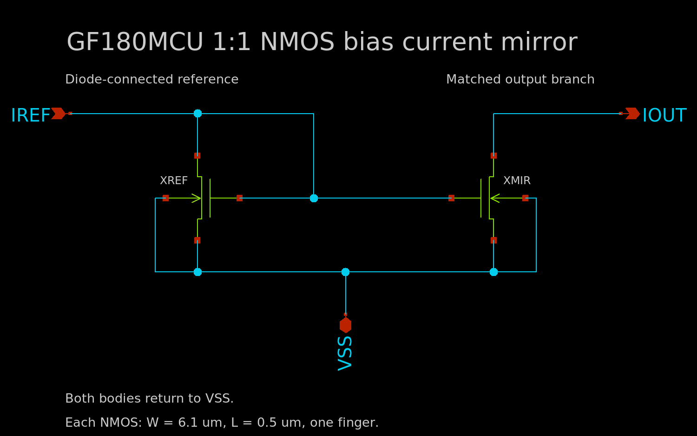
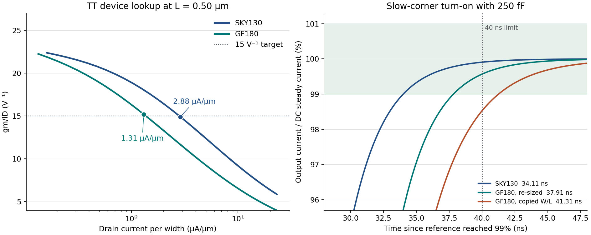

# 同一条 8 µA ADC 偏置支路，换工艺后怎样重新定尺寸

把这句话交给 agent 就可以开始：“给 ADC 复制外部 8 µA 参考电流。参考节点接 250 fF，输出在 0.40–1.20 V 时误差不超过 8%，开启后 40 ns 内稳定。在 SKY130 和 GF180 各找一个达标且栅面积较小的方案，给我原理图和实测波形。”

同一对 NMOS 电流镜在 SKY130 用 **2.80/0.50 µm** 达标。把这对管的尺寸直接用于 GF180，最慢建立时间为 **41.31 ns**，超过 40 ns。在 GF180 重新测量电流密度后，每管取 **6.10/0.50 µm**，同一慢角测得 **37.91 ns**。[完整输入规格](../sky130-current-mirror/adc-bias.example.json)

## 从器件表选到实际原理图

两种工艺各自扫描 NMOS 和 PMOS。每种极性取 0.50、1.00 µm 两档沟道长度，参考管宽为 2 µm，|VDS| 取 0.35、0.65、1.20 V，体偏置取零和 0.15 V 反偏。每条曲线以 10 mV 步长将 |VGS| 从零扫到对应电源电压。以下是本例的三组确定性工况。

| 工况 | 温度 | SKY130 1.8 V MOS 供电 | GF180MCU 3.3 V MOS 供电 |
|---|---:|---:|---:|
| TT | 27 °C | 1.80 V | 3.30 V |
| SS | 85 °C | 1.62 V | 2.97 V |
| FF | −40 °C | 1.80 V | 3.30 V |

两套表分别含 **12,600** 和 **23,040** 条工作点记录。选尺寸时，两边都用 TT、VDS = 0.65 V、VBS = 0 V 的 NMOS 行，寻找最接近 15 V⁻¹ 的 gm/ID，然后用 **W = 8 µA ÷ (ID/W)** 起算，按 0.05 µm 取整。本例比较的单指宽度范围为 0.50–20 µm。以短管为例，两种工艺用到了不同的表行。

| 工艺 | 表内 VGS | 表内 gm/ID | 表内 ID/W | 计算 W → 原理图 W | 整电路 TT 参考支路 gm/ID |
|---|---:|---:|---:|---:|---:|
| SKY130 | 0.72 V | 14.90 V⁻¹ | 2.883 µA/µm | 2.775 → 2.80 µm | 14.99 V⁻¹ |
| GF180MCU | 0.75 V | 15.20 V⁻¹ | 1.306 µA/µm | 6.123 → 6.10 µm | 15.03 V⁻¹ |

每个候选都生成可编辑的 Xschem 核心图、symbol 和父级测试台。脚本从原生网表回读 D/G/S/B、W/L、指数量、结面积和周长，再从 ngspice 内部 MOS 工作点按米回读 W、L，核对两支管的实际偏置和 gm/ID。父级的 IREF 从左侧向左引出、IOUT 向右、VSS 从底部向下。



## 直流误差、速度与面积怎样取舍

| 工艺与取法 | 单管 W/L (µm) | 两管栅面积 ΣWL (µm²) | 三工况最大电流误差 | 三工况最慢建立 | 按原规格 |
|---|---:|---:|---:|---:|---|
| SKY130 短管 | 2.80 / 0.50 | 2.80 | 6.16% | 34.11 ns | 选中 |
| SKY130 长管 | 5.70 / 1.00 | 11.40 | 5.22% | 36.11 ns | 达标 |
| GF180 短管 | 6.10 / 0.50 | 6.10 | 5.93% | 37.91 ns | 选中 |
| GF180 长管 | 12.10 / 1.00 | 24.20 | 2.78% | 42.71 ns | 建立超限 |
| GF180 照搬 SKY130 短管 | 2.80 / 0.50 | 2.80 | 4.46% | 41.31 ns | 建立超限 |

照搬尺寸的 GF180 参考管在 TT 的实际 gm/ID 为 **11.74 V⁻¹**。它的直流误差仍然达标，增加的建立时间会影响 ADC 使用这路偏置的时刻。GF180 长管进一步改善了直流精度，同时占用约四倍于本工艺短管的栅面积，慢角也超过时限。两种工艺都按最小栅面积从通过全部约束的本工艺候选中选择。



直流检查覆盖 0.40–1.20 V 之间的 81 个输出电压。建立时间从参考电流达到设定值的 99% 起算，输出固定在 0.80 V，进入并持续保持在该工况直流输出电流的 ±1% 才算稳定。250 fF 接在参考端，参考电流由测试台提供。ΣWL 只计核心两只 MOS 的栅面积。当前测量覆盖这三组前仿工况，失配、参考源本身的启动和芯片实占面积需要各自的验证。

## 复跑和打开选中的电路

在仓库根目录执行下面的命令。生成需要 Python 3、Xschem 和 ngspice。首次运行会下载两个固定版本的公开模型，输出写入新的目录。用 Debian trixie 可以通过 `apt-get install python3 xschem ngspice ca-certificates` 安装依赖。

```sh
python3 examples/cross-pdk-current-mirror/transfer.py run --out work/transfer
python3 examples/cross-pdk-current-mirror/transfer.py verify --out work/transfer
sh work/transfer/gf180/short/open.sh core
sh work/transfer/gf180/short/open.sh bench
```

打开输出根目录的 `RESULTS.md` 即可找到每种工艺选中的图和对应查表行。`summary.json` 保存三组工况下两支管的工作点、最差误差以及建立时间。想查 GF180 的短管时，看 `gf180/short/sizing.json`，再对照 `gf180/short/tt/op.dat` 和 `gf180/short/ss/transient.dat`。改规格可以复制输入 JSON，填写已确认的参考电流、负载、误差和期限，保留 `selection=min_gate_area`，用 `run --requirements 你的文件.json --out 新目录` 重跑。

已有离线模型时，`--sky130-models` 和 `--gf180-models` 分别接收与锁文件目录结构一致的上游源树。每份输入先校验 SHA-256。SKY130 的上游选项使用微米缩放，GF180 的原始 ngspice 子电路用 `nmos_3p3`、`pmos_3p3`，长度显式写 `u`、结面积显式写 `p`。GF180 的 TT 映射到 `typical`，三组确定性工况均关闭全局统计与局部失配开关。[SKY130 输入锁](../sky130-current-mirror/models.lock.json) · [GF180 输入锁](gf180-models.lock.json) · [GF180 原始模型](https://github.com/google/globalfoundries-pdk-libs-gf180mcu_fd_pr/blob/9f992d5a9186d1f7820c58f039c484ad35b2edea/models/ngspice/sm141064.ngspice)

只想复核结果时，从最近一次通过的工作流下载 `cross-pdk-bias-evidence`，解压到空目录。在对应提交的仓库中执行 `python3 examples/cross-pdk-current-mirror/transfer.py verify --out 解压目录`。这一步只需 Python，会从原始曲线重建表行、从网表和内部工作点核对尺寸，并从 DC 与瞬态重算全部结果。返回 0 表示两种工艺各有达标方案，1 表示有工艺缺少达标方案，2 表示输入、运行或证据检查失败。[仿真工作流与下载入口](https://github.com/w1213ph/virtuoso-circuit-skills/actions/workflows/cross-pdk-sizing.yml)
