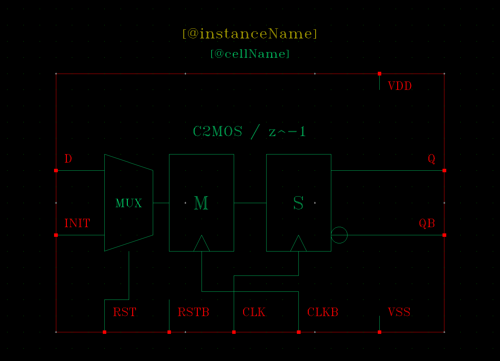

# CTDSM18：已认可的绘图与迁移基准

这是一轮已有电路的原理图、symbol、命名和环境整理案例。用户认可的是紧凑功能图、清楚的父级连接和工程组织。

| 项目 | 当时实际完成 |
|---|---|
| 原理图 | 22 张，Check & Save 均 (0,0) |
| Symbol | 18 个原生功能图；pin/方向/有效端序/NLP/选择框回读 |
| 电气不变 | 逐实例属性、逐端网络一致；四对原生 SI 网表等价 |
| Maestro | 6 项已保存测试完整迁移、重新绑定并原生回读 |
| 安装 | 新进程库映射、22 图回读、155 个原生文件哈希、顶层 SI 一致 |
| GUI | 全图、局部、symbol 和实际父级已检查 |
| 新行为仿真 | **0 次；本轮没有重跑仿真** |

历史电路性能不作为这次重排、公共工具或使用者新工程的通过指标。公开资料不包含那套实际工艺电路数据库和历史仿真。

## 为什么比原先的图清楚

- OTA 用级联与前馈路径表达，比较器体现再生/缓冲，积分器体现反馈电容/复位。
- FIR 用差分抽头与权重，C²MOS 用主从级、时钟/复位，顶层用 CIFF-B 和数字反馈。
- 按功能图缩小 symbol 后，移动父级、重拉主通路与反馈，清除旧坐标留下的空旷感。
- 同类模块命名统一，schematic/symbol/layout 保持同一 cell 的不同 view。

例如 OTA symbol 显示 bbox 面积约缩小 65%、DFF 约 83%、顶层 schematic 约 88%。这是数据库显示包围框，与版图面积无关；新工程不应机械追逐同样百分比。

## 可复用的数据

[symbol 场景](../../skills/paper-to-virtuoso/assets/ctdsm18-symbols.json) 固定 18 个图形与接口。图元以用户单位存储，参考 DBU=160，字体 roman。生成 SVG/原生 SKILL 的命令见 [SETUP.md](../../docs/SETUP.md)。

[父级参考](../../skills/paper-to-virtuoso/assets/ctdsm18-layouts.json) 保留积分器、环路滤波器和顶层的布局关系/布线路径，去掉 PDK 参数与连接主机。它只作排版参照，不能覆盖目标实际电气清单。

命名示例：`CTDSM_OTA_FF`、`CTDSM_CMP_DYNAMIC`、`CTDSM_DFF_C2MOS`、`CTDSM_FIR_DAC_MAIN`、`CTDSM_TOP`、`TB_CTDSM_TOP`。

6 个迁移测试为 `CT_STARTUP`、`CT_FFT`、`CT_NOISE`、`OTA_AC`、`INT_STEP`、`R1_HB`。测试名称不是新仿真已通过的证据。
