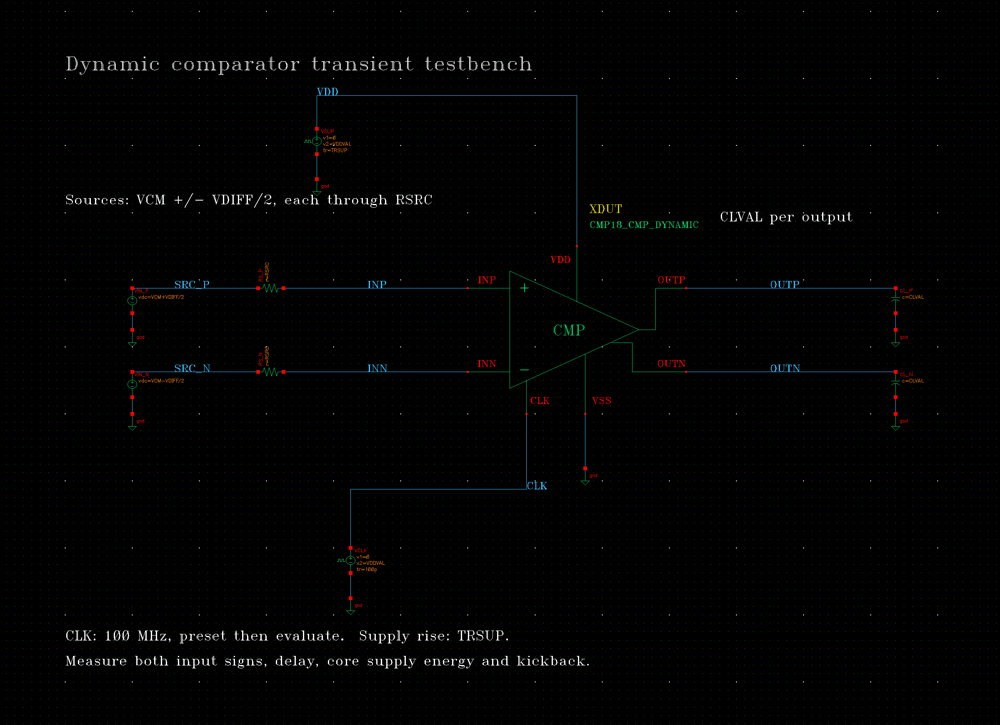

# 动态比较器的原生前仿与尺寸取舍

这个案例用同一套测试台比较两个真实 PDK 电路。核心是带四个预充电管的动态差分锁存比较器。时钟低时预充电，时钟高时判决。正差分输入对应 OUTP 高、OUTN 低。[连接与尺寸表](topology.json)给出可重建的电气定义。

## 从空目录复跑

要比较失配样本、定位慢角并在 Virtuoso 打开一次实际判错，见[小输入比较器的尺寸取舍](SIZING_STUDY.md)。里面给出了两组可重建的尺寸、独立样本复核和失败波形的打开命令。

在装好 Virtuoso、SI、Spectre 和 SMIC18 的 Linux 主机上，从仓库根目录执行。可以把这一节交给 agent，并告诉它本机工程的 `cds.lib` 和 Spectre 模型入口在哪里。此例使用实际的 `n18`、`p18`、`analogLib` 和 `basic`，已在 Python 3.6.8、IC6.1.8、Spectre 15.1 上运行。

```sh
cp examples/dynamic-comparator/native.example.json comparator.local.json
```

在本地配置中填入 `cds_lib` 和 `model_file`。前者须能解析工艺与标准器件库，后者须包含指定工艺角。`virtuoso`、`si`、`spectre` 可用 PATH 中的名字或本机可执行文件路径。配置中的相对文件路径以配置文件所在目录为起点。选一个尚未创建的输出目录。

```sh
python3 examples/dynamic-comparator/run_native.py --config comparator.local.json --out work/cmp-first
```

命令在 `baseline/` 和 `candidate/` 各建一套隔离的 `CMP18_BENCH` 库，生成核心、symbol 和测试台。第一次先从基线原生网表取表征器件，生成九条 gm/ID 曲线，再运行同条件瞬态。如果当前工程已映射同名库，启动时请在本地配置中选择仅含所需 PDK 和标准库的 `cds.lib`。已有输出目录会被保留，再跑请选择新目录名。

先打开 `work/cmp-first/RESULTS.md`。里面有每个工况的延迟、能量、反冲、器件尺寸和打开原生图的命令。`nom_pos` 和 `nom_neg` 分别是正、负输入。`status.json` 记录成功配对的工况和超限项。默认要求三个完整判决均正确，延迟小于 4 ns。能耗和反冲默认保留实测值，设定自己的预算后，在本地配置的 `limits` 中填入 `energy_fJ` 或 `kickback_mV`，也可用 `delay_ps` 定义延迟上限。脚本返回非零时先看 `status.json` 和对应工况的 `measurement.json`。

改变差分输入或负载，可沿用上一次的器件表。在本地配置中更改工况后执行第二次命令。

```sh
python3 examples/dynamic-comparator/run_native.py --config comparator.local.json --out work/cmp-next --reuse-lut work/cmp-first/characterization
```

输入表、实际加载的模型依赖和表征条件均匹配时复用旧表。工艺角、温度、电源或模型内容变化会触发重新表征。运行记录写入 `characterization/manifest.json`。表中只有本例两种参考器件的尺寸。改变器件类型、沟道长度或指宽时，应按新几何补扫，再选电路尺寸。此例的 PDK 映射和 CDF 参数用于 SMIC18，其他工艺需单独适配和验证。

## 从工艺数据到尺寸

先回读所用 NMOS、PMOS 的端子、CDF 和原生网表。表征采用与本例一致的 0.18 µm 沟道长度、每管 1.6 µm 总宽与两指。TT、27°C 下扫描栅压，漏源电压绝对值取 0.25、0.50、0.90 V，NMOS 比较零及 0.15 V 反向体偏置。记录电流密度、gm/ID、gm/gds、VDSAT、Cgg 和 Cgd。

判决开始约 100 ps 时，基线输入 NMOS 的 VGS 约 0.84 V、VDS 约 0.47 V。查相近工况的表，gm/ID 约为 4.3–4.9 V⁻¹，1.6 µm 器件的 gm 约 0.66–0.68 mS。本例将输入对每只管的总宽从 1.6 µm 调到 2.0 µm，保持两指，验证早期差分建立、能耗和反冲。跨导与电流密度用于选取该候选，实际判决取自瞬态波形。[器件表征方法](../../skills/paper-to-virtuoso/references/electrical.md#初用工艺时先做器件表征)

## 建测试台并提取指标

1. 用实际工艺器件重建原理图、symbol 和独立测试台。主输入左、输出右、VDD 在上，CLK 与 VSS 在下。回读变换后父级引线、器件尺寸和逐端连接。
2. 设置电源 1.8 V、输入共模 0.9 V、差分输入 ±5 mV。两输入各串 1 kΩ，输出各接 20、35 或 50 fF 到地。电源从零上升，用 0.1 ns 为名义斜率，并在名义负载下检查 5 ns 上升时间。
3. 时钟为 100 MHz，首个上升沿在 8 ns，边沿 100 ps，评估高电平约 4 ns。仿真至 39 ns，用 PSF ASCII 格式以 5 ps 或更细的步进输出波形。保存 `CLK`、`VDD`、`INP`、`INN`、`OUTP`、`OUTN` 和 `VSUP:p`。VSUP 是仅向 DUT 供电的源。
4. 从时钟 50% 上升沿到正确输出持续满足高轨 80%、低轨 20% 计算延迟。检查每次判决前两端均完成预充电。用完整时钟周期积分 DUT 电源功率，输入源与理想时钟驱动功耗另计。按评估窗内实际输入差分偏离设定值的峰值计算反冲。

```sh
python examples/dynamic-comparator/measure_psf.py work/comparator/tran.tran.tran --vdd 1.8 --vcm 0.9 --delta-mv 5
```

`--delta-mv -5` 用于负极性运行。脚本返回有效判决次数、最坏延迟、平均能量、差分与共模反冲。保持模型、时钟、负载和提取定义一致，分别保存两份原生网表及实际输出。将延迟、运行证据和输入摘要填入 [前仿计划](../../skills/paper-to-virtuoso/references/simulation.md#前仿计划与指标记录)，用 `check` 和 `compare` 做复核。

## 实际结果

### 打开和复跑可编辑的 ADE Maestro 测试台

在同一配置中填好本机工具和模型，从仓库根目录运行。每个版本单独建库。若只想先熟悉操作，在 `scenarios` 中保留 `nom` 一组，就会得到 `NOM_POS` 和 `NOM_NEG` 两个测试。

```sh
python3 examples/dynamic-comparator/run_native.py --config comparator.local.json --out work/cmp-ade --maestro
python3 examples/dynamic-comparator/maestro.py --config comparator.local.json --out work/cmp-ade
```

第一条命令生成工程，保存 Maestro 后用另一个 Virtuoso 进程重新打开并启动测试。第二条命令单独复核已保存的结果，无需重仿。按 `RESULTS.md` 的命令启动所选版本的 Virtuoso，在 Library Manager 中打开 `CMP18_BENCH / TB_CMP18_CMP_DYNAMIC / maestro`。在 Tests 中选一个输入方向，查看设计变量 `VDIFF`、每端负载 `CLVAL` 和分析 `tran`，打开该测试的历史即可查看输出波形。更改设计条件时另存工程或选新输出目录，以保留原始对照。

复核器按原配置核对测试清单、DUT 和父级各实例端序及参数、实际加载的模型及工艺角、温度、仿真精度与输出网格。随后从直接运行与 ADE 历史各读取一次原始波形，重新计算三个指标。原始采样为 0–39 ns、间隔 5 ps。每条波形要求三个完整的预充电和有符号判决，两条路径的同指标差异限为 1%。测量详情、原生历史名及警告保存在 `maestro-evidence/maestro-report.json`。复核退出码 0 表示已声明的候选上限均满足，1 表示候选超限，2 表示证据无效。

下图是原生父级测试台。两路输入向左引出，CLK 与 VSS 向下，VDD 向上，输出向右。[晶体管级原图](schematic.png)



### 失配抽样与有效性

先在本地配置选择器件。原例和旧配置默认使用 `"mos_family": "nominal"`，生成 `n18/p18`。研究 SMIC18 V1.11_3 的器件失配时，另存一份配置为 `comparator-stat.local.json`，设 `"mos_family": "statistical"`，用同一组尺寸重建为原生四端 `n18_ckt/p18_ckt`。生成器回读 SI 的有效宽度、沟道长度、每指宽度、栅指数量、倍率 `mr` 及 `mismod=1`。工艺表、标称和慢角均须按所选器件重跑。模型段名按本机 PDK 核实，本例为 `mos_mc`。

```sh
python3 examples/dynamic-comparator/run_native.py --config comparator-stat.local.json --out work/cmp-stat --maestro
python3 examples/dynamic-comparator/mismatch.py --config comparator-stat.local.json --run work/cmp-stat --variant candidate --scenario nom --model-section mos_mc --runs 16 --seed 5317 --out work/cmp-mismatch
```

先看 `summary.json`，再按极性查看 `samples.json`。每个样本核对实际激励、预充电、判决、延迟、能量和反冲。脚本再检查 Spectre 保存的失配向量，并比较第二个判决沿后 100、200、300 ps 的内部差分节点 XP−XN。在本案例固定的 0.1 µV 电压绝对容差下，以 1 µV 跨样本变化作为诊断下限。即使 16 次判决全部正确，只要抽样没有产生可分辨的电路响应，结果仍为 `mismatch_sensitivity_unconfirmed`。统计段、抽样次数、两种极性和噪声分析各有不同含义。该检查单独使用时无法估算产品良率。

本次预设开发上限为延迟 500 ps、DUT 能量 205 fJ/次、差分反冲 3.5 mV。每端负载 20 fF，上电 0.1 ns。TT、27 °C、1.80 V、±5 mV 时，候选三项均在限内。SS、85 °C、1.62 V、±1 mV 时，正负输入均得到 820 ps，延迟超限 320 ps。ADE 各运行有一条 `SFE-884`，来自默认 `gmin` 与模型设置重复；两条求解路径在这些工况给出相同的工程结论。此次 `n18/p18` 统计试验每个方向有 16 个不同抽样向量，内部节点的最大跨样本变化约为 1.12 × 10⁻¹³ V。这个结果保留为失配敏感性未证实。[逐工况验收数据](native-review.json)

同工艺的一组成对器件对照先验证了 `_ckt` 器件的失配响应。随后在同一比较器中使用这组统计器件，两种几何、TT/SS 的确定性前仿在表中精度内复现。再以 TT、±5 mV、每端 20 fF 对候选抽样。每个输入方向的分母为 16 组器件抽样，每组要求三个时钟周期全部判对。

| 条件 | 正输入 | 负输入 |
|---|---:|---:|
| 三个周期判决均正确 | 10/16 | 11/16 |
| 判决正确且三个开发预算均满足 | 7/16 | 9/16 |
| 内部再生节点跨样本的最大变化 | 0.369 V | 0.361 V |

同种子两次运行的实际失配向量摘要相同。以同一组器件同时满足正负输入为条件，16 组中有 5 组两种极性都判对，0 组同时满足两种极性的全部预算。逐样本判决、超限项和原始结果摘要留在报告中。这个样本量用于复现故障，产品的失调分布、误码率和良率仍需专门测试。

### 以往负载扫描

Virtuoso IC6.1.8、Spectre 15.1、SMIC18、TT、27°C。表中延迟取两种极性和各三个完整判决周期的最坏值，能量取相应周期平均，反冲取差分峰值。

| 每端输出负载 | 延迟 ps，基线 → 候选 | DUT 能量 fJ/次，基线 → 候选 | 差分反冲 mV，基线 → 候选 |
|---|---:|---:|---:|
| 20 fF | 425 → 395 | 199.13 → 200.29 | 2.96 → 3.23 |
| 35 fF | 630 → 580 | 287.98 → 288.06 | 1.98 → 2.20 |
| 50 fF | 830 → 765 | 376.86 → 375.85 | 1.49 → 1.68 |

在 20 fF、5 ns 电源上升条件下，两种极性的首次完整判决通过，最坏延迟分别为 425 ps 和 395 ps。两版的原生 schematic 与测试台均 Check & Save (0, 0)，各核对 11 个 MOS 的 44 个端子与 7 个父级引线。16 次短瞬态均为零错误、零警告。[两极性及慢上电测值](measurements.json)

选用候选前应核对实际前级的反冲预算。本例的面积指标采用 ΣWL，基线 2.700 µm²、候选 2.844 µm²。这个量只统计 MOS 栅面积。扩散、器件间距和布线占地要到版图阶段才能确定。

## 小输入和慢角复测

同一原生入口又测了两组 ±1 mV 的差分输入。每个输出端接 20 fF，电源上升时间为 0.1 ns，表中列出正负输入中较差的结果。复跑时在本地配置将 `diff_mV` 改为 `1`，`scenarios` 只保留 20 fF、0.1 ns 这一项。第二行再设 `corner` 为 `ss`、`temp_C` 为 `85`、`vdd_V` 为 `1.62`、`vcm_V` 为 `0.81`。

| 工艺、电源、温度、共模 | 判决延迟 ps，基线 → 候选 | DUT 能量 fJ/次 | 差分反冲 mV |
|---|---:|---:|---:|
| TT，1.80 V，27 °C，0.90 V | 520 → 480 | 224.4 → 225.0 | 2.967 → 3.248 |
| SS，1.62 V，85 °C，0.81 V | 915 → 820 | 164.3 → 165.7 | 1.502 → 1.734 |

当输入差分变小时，给同一对输入管加宽仍可缩短判决延迟，同时会增加峰值反冲。这里每个极性检查了三个完整判决，结果来自确定性瞬态。判决误码率、输入失调分布、瞬态噪声和完整 PVT 覆盖仍需专门测试。[逐极性测值](measurements.json)
