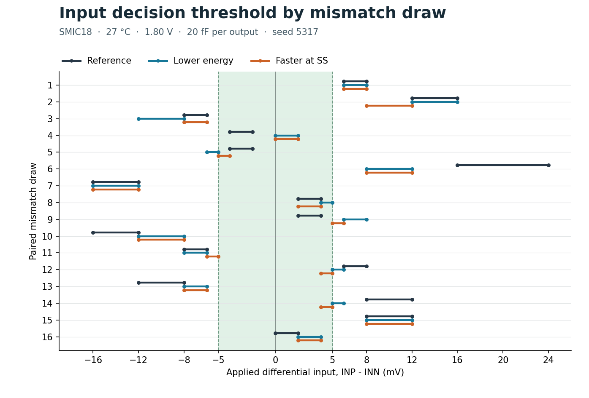

# 小输入动态比较器怎样选尺寸

先给 agent 一项可以核验的任务：“在同一组器件失配下，给比较器分别加 +5 mV 和 −5 mV。把判反的样本和判对但太慢、太耗电的样本列出来，再试两组对称尺寸。给我能在 Virtuoso 里打开的一条失败波形。”

本例用 SMIC18 V1.11_3 的四端统计 MOS 在 Virtuoso IC6.1.8、Spectre 15.1 上完成。参考尺寸在标称条件下通过三个预算，但独立抽出的 32 组器件中，只有 2 组在两种输入方向同时判对并满足全部预算。两种尺寸调整各自改善了一部分指标，都还有慢角延迟和失配问题。[逐项数据与样本编号](sizing-study.json)

## 判反、判得慢与能量超限

INP 高于 INN 时应当得到 OUTP 高、OUTN 低。每次判决从时钟的 50% 上升沿计时，输出需分别越过 80% 和 20% 电源电压并维持到评估末段。阈值扫描单独读取实际判决方向，要求三个完整周期方向一致，末段至少稳定 50 ps。预算为 500 ps、205 fJ/次、差分回踢 3.5 mV。两路输入各经 1 kΩ，每个输出接 20 fF，电源上升时间 0.1 ns。

- 第 6 组加 **+5 mV**，OUTN 在 **345 ps** 时已稳定为高，三个周期全部判反。同一组器件要在 **+16 到 +24 mV** 之间才翻转。延长判决时间无法纠正这条轨迹。[ViVA 中的实际波形](failure-wave.png)
- 第 4 组加 **−5 mV**，OUTN 在 **440 ps** 时稳定为高，方向正确，三个周期的平均能量为 **215.04 fJ/次**，超出预算 10.04 fJ。两条记录都在独立的 Maestro 测试台历史中复现，并与直接 Spectre 仿真的实际失配向量及波形核对。

下图的每条线连接该组器件仍判为负的最大实测输入和已判为正的最小实测输入。绿色带表示规定要分辨的 ±5 mV。每套尺寸均扫描 19 个输入电平，含零和 ±5 mV。图中每行的三套尺寸共用同一组失配变量，全部 48 个区间均得到两侧判决。输入位于测试网格点时，可在数据文件中核对该极性的实际判决。



## 在相同输入下定位慢角延迟

参考尺寸固定输入为 ±1 mV，取第二个完整周期，两个极性测得的标记相同。TT 为 1.80 V、27 °C，SS 为 1.62 V、85 °C，共模均为电源的一半。

| 从时钟上升沿算起 | TT | SS | SS 增加 |
|---|---:|---:|---:|
| XP、XN 中首个节点降到 0.5 VDD | 40 ps | 75 ps | 35 ps |
| 两个输出的差值达到 0.1 VDD | 365 ps | 630 ps | 265 ps |
| 判决稳定达到 80% / 20% | 480 ps | 820 ps | 340 ps |

慢角额外的 340 ps 中，有 265 ps 在输出差值首次达到 0.1 VDD 时已经出现。单独放大锁存 NMOS 和 PMOS 后，慢角为 830 ps。加宽输入对和尾管则降到 665 ps，但 TT 能量升到 211.97 fJ，回踢增到 4.15 mV。进一步减小预充管，再分别试验两组输入对、尾管和锁存器尺寸，得到下面两种取舍。

## 匹配样本比较和独立复核

所有宽度均为每个实例的总宽，单位 µm，沟道长均为 0.18 µm。同组左右器件同时调整。表中延迟、能量、回踢取正负两个输入中较差的一侧。

| 方案 | 输入对 / 尾管 | 锁存 N / P | 内部 / 输出预充 P | 栅面积 ΣWL | TT ±5 mV 延迟 / 能量 / 回踢 | SS ±1 mV 延迟 / 能量 / 回踢 |
|---|---|---|---|---:|---|---|
| 参考 | 2.0 / 3.0 | 1.2 / 1.6 | 0.8 / 0.8 | 2.844 µm² | 395 ps / 200.29 fJ / 3.235 mV | 820 ps / 165.65 fJ / 1.734 mV |
| 低能耗 | 2.6 / 5.4 | 0.8 / 1.2 | 0.5 / 0.5 | 2.988 µm² | 385 ps / 193.35 fJ / 2.622 mV | 785 ps / 157.94 fJ / 1.484 mV |
| 慢角提速 | 3.6 / 6.0 | 1.0 / 1.1 | 0.5 / 0.5 | 3.492 µm² | 350 ps / 201.54 fJ / 3.171 mV | 705 ps / 165.59 fJ / 1.855 mV |

用种子 5317 的 16 组做尺寸比较，固定以上两组候选后，再用种子 19427 的 32 组复核。每组都在 ±5 mV 下分别评估三个周期。每个种子在各尺寸和极性间核对了 Spectre 实际写出的失配参数名、顺序和数值。开发阶段选低能耗候选看联合预算，同时保留慢角更快的候选看速度代价。

| 方案 | 开发 16 组，两侧都判对 | 开发 16 组，两侧都判对且三项达标 | 独立 32 组，两侧都判对 | 独立 32 组，两侧都判对且三项达标 |
|---|---:|---:|---:|---:|
| 参考 | 5 | 0 | 14 | 2 |
| 低能耗 | 3 | 2 | 11 | 5 |
| 慢角提速 | 6 | 1 | 14 | 3 |

低能耗候选把标称能量降了 6.94 fJ、回踢降了约 0.61 mV，栅面积增加约 5.1%。慢角提速候选省下 115 ps，栅面积增加约 22.8%，慢角仍超出 205 ps。独立样本数只支持这里的计数。器件失配、整个工作范围内的 PVT 和瞬态噪声需要按实际产品目标继续验证。面积数值只计各 MOS 的 W×L。

## 在自己的工程复跑

在安装对应 PDK 的 Linux 主机上，从仓库根目录运行。先按[原生比较器示例](README.md#从空目录复跑)填写本地配置 `comparator-stat.local.json`，选择 `"mos_family": "statistical"`，将场景设为 `nom`、20 fF、0.1 ns。使用上述 TT 电源、温度、共模和 5 mV 输入幅值。将 `limits` 设为 `{"delay_ps": 500, "energy_fJ": 205, "kickback_mV": 3.5}`。`mos_mc` 是本次验证使用的 SMIC18 统计模型 section。换工艺时先验证统计器件与模型映射。

```sh
ex=examples/dynamic-comparator
python3 "$ex/run_native.py" --config comparator-stat.local.json --out work/cmp-ref
python3 "$ex/mismatch.py" --config comparator-stat.local.json --run work/cmp-ref --variant candidate --scenario nom --model-section mos_mc --runs 16 --seed 5317 --out work/cmp-ref-mc
python3 "$ex/offset.py" --config comparator-stat.local.json --run work/cmp-ref --variant candidate --scenario nom --model-section mos_mc --runs 16 --seed 5317 --out work/cmp-ref-offset
python3 "$ex/replay_mismatch.py" --config comparator-stat.local.json --run work/cmp-ref --mc work/cmp-ref-mc --sign pos --draw 6 --out work/cmp-ref-wrong
python3 "$ex/replay_mismatch.py" --config comparator-stat.local.json --run work/cmp-ref --mc work/cmp-ref-mc --sign neg --draw 4 --out work/cmp-ref-energy
```

`mismatch.py` 发现判错或超预算时退出码为 1，结果在 `summary.json` 及每个极性的 `samples.json`。`offset.py` 的 `brackets` 给出各样本的区间，若网格内没有翻转、输出未稳定或出现反复翻转，会记录相应状态。`replay_mismatch.py` 的成功标志为 `reproduced`。它重新生成可编辑的 `TB_CMP18_CMP_DYNAMIC/maestro`，并将历史中的指定原生波形原样导出到 `selected-psf`。在 Virtuoso CIW 输入以下命令打开该样本的 CLK、OUTP 和 OUTN，将路径换成本机绝对路径。

```lisp
load("/absolute/path/to/work/cmp-ref-wrong/open-wave.il")
```

要复跑低能耗候选，在配置副本中加入下面的字段，然后把各命令的 `--config`、`--run` 和 `--out` 指向新配置及新目录。慢角提速候选的六个宽度见上表。独立复核用 `--runs 32 --seed 19427`。慢角确定性前仿再使用 `ss`、85 °C、1.62 V、0.81 V 共模和 1 mV 输入幅值运行 `run_native.py`。每次建图都会读回 CDF 和原生网表，核对 11 只 MOS 的宽度、指数量和端子连接。

```json
{"candidate_widths_um": {"input_pair": 2.6, "tail": 5.4, "latch_n": 0.8, "latch_p": 1.2, "internal_reset": 0.5, "output_reset": 0.5}}
```
