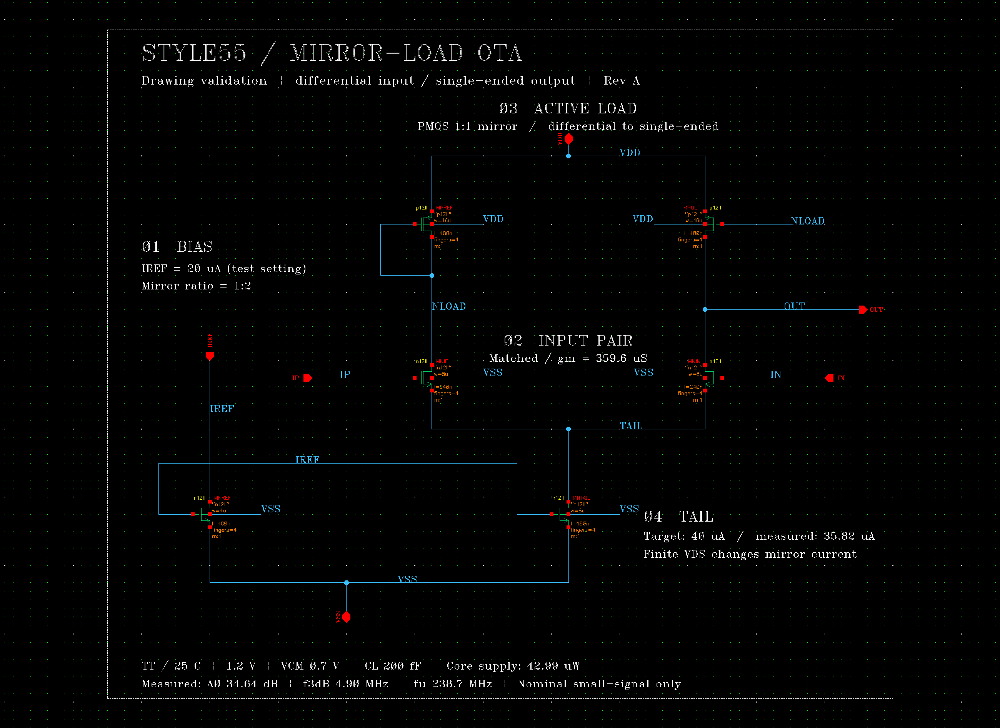
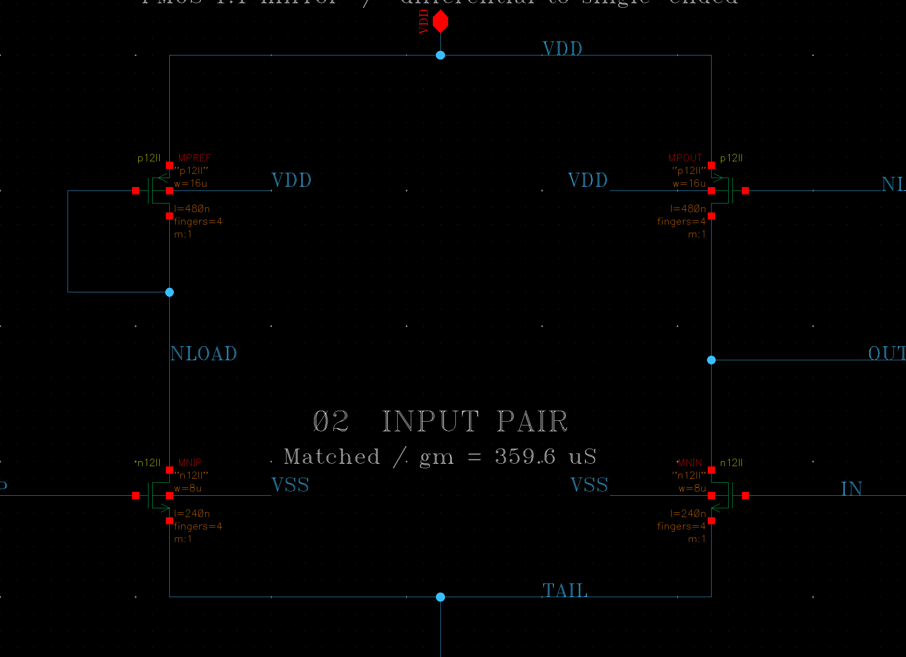
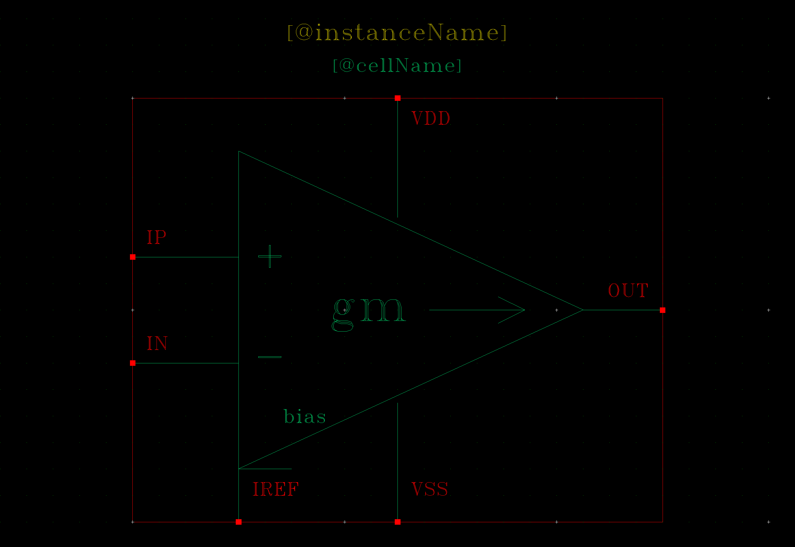
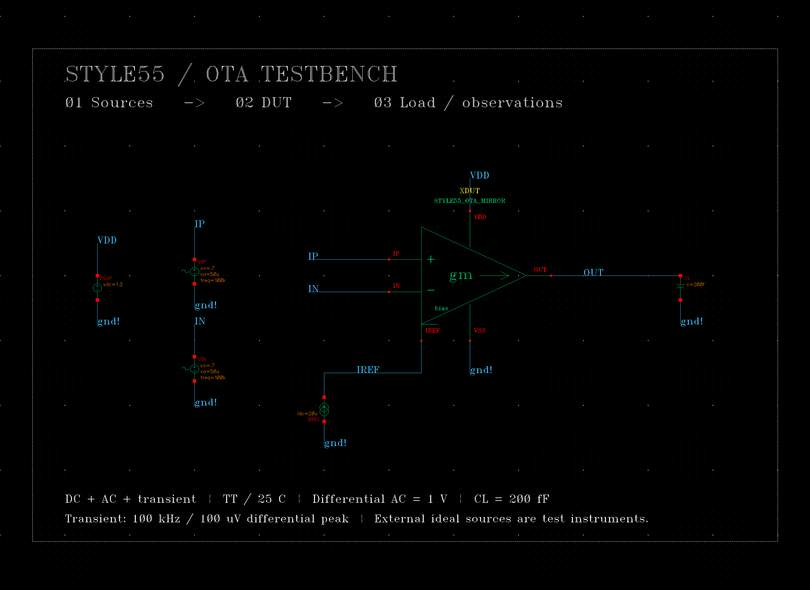
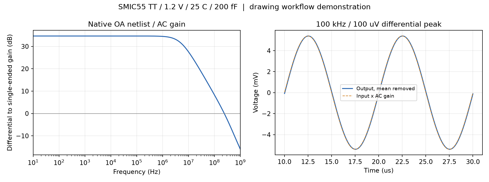

# 工程化 schematic：独立六管 OTA 演示

这是为检验排版方法新建的简单电路，不是参考接收机 IP 的复制，也没有复现新的论文。使用实际 55 nm MOS；五管镜像负载 OTA 另加一个二极管连接的偏置参考管，共六管。

## 看图时关注什么

偏置、输入对、有源负载和尾电流四组各自有功能说明。差分支路、尾电流合流、参考支路的二极管连接用实体线；体端采用水平短线并将网标放在外端，跨支路的公共栅极采用原生同名短线。每个管子的 CDF 参数保留，目标电流与实测电流分别写出。图框按内容定大小，条件和测量摘要放在底栏。

局部放大用于核对参数、连接点和文字。曾发现较长的 gm 说明压到实例名，已缩短后重新导出；最终图经过再次目视检查。

## Symbol 保持既有风格

沿用紧凑增益三角、正负端、功能提示、原生 pin、NLP 动态标签与独立选择框。symbol 编辑视图中的实例/单元名是表达式，选择框可见；在实际父级显示为真实名称。既有 CTDSM18 的 18 个 symbol 资产没有改动。

父级依次安排激励、DUT、输出负载。源与 DUT 之间的同名短线经过逐端回读和原生 SI 网表核对。图面采用 roman，不改用户全局 UI 或缩放。

## 实际验证结果

2026-10-26，Virtuoso IC6.1.8、Spectre 15.1；SMIC55 TT、25°C、VDD=1.2 V、输入共模0.7 V、IREF=20 µA、输出负载200 fF。

| 项目 | 实测 |
|---|---:|
| 低频差分到单端增益 | 34.643 dB / 53.9698 V/V |
| −3 dB 带宽 | 4.900 MHz |
| 开环增益幅值降到 1 的频率 | 238.714 MHz |
| 输出直流电压 | 0.7131 V |
| 尾电流 | 35.823 µA，设计目标40 µA |
| 核心 VDD 供电功率 | 42.988 µW，不含外部理想 IREF 激励 |
| 100 kHz 瞬态增益 | 53.9578 V/V |

瞬态为30 µs、100 µV差分峰值；用10–30 µs拟合，实际差分幅度和共模均核对。与同频 AC 幅值相差约0.00144%。以上是标称小信号演示，不代表闭环稳定性、噪声、PVT、失配或版图签核；开环 unity-gain 频率也不能单独证明闭环稳定。

两张 schematic 均 Check & Save(0,0)；六管24个端子、六个模块端口及真实父级连接回读正确。公开注释生成器已在原生 OA 中重放：16个注释对象，前后 Check(0,0)。精修、体端短线和注释调整后的完整 SI 网表与已仿真版本逐字节相同，SHA256为 `314bc58bce0be7651390b4ee22657ed88eaec3d3ed80d3afa3a5a9cc9a363abc`。全图、局部、symbol 和真实父级均实际查看。

结构化验收见[validation.json](validation.json)，数值见[measurements.json](measurements.json)；可复用的[排版方法和模板](../../skills/paper-to-virtuoso/references/engineering-schematic.md)说明如何适配自己的电路。公开仓库不含 PDK、完整 OA 数据库、原始 PSF 或参考 IP 文件，不能直接作为一个现成的工艺电路库打开。新电路仍需自己的电气设计与验证。

2026-10-26 图面修订：按用户反馈去掉六处体端短线末端的折角，保留水平短线和外端网标。器件参数、24个MOS端子与模块端口相同；Check(0,0)，原生SI与前版相同。本次仅排版，未重跑行为仿真；上表仍为此前实际仿真。
