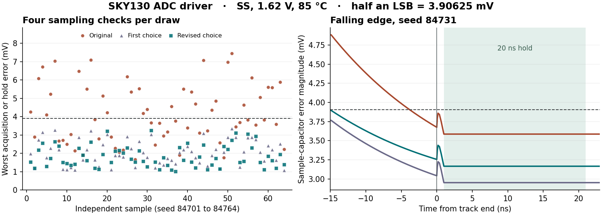
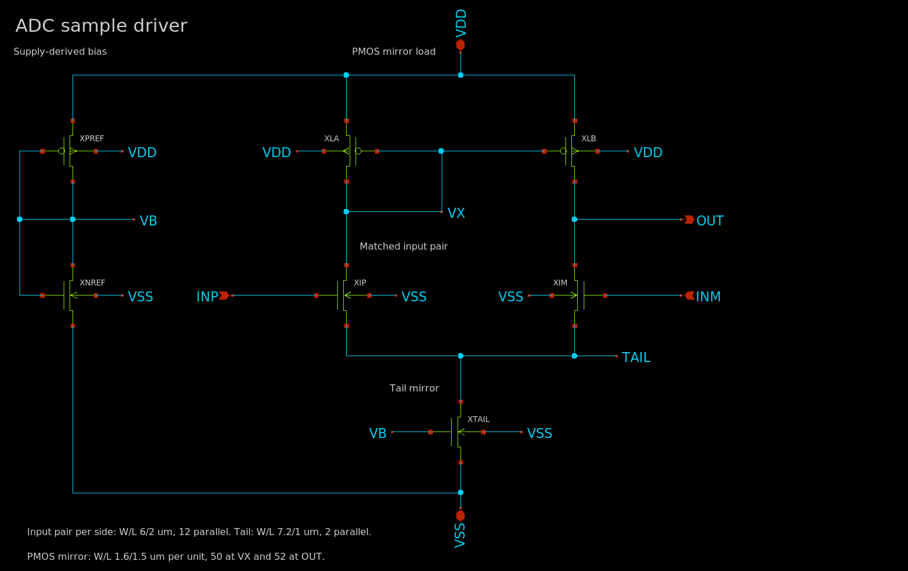

# 慢角采不准，先改哪一只管？

> 请让这个 SKY130 驱动器在 100 ns 内把 1 pF 的采样电容充到目标值，保持 20 ns 后也要采准。按 1 V 量化范围、7 位精度验收。如果器件失配会导致超限，找出原因，改一版，再用新样本比较面积与误差。

在装有 Python 3、Xschem 和 ngspice 的 Linux 上，从仓库根目录运行。第一次运行会下载锁定的公开 SKY130 模型。输出目录须为新目录。无需先跑其他案例。

```sh
python3 examples/sky130-adc-driver/matching.py run --out work/driver-matching
python3 examples/sky130-adc-driver/matching.py verify --out work/driver-matching
```

打开 `work/driver-matching/RESULTS.md` 看本机使用的仿真器、选中的尺寸和原始波形。本文在 ngspice 39 和 44.2 两个环境各做了一次独立验收，选中的核心栅面积分别是 549.40 和 477.40 µm²，原因见下表。通过时，在带图形桌面的机器上运行以下命令。也可以把参数换成 `symbol` 或 `sampler`。从 GitHub 下载 `sky130-driver-matching` 工件后，第二条 Python 命令可以直接在解压目录上复算，无需安装仿真器。[公开运行与工件](https://github.com/w1213ph/virtuoso-circuit-skills/actions/workflows/adc-driver-matching.yml)

```sh
sh work/driver-matching/open.sh core
sh work/driver-matching/open.sh bench
```

生成命令返回 0 表示选中通过的设计，返回 1 表示实际运行后仍有超限，此时报告提供诊断用原理图。返回 2 表示输入、求解或证据有问题。复算返回 0 表示原始证据与报告一致。可以从原规格另存一份，通过 `--requirements` 在新目录复跑。[规格文件](requirements.example.json)

## 从波形定位到晶体管

在 SS、1.62 V、85 °C，把输入从 0.85 V 跳到 1.05 V。原设计慢角标称上行跟踪误差为 3.7315 mV，距离半个 LSB 约 0.175 mV。在相同的最差开发样本 24722 中，所有器件均施加局部失配时误差为 7.306 mV。只给输入对施加该扰动时为 6.551 mV，只给 PMOS 有源负载施加时为 4.510 mV，只给偏置或采样开关时分别为 3.690 和 3.726 mV。这些单独试验都包含标称误差，不能直接相加。每一次都从采样电容读数。

先在本工艺扫描 N/P MOS 的 gm/ID 和 ID/W。0.5、1、1.5、2 µm 四种沟道长度在三个工艺角共有 25,200 个工作点。再从完整驱动器的直流工作点读回两支路的电流、gm/ID 和饱和余量。原图在输出中点有 +2.640 mV 的系统失调。将有源负载拆成等宽的 2.5 µm 单元时，参考侧与输出侧各用 24 个，系统失调为 +2.452 mV。只在输出侧多放一个单元，失调降为 +0.052 mV。接着增加输入对栅面积和延长负载管，观察同一批种子的散布、双向建立和两态稳定性。采样开关、0.60 pF 固定负载、偏置、输入时序和 3.90625 mV 误差限值均贯穿比较。[慢角 NMOS 模型](https://github.com/google/skywater-pdk-libs-sky130_fd_pr/blob/f62031a1be9aefe902d6d54cddd6f59b57627436/cells/nfet_01v8/sky130_fd_pr__nfet_01v8__ss.pm3.spice) · [慢角 PMOS 模型](https://github.com/google/skywater-pdk-libs-sky130_fd_pr/blob/f62031a1be9aefe902d6d54cddd6f59b57627436/cells/pfet_01v8/sky130_fd_pr__pfet_01v8__ss.pm3.spice)

## 如何认定改型有效

每个样本要同时满足四项采样误差要求（上、下行各测跟踪末端和保持窗口）以及跟踪和保持时分别至少 60° 的相位裕度。训练先选三组标称工况都达标、且在开发样本上通过的几何尺寸，优先保留半个 LSB 的 10% 作为选型余量，再按栅面积取小。每次换尺寸都会重新校验 NMOS/PMOS 局部失配以及并联数的面积缩放。

第一次用 24701–24732 开发，冻结网表后用 54701–54732 复验。首轮假设失效时保留结果，将看过的 64 个样本合并用于改型。第二次冻结后，使用早已预留的 84701–84764，对原图、第一版与新图逐种子作同条件比较。第二次验收后结束搜索。两次冻结、尺寸、真实网表、逐种子原始波形均可用上述命令重建。

第一组 32 个样本中，原图通过 14 个。第一版将输入对改为每侧 9 个 6/2 µm 单元，有源负载为参考侧 32 个、输出侧 33 个 2.5/1.5 µm 单元。它通过了全部 32 个开发样本，最大误差 3.289 mV。换第一组独立种子，同一版只通过 31/32。种子 54704 的上行跟踪误差为 3.915304 mV，比原要求高约 9.05 µV。原图在这组种子上为 20/32。

## ngspice 39 上的面积与误差

| 同一组 64 个独立慢角样本 | 核心栅面积 (µm²) | 六项同时达标 | 最坏采样误差 (mV) | 最低两态相位裕度 (°) | 三角标称最大静态电流 (µA) |
|---|---:|---:|---:|---:|---:|
| 原图 | 172.60 | 33/64 | 7.447 | 75.20 | 43.09 |
| 第一版（首轮复验曾超限） | 476.35 | 64/64 | 3.360 | 84.25 | 43.50 |
| 最终改型 | 549.40 | 64/64 | 3.256 | 89.41 | 43.61 |

最终改型的最差工况是种子 84731 的**下行跟踪末端**，距离 3.90625 mV 上限还有 0.651 mV。三组标称工况中，四项采样误差的最大值为 1.223 mV。最终比较中第一版也通过了全部样本，先前种子 54704 上的超限仍可单独复现。[逐版尺寸、两次独立复验与分项数据](matching-review.json)



### 这些面积花在了哪里

最终输入对每侧使用 12 个 W/L = 6/2 µm 单元，两侧合计 288 µm²，比原图多 252 µm²。两个有源负载采用相同的 W/L = 1.6/1.5 µm 单元，参考侧 50 个，输出侧 52 个，合计 244.8 µm²，比原图多 124.8 µm²。其余偏置和尾管合计 16.6 µm²，采样开关另占 1.35 µm²。这里统计晶体管的 Σ(W × L × M)。实际占地还取决于单元排布、间距、隔离和布线。

一个较小的 477.40 µm² 方案在已知的 64 个开发样本上也全部达标，但最坏误差 3.531 mV，高于选型时预留 10% 余量的 3.516 mV。549.40 µm² 版本在同一开发集为 3.246 mV，满足这项额外偏好。更大两版因此停止评估。若面积更重要，可更改 `--reserve-percent`，为新选型另留未看过的验收种子。



## 为什么 GitHub 选了更小的一版

两套环境使用同一份模型、原理图和随机向量。对于 477.40 µm² 方案，64 个开发样本的跟踪和保持输入网表逐个相同，仅模型文件所在目录不同。两次最坏读数都来自种子 24713 的下行跟踪末端。选型余量线为 3.515625 mV，电路硬性上限始终为 3.90625 mV。

| 仿真环境 | 477.40 µm² 方案的开发最坏误差 | 按同一规则选中的栅面积 | 选中方案独立通过 | 独立最坏误差 | 最低两态相位裕度 |
|---|---:|---:|---:|---:|---:|
| 实验服务器，ngspice 39 | 3.530878 mV | 549.40 µm² | 64/64 | 3.255639 mV | 89.41° |
| GitHub Actions，ngspice 44.2 | 3.512840 mV | 477.40 µm² | 64/64 | 3.599476 mV | 84.02° |

GitHub 选中的设计把输入对从每侧 12 个单元减为 9 个，两侧共省 72 µm²，镜像负载仍为 50 和 52 个单元。该环境原图也只通过 33/64，最坏误差为 7.450 mV。两种环境用的是同一批验收种子，样本数按每套环境各 64 个记录。下载哪一套工件就复算哪一套原始波形，打开相应报告所选的图。[ngspice 44.2 的实测运行](https://github.com/w1213ph/virtuoso-circuit-skills/actions/runs/45764945872) · [两种环境的逐版测值](matching-review.json)

## 规格收紧到 10 位

将同一负载和时钟的规格提高到 10 位，半个 LSB 为 0.48828125 mV。这次对照中，全部 11 种尺寸均未通过完整要求，最后一个诊断方案在另外 4 个样本上为 1/4。7 位结果覆盖给定摆幅、三个确定性工况及慢角局部 MOS 失配。对于整机噪声、时钟抖动、无源偏差、不同输入共模和制造良率，仍需各自的预算与测量。

要复现这个超限对照，将规格文件另存为 `ten-bit.json` 并把 `adc_bits` 改为 10，再运行以下两条命令。也可以下载同一次公开运行的 `sky130-driver-ten-bit-control`，用第二条命令回放解压后的工件。[7 位与 10 位仿真工件](https://github.com/w1213ph/virtuoso-circuit-skills/actions/workflows/adc-driver-matching.yml)

```sh
python3 examples/sky130-adc-driver/matching.py run --requirements ten-bit.json --out work/driver-ten-bit --samples 2 --training-seed 801 --validation-seed 901 --confirmation-seed 1001
python3 examples/sky130-adc-driver/matching.py verify --out work/driver-ten-bit
```
