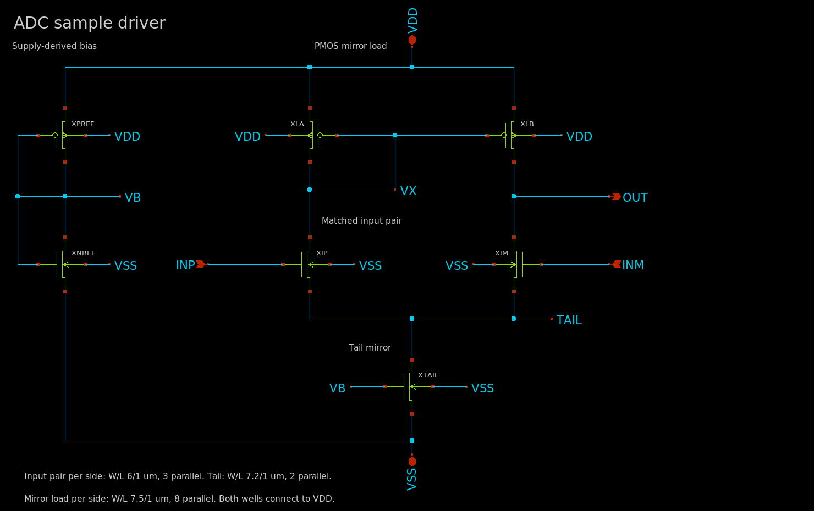
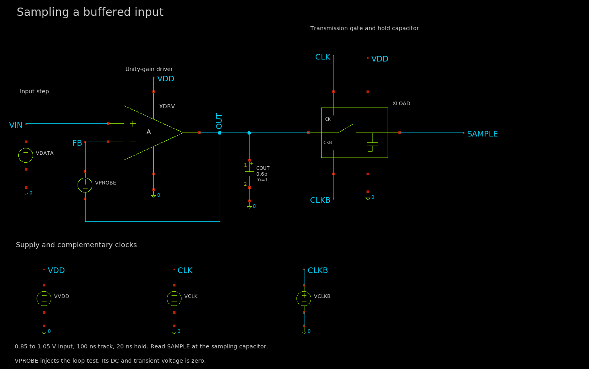
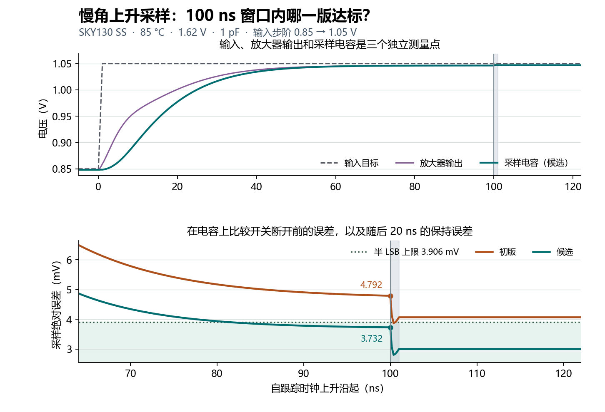
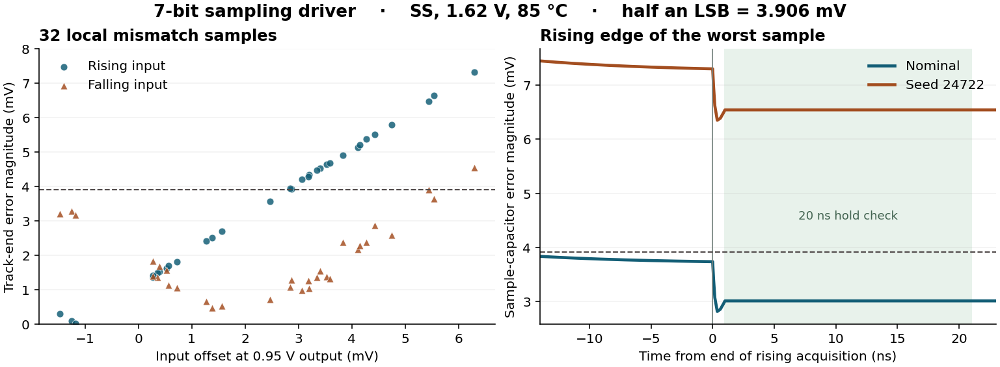

# 用 SKY130 放大器驱动 ADC 采样电容

> 给 7 位、量化范围 1 V 的单端 ADC 驱动 1 pF 采样电容。输入在 0.85 V 和 1.05 V 间跳变，100 ns 内采好，断开后 20 ns 内仍要在半个 LSB 内。

把这句话交给能运行命令的 agent，可以拿到两个可编辑的晶体管级放大器、实际 NMOS/PMOS 传输门、采样负载、测试台和比较报告。7 位、1 V 和各项负载及时序是本练习的规格。若要换成自己的 ADC，先说明输入电平、量化范围、实际采样电容、可用的跟踪窗口，以及要求在哪一时刻读数。[本例的完整需求](requirements.example.json)

**直接试用**，下载 ZIP 并解压，打开 `index.html`。页面上的两组原理图都有对应的 Xschem 源文件。波形同时画出放大器输出 OUT 和传输门后的 SAMPLE，黑点标出实际用于判定的电容电压。工程根目录运行 `python sample.py` 即可从器件扫描、网表和波形复算。Windows 复算只需 Python 3。[下载 7 位、1 pF 的完整工程](https://github.com/w1213ph/virtuoso-circuit-skills/releases/download/adc-driver-7bit-v1/adc-driver-7bit.zip)

**改成自己的规格**，让 agent 更新包内的 `my-driver.json`。在装有 Xschem 和 ngspice 的 Linux 上运行 `python3 sample.py run --out my-design`，再运行 `python3 sample.py verify --out my-design`。原理图和逐工况测值见 `my-design/RESULTS.md`。也可以在自己的 GitHub fork 启用 Actions，选择 **Build an ADC sampling driver from user requirements**，将 JSON 粘贴到 `requirements`。工作流在初始两版均超限时会继续优化。下载 `adc-sampling-project` 即可拿到本次工程。复算返回 0 表示有方案达标，1 表示已测方案均超限，2 表示运行或证据有误。[在 GitHub 提交规格](https://github.com/w1213ph/virtuoso-circuit-skills/actions/workflows/adc-driver-project.yml)



<a id="precision"></a>
## 把超限的 8 位采样驱动器改到达标

> 给我的 8 位 ADC 驱动 1.25 pF 的采样电容。量化范围 1 V，输入在 0.85 V 和 1.05 V 间跳变。跟踪 85 ns、保持 25 ns，误差最多半个 LSB，两种状态的相位裕度都要超过 60°。请给我可编辑的电路，解释初版为什么失败，以及改善精度增加了多少器件面积。

解压后打开 `index.html` 查看选中的原理图和波形。点击“查看全部”能逐一打开被淘汰的尺寸。在解压目录运行 `python sample.py` 可离线复算。要按自己的规格重新设计，让 agent 修改 `my-driver.json`，在装有 Xschem 和 ngspice 的 Linux 上运行 `python3 sample.py run --optimize --out my-design`。GitHub 的采样驱动器工作流也按提交的规格执行同样的优化。[下载 8 位实测工程](https://github.com/w1213ph/virtuoso-circuit-skills/releases/download/adc-driver-precision-v1/adc-driver-8bit-optimized.zip) · [最初两版超限工程](https://github.com/w1213ph/virtuoso-circuit-skills/releases/download/adc-driver-7bit-v1/adc-driver-8bit.zip)

原长沟道版在慢角、1.05 V 输入下，稳态采样电压离目标约 3.59 mV，超过 1.953 mV 的限值。将 PMOS 镜像每条支路拆成相同的小单元后，只在输出支路增加两个单元，使 VX 与 OUT 的个数为 48 和 50。三个工况各测九个输入电平，最大静态误差降至 1.736 mV。慢角下降步阶的采样误差仍有 3.586 mV。沿用这组放大器，把传输门的 NMOS 和 PMOS 各改为两组并联，再测采样电容上的电压。

| 同一组 8 位要求 | 放大器与开关总栅面积 | 通过项 |
|---|---:|---:|
| 原长沟道负载、原开关 | 250.75 µm² | 12/18 |
| 原长沟道负载、两组并联开关 | 252.10 µm² | 11/18 |
| 48∶50 镜像、原开关 | 254.50 µm² | 16/18 |
| 48∶50 镜像、两组并联开关 | **255.85 µm²** | **18/18** |

完整搜索测了 17 组尺寸。两组通过三个确定性工况的全部检查，入选的是总栅面积较小的一组。其最坏跟踪误差为 1.736 mV（典型角下降），最坏保持误差为 1.196 mV（慢角下降），最低相位裕度为 72.88°（快角保持）。栅面积含器件倍率，放大器占 253.15 µm²，开关占 2.70 µm²，1.25 pF 是单列的接口负载。

**加入慢角器件失配后，32 个独立样本中有 10 个同时满足四项采样要求。** 冻结入选电路的网表、尺寸、负载和时序，在 SS、1.62 V、85 °C 使用预先指定的种子 126701 至 126732。上行跟踪误差最大为 5.023 mV（种子 126717），下行保持误差最大为 4.713 mV（种子 126718），均超过 1.953125 mV。这个设计在上述失配条件下仍有超限，32 个样本不能给出产品良率。[下载含逐样本波形的 8 位完整工程](https://github.com/w1213ph/virtuoso-circuit-skills/releases/download/adc-driver-8bit-mismatch-v1/adc-driver-8bit-mismatch.zip)

在这个工程中运行 `python sample.py mismatch`，可以离线核对所选电路并从原始波形复算。`mismatch/samples.csv` 按种子列出双向跟踪与保持误差，`mismatch/seed-126717/transient.dat` 保留上行最差样本的原始电压。复算返回 0 表示数据、报告与选中电路相符。要用新样本检查另一个设计，在 Linux 运行 `python3 sample.py mismatch run --driver-run my-design --out my-mismatch --samples 32 --seed 127001`。如有样本超限，此次仿真返回 1；缺少已达标的标称设计或证据有误时返回 2。若使用外置模型，添加 `--models` 并指向设计时的同一目录。

对于其他规格，程序先从实测 gm/ID 表得到两组初始尺寸。如果已经有达标方案，就在这两组中选型。两组都超限时，分别在短、长沟道负载中比较等比拆分及输出支路增减一到两个单元。每种长度选出静态误差最小的一组，再试两组与三组并联开关。每个被比较的尺寸均重新生成原生图、网表和双向瞬态。18 项判定保留跟踪、保持和稳定性要求，静态扫描只用于定位误差和选择下一步。

## 从空目录开始

已有标称设计，想知道慢角失配后该改哪只管，可以直接从公开工艺重建尺寸优化案例。它保留第一次改型失手的波形，并将最终原理图与未参与选型的样本一起交付。[按失配和面积优化采样驱动器](MATCHING.md)

使用装有 Python 3、Xschem 和 ngspice 的 Linux。在 Debian 13 可安装 `git ca-certificates python3 xschem ngspice`。首次运行会下载并校验公开的 SKY130 模型。在仓库根目录运行以下命令。

```sh
python3 examples/sky130-adc-driver/run.py --out work/adc-driver
python3 examples/sky130-adc-driver/verify_results.py work/adc-driver
```

第一条命令生成工程并运行前仿。第二条命令从已保存的 AC 和瞬态数据复算测值，也可以在下载工件后用 Python 单独运行。打开 `work/adc-driver/RESULTS.md` 查看所选方案、超限项及原理图链接。在同一台带图形桌面的机器上打开选中的设计：

```sh
sh work/adc-driver/candidate/open.sh core
sh work/adc-driver/candidate/open.sh bench
sh work/adc-driver/candidate/open.sh sampler
```

若要从源码改条件，复制 `requirements.example.json`，修改后用 `--requirements 新文件 --out 新目录` 重跑。若已有本仓库电流镜案例的运行目录，可加 `--models work/mirror/models --reuse-lut work/mirror/characterization`。程序校验模型、工况、查表输入、求解器和原始数据后复用器件表，两版驱动器均重新网表化和仿真。新工程在仿真前记录所有可编辑图和符号。复算会重读实际器件曲线、还原定尺寸与激励，并检查归档图与测量的一致性。在副本中改了采样电容后，可用同一入口重建测试台并重新测量。

## 由采样需求推导设计指标

1. 量化范围 1 V，半个 LSB 为 `1 V / 2⁸ = 3.90625 mV`。上、下行步阶都是 0.20 V。用一阶响应估算，`τ ≤ 100 ns / ln(200 / 3.90625) = 25.41 ns`，对应闭环带宽至少 6.26 MHz。这里的步幅只覆盖指定的两种输入电平。
2. 采样电容 1.00 pF，放大器输出另加等效负载 0.60 pF，初算有效跨导至少 62.97 µS。取四倍动态设计余量，按输入对 gm/ID 约 16 V⁻¹ 起算，每侧约 15.74 µA。这是一阶起点；开关电阻、关断电荷和有限直流增益由整电路仿真验证。
3. N、P MOS 在 TT、SS、FF 三组工况共扫描 12,600 个工作点。输入对从 TT、VDS = 0.65 V、VBS = −0.15 V 的实际 ID/W 取初始总宽，再取整到并联单元。两版输入对每侧均为 3 个 W/L = 6/1 µm 的单元。偏置由二极管连接的 PMOS 和 NMOS 从电源建立，尾管镜像其电流。
4. 两版只改变 PMOS 有源负载。初版每侧 3 个 8/0.50 µm 单元，候选每侧 8 个 7.50/1.00 µm 单元。尺寸、倍率及所用查表行保存在 `sizing.json`；实际 D/G/S/B、端序、父级引线可查 `readback.json`。

## 怎样在采样电容上验收



测试台先用 100 ns 将电源从零升起，记录实际偏置电压和参考电流，再将电容预充到低电平附近。每次跟踪开始时切换输入，先测上升，再测下降。分别测传输门开始关断前的电容误差，以及完全关断后 20 ns 内的**最大**电容误差。测量同时核对实际电源、输入、两相时钟和时间步长。VPROBE 在直流和瞬态为 0 V，在跟踪及保持两种固定时钟状态下，分别向高阻反馈输入注入交流电压，以 `−V(OUT)/V(FB)` 的过零分贝频率估算相位裕度。本例规定两种状态均需 ≥60°。实际时钟切换另由双向大信号瞬态覆盖。采样电容、开关和时序的建模依据可参见 TI 的采样保持说明。[TI SBAA531 §2.1](https://www.ti.com/document-viewer/lit/html/SBAA531/GUID-C628EB31-82F2-49EE-9BCE-BC451204DC7F)

| 三组工况的汇总 | 初版 | 候选 |
|---|---:|---:|
| 跟踪结束的最坏误差 | 4.792 mV | **3.732 mV** |
| 保持期间的最坏误差 | 4.536 mV | **3.164 mV** |
| 两个时钟状态的最低相位裕度 | 86.84° | **75.05°** |
| 放大器总栅面积（含并联单元） | 76.60 µm² | **172.60 µm²** |
| 通过项数 | 14/18 | **18/18** |

每个工况有上、下行各两项误差检查，以及跟踪、保持各一项裕度检查。三组为 TT / 27 °C / 1.80 V、SS / 85 °C / 1.62 V、FF / −40 °C / 1.80 V。初版在 SS、FF 的上升跟踪和保持均超限。候选在 SS 上升跟踪时只剩 **0.175 mV** 余量。最慢角此时放大器自身的误差也有 3.722 mV。两版使用相同的采样开关和固定时序，候选改善了输出的直流精度，代价是总栅面积增加 96.00 µm²，最低小信号裕度也有所下降。采样开关另外占 1.35 µm² 栅面积。



再把要求改为 **8 位、同样 1 V 量化范围**，误差上限收紧到 1.953125 mV。重新按预算取整尺寸并仿真，两版均通过 11/18 项，报告保留 `review_required` 和失败工况。此案例的证据覆盖规定步阶、三个确定性工况和标称电容。整机输入范围、随机失配、噪声及实际 ADC 转换性能要在目标工程另测。

## 跟踪误差来自哪里

在 7 位初版的慢角，上升跟踪结束时，开关两端只差 **0.0226 mV**，但驱动输出离目标还差 **4.7690 mV**。同一时刻，采样电容离目标 **4.7916 mV**，超过半个 LSB 的 **3.90625 mV**。这个工况要优先查放大器的输出精度和建立过程。报告中的三个量均取绝对值，其他工况复核时应从同一时刻的两个节点直接算压差。

每版有三种工况、两个方向，共六个开关压差诊断读数。`RESULTS.md` 把它们列在“开关导通末端的误差来源”中，`checked.json` 用 `DIAGNOSTIC_MEASURED` 标出这些读数。版本选型仍按采样电容误差与相位裕度的 18 项正式要求进行。复算命令也能读取原先只有 18 项记录的工件。

<a id="slow-corner-mismatch"></a>

## 慢角只剩 0.175 mV，加入器件失配后会怎样？

> 保留现在的 7 位原理图、电源、负载和采样时序。先证明模型能让两只同尺寸的 MOS 产生不同电流，再告诉我有多少个样本能同时采准上升和下降的输入。

标称候选在慢角上行跟踪末端误差为 3.7315 mV，规格为 3.90625 mV。在 SS、1.62 V、85 °C 下，对原测试台和已选尺寸施加局部 MOS 失配，预先固定 32 个种子。**14 个样本同时满足全部四项采样要求。** 最大的上行跟踪误差为 **7.3064 mV**。最差的种子 24722 在四项检查中均超限，原始波形保存在工件的 `seed-24722/`。

| 从实际采样电容测量 | 标称误差 (mV) | 32 个样本中的最大误差 (mV) | 在半个 LSB 内 |
|---|---:|---:|---:|
| 上行，跟踪结束时 | 3.7315 | 7.3064 | 14/32 |
| 上行，保持窗口内 | 3.0050 | 6.5458 | 22/32 |
| 下行，跟踪结束时 | 0.7884 | 4.5375 | 31/32 |
| 下行，保持窗口内 | 0.9004 | 4.6349 | 30/32 |

另在同一组器件参数下保持跟踪时钟，扫描直流输入，使输出停在 0.95 V。把此时的输入减去反馈端电压作为有符号输入失调，标称值为 +2.640 mV，32 个样本从 −1.472 到 +6.295 mV，样本标准差为 2.073 mV。该定义保留固定工作点的系统误差。`samples.csv` 还给出每个样本相对标称的变化量。



先按本页开头的命令生成 7 位工程，再从仓库根目录运行。

```sh
python3 examples/sky130-adc-driver/mismatch.py run --driver-run work/adc-driver --out work/driver-mismatch
python3 examples/sky130-adc-driver/mismatch.py verify --out work/driver-mismatch
```

若原工程使用外置模型，第一条命令加 `--models` 指向同一目录。程序校验原选型并冻结网表、器件尺寸、规格和慢角标称原始波形。默认种子为 24701 至 24732，另运行未包裹的原网表、零失配和首个种子的独立重跑。此次第一条命令返回 **1**，表示测到了超限。复算返回 **0** 表示原始证据与报告一致。运行或证据不完整返回 **2**。下载 `sky130-adc-driver-mismatch` 工件后，也可仅用 Python 运行第二条命令，给 `--out` 传解压后的目录。[GitHub 仿真工件](https://github.com/w1213ph/virtuoso-circuit-skills/actions/workflows/sky130-prelayout.yml)

抽样沿用锁定的 SKY130 慢角模型中的局部失配方程。对每个原生 MOS 实例组按模型声明独立抽取标准正态系数，在局部 SPICE 子电路内绑定。并联数同时进入支路电流倍率与模型有效面积。校准时两只相同 MOS 的零扰动电流一致，给阈值系数相反扰动后有可分辨的电流差，交换扰动后电流差反号。单元与并联组的相对电流差之比分别为 1.732 和 2.827，与输入管三并联和有源负载八并联的面积缩放一致。32 个样本描述这个慢角、固定输入和负载下的局部 MOS 失配。全局工艺分布、系统梯度、无源偏差及产品良率需另行评估。[NMOS 模型及统计声明](https://github.com/google/skywater-pdk-libs-sky130_fd_pr/blob/f62031a1be9aefe902d6d54cddd6f59b57627436/cells/nfet_01v8/sky130_fd_pr__nfet_01v8__ss.pm3.spice) · [PMOS 模型及统计声明](https://github.com/google/skywater-pdk-libs-sky130_fd_pr/blob/f62031a1be9aefe902d6d54cddd6f59b57627436/cells/pfet_01v8/sky130_fd_pr__pfet_01v8__ss.pm3.spice)
