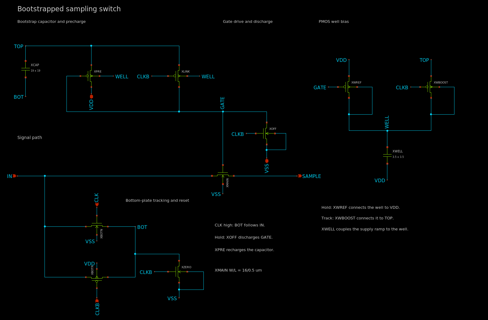

# SKY130 自举采样开关

把下面这句话和仓库链接交给 agent，就能从工艺器件表开始，搭出自举开关、普通传输门和同一套采样测试台。

> 用 SKY130 采样 0.95 V 共模的正弦，摆幅为 0.2 Vpp 和 1.0 Vpp。时钟 8 MHz，输入源 50 Ω，保持电容 1.25 pF。跟踪 85 ns，完全关断后 25 ns 读数。第 2 至 5 次谐波的总失真要求不高于 −58 dBc。检查上电和每只管的端压，解释需要多大的电容。

这个电路适合练习三个问题。栅极能否随输入抬升？栅压升高后，哪只管先遇到端压限制？缩小自举电容以后，还能否在规定时间内采到低失真的信号？

## 打开工程

在 GitHub 的 Actions 页面运行采样开关工作流。保持输入框为空可用上面的条件，填入一份完整的规格 JSON 可重新设计。下载本次运行的 `sky130-bootstrap-switch`，解压并打开 `index.html`。页面有可放大的原生原理图、测试台、保持样本的频谱和逐工况数据。[运行工作流](https://github.com/w1213ph/virtuoso-circuit-skills/actions/workflows/sky130-bootstrap-switch.yml) · [规格样例](requirements.example.json)

在解压目录运行 `python sample.py`，只需 Python 3，即可从工艺扫描和每个时间点的电压复算，包括全部超限方案。安装了 Xschem 的 Linux 用户可以在页面指定的 `evidence/designs/<电路名>` 下运行 `sh open.sh core` 或 `sh open.sh bench` 进入原理图或测试台。测试台的输入向左引出，SAMPLE 向右连接外部保持电容，上下侧引脚分别直出。

在仓库根目录重新建图和仿真用以下命令。需要 Python 3、Xschem、ngspice，以及首次下载公开模型的网络连接。工作流使用 Debian 13 的发行版软件包。

```sh
python3 examples/sky130-bootstrap-switch/switch.py run --out work/switch
python3 examples/sky130-bootstrap-switch/switch.py verify --out work/switch
```

已有工艺模型副本时，分别用 `--core-models PATH` 和 `--switch-models PATH` 指向包含锁文件所列目录的源树。程序校验每个原始文件的 SHA-256。把负载、时钟或摆幅改在规格文件中，指定 `--requirements 文件名 --out 新目录`，会重新扫描器件、选尺寸和跑前仿。返回码 0 表示在示例工程限值内找到候选，1 表示已完成测量且全部候选超限，2 表示输入或证据有误。公开工艺符合性与可靠性仍要单独核查。

## 怎样搭电路

跟踪时，底板开关把 BOT 接到输入，已预充的 MIM 电容抬升 TOP，XLINK 将 TOP 接到主采样管的 GATE。保持时，XOFF 拉低 GATE，XZERO 拉低 BOT，XPRE 给电容充电。测试台给出真实电源爬升、带源电阻的正弦和互补时钟，测量节点是负载电容上的 SAMPLE。



这张图可以在 Xschem 中逐只选中器件查看尺寸。从主开关的输出到负载电容的实际接线见[父级测试台原生图](images/bench.png)。

| 电路 | 工程上改了什么 |
|---|---|
| `transmission` | 普通互补传输门，与自举电路共用信号源、时钟和外部保持电容 |
| `thin` | 七只 1.8 V 管和一只工艺 MIM，用来观察升压节点向其他器件施加的端压 |
| `mixed` | 主开关、栅驱、预充与放电四个位置换为厚栅器件 |
| `reset` | 调整放电、底板复位和预充管尺寸，比较相同极板面积下的瞬态结压 |
| `plate` | 在 `reset` 上放大自举电容，测量大信号和小信号的失真与面积代价 |
| `well` | 预充与栅驱 PMOS 共用受控阱。保持时接电源，跟踪时接 TOP，增加一只小 MIM 耦合上电斜坡 |
| `compact` | 缩小主极板，另调阱开关尺寸与辅助电容，按相同工况重新验收 |

厚栅 NMOS、PMOS 先扫栅压和八档宽度，分别测 1 mV 漏源压下的导通电阻、0.5 V 漏源压下的电流与 gm/ID。厚栅主开关取覆盖所测角落与输入端点的最小合格宽度。估算给开关和源电阻分配 15% 跟踪窗口来建立 10 位阶跃到半 LSB，实际交流精度再由采样波形判定。面积列分别统计 MOS 总栅面积和两块 MIM 的极板总面积。固定负载电容属于测试台。

在上面的示例规格下，导通电阻预算为 1.288 kΩ，12 µm 和 16 µm 主开关的最差实测值分别为 1.514 kΩ 和 1.146 kΩ，因此主开关初选 16 µm。慢角、1.0 Vpp、0.25 ns 初筛步长下，普通传输门的 THD 为 −42.70 dBc。换成厚栅并调整复位尺寸后，`reset` 达到 −63.77 dBc，上电时预充管的漏区与阱之间仍超过 0.20 V。两种阱偏置方案在这一步都通过六个工况，还要继续完成下面的细步长复测。

## 怎样看结果

- 工况为 TT / 1.80 V / 27 °C、SS / 1.62 V / 85 °C、FF / 1.80 V / −40 °C。三种工况使用公开 MIM 典型系数。先在 200 ns 内从零抬升电源，500 ns 后启动时钟。端压检查包含第一次采样和全部时钟边沿。
- 稳态失真从实际时钟下降沿定位。丢弃 12 个初始周期，保存随后 128 个保持样本，输入音调选第 11 个频点。默认输入为 687.5 kHz。用 H2–H5 幅度的平方和开根号除以基波计算 THD，并用源信号校验采样窗口。负载、Vpp 和读数时刻随记录交付。
- 每只 MOS 保存 VGS、VGD、VGB、VDS、VBS、VBD 的有符号最小值、最大值和发生时刻，两个 MIM 各查两板电压。工程筛选采用 0.20 V 瞬态正向结压预算，另查增益、预充、跟踪栅压和关断残压。对达到全部工程指标的自举候选先按 MIM 面积、再按 MOS 栅面积排序。优先复测面积较小者的全部工况，逐次把最大步长从 0.25 ns 减半，最低至 0.03125 ns。相邻两次的逐项判定要一致，THD 变化须在 0.5 dB 以内，全部已测器件端压极值变化须在 30 mV 以内。
- 工程筛选与官方模型有效范围分别列出。按网表固定的源漏定义比较有符号 VGS、VDS、VBS，包含反向导通和关断边沿，越界记录带器件、端子和时间。举例说，厚栅管公开的正向 VBS 边界为 0 V。即使短脉冲在示例 0.20 V 预算内，报告仍会显示超出模型范围的数值。进入产品设计还要有目标 PDK 的瞬态 SOA、寿命和其他工作条件依据。[SkyWater 器件模型有效范围](https://skywater-pdk.readthedocs.io/en/main/rules/device-details.html)

开关工作原理可参考 Razavi 的采样电路文章。本例使用独立绘制的原理图。模型来自固定版本的 SkyWater 开源库，MIM 保留工艺模型的面积、周长和串联电阻项。[采样开关工作原理](https://www.seas.ucla.edu/brweb/papers/Journals/BRSummer15Switch.pdf) · [M3 MIM 原始模型](https://github.com/google/skywater-pdk-libs-sky130_fd_pr/blob/f62031a1be9aefe902d6d54cddd6f59b57627436/cells/cap_mim_m3/sky130_fd_pr__cap_mim_m3_1.model.spice) · [工艺模型校验清单](models.lock.json)
