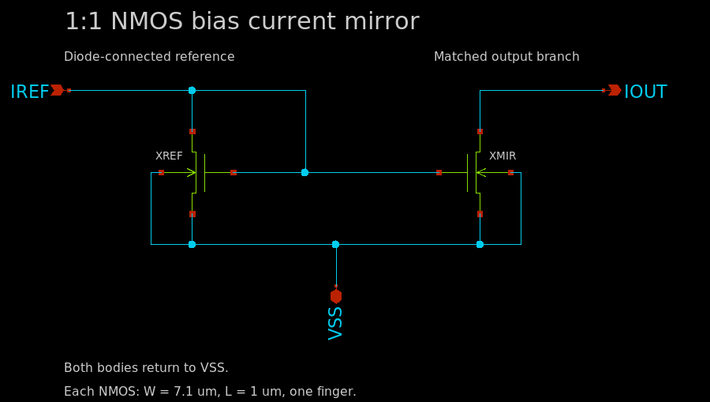
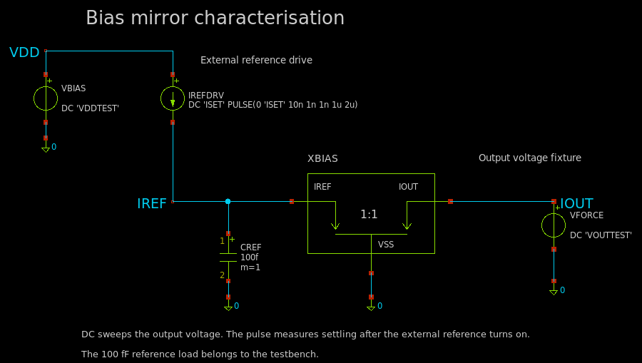

# 用 SKY130 搭建第一个电流镜

目标是让一条输出支路复制另一条支路的 10 µA 参考电流。这个偏置模块只有两只 MOS，可以沿原理图直接追踪每根线。你将得到两个可以打开的 Xschem 工程、一套原生网表、三组工况的 ngspice 仿真数据，以及一份中文比较报告。



## 从空目录复跑

可以直接告诉能运行命令的 agent：“替我复跑这个案例，给我原理图、测试台和报告，解释哪一版适合输出精度优先的设计。”以下命令使用 Linux。在 Debian 13 上可让有安装权限的人运行 `apt install git ca-certificates python3 xschem ngspice`。已安装时可直接开始。[Xschem 软件包](https://packages.debian.org/trixie/xschem) · [ngspice 软件包](https://packages.debian.org/trixie/ngspice)

```sh
git clone https://github.com/w1213ph/virtuoso-circuit-skills.git
cd virtuoso-circuit-skills
python3 examples/sky130-current-mirror/run.py --out work/first-mirror
```

首次运行下载锁定的 SKY130 模型并逐文件校验，先扫器件，再产生真实电路并仿真。终端显示 `completed` 后，从 `work/first-mirror/RESULTS.md` 开始看。在有图形桌面的同一台机器运行下列命令。命令行建图、生成网表和前仿均可在无桌面的 Linux 上完成。

```sh
sh work/first-mirror/candidate/open.sh core
sh work/first-mirror/candidate/open.sh symbol
sh work/first-mirror/candidate/open.sh bench
```

如果还没有 Linux 环境，可以先打开已完成的 GitHub 仿真，查看摘要。登录 GitHub 后可在 Artifacts 下载原理图、器件表、网表和波形。已有本仓库副本的使用者也可在自己仓库的 Actions 页选择 `Run workflow`。[一次完整复跑](https://github.com/w1213ph/virtuoso-circuit-skills/actions/runs/45412924301) · [全部运行记录](https://github.com/w1213ph/virtuoso-circuit-skills/actions/workflows/sky130-prelayout.yml)

## 怎样选尺寸

1. 两只 1.8 V NMOS 源端和体端接 VSS，共栅。左支路的漏端接栅端，10 µA 外部参考由此建立栅压。右支路给负载提供电流下拉。测试台用电压源设定输出电压，以测量输出吸收的电流。
2. 在 TT、SS、FF 分别记录 N/P MOS 的 `gm/ID`、`ID/W`、`gm/gds`、`VDSAT` 和电容。每个工况扫两个沟道长度、三个漏源电压和两个体偏置，共 24 条曲线。扫描步长 10 mV，三组共 12,600 个工作点。
3. 用 TT、体偏置 0 V、漏源电压 0.65 V 的数据选一个接近 15 V⁻¹ 的参考工作点。由 `W = 10 µA ÷ (ID/W)` 计算，再以 0.05 µm 为步长取整。两版各使用两只相同的单指 NMOS。所有工况保持各自版本的尺寸，并重新测电路。[机器可读的尺寸和测值](measurements.json)

| 每只管的尺寸 | W × L（µm） | 两管栅面积（µm²） | 查表参考 gm/ID（V⁻¹） |
|---|---:|---:|---:|
| 初版 | 3.45 × 0.50 | 3.45 | 14.90 |
| 候选 | 7.10 × 1.00 | 14.20 | 15.27 |

栅面积是两只管子的 `Σ(W × L)`。网表为每端扩散结采用 0.30 µm 长度估算面积和周长。接触、走线、隔离和匹配留白会另外占用面积。测试台上的 100 fF 接在参考端。下图可见 IREF 向左引出、IOUT 向右、底部 VSS 竖直向下。



## 怎样看实测结果

本例先约定两个教学指标。输出在 0.40–1.20 V 内，最坏镜像误差应 ≤5%。外部参考由 0 开到 10 µA，参考端接 100 fF、输出固定在 0.80 V，从参考达到 99% 起，输出应在 200 ns 内进入并保持在其最终直流值的 ±1%。输出电阻用 0.75 V 和 0.85 V 的电流差计算。

| 工况 | 最坏误差，初版 → 候选 | 稳定时间，初版 → 候选 | 输出电阻，初版 → 候选 |
|---|---:|---:|---:|
| TT，27 °C，1.80 V | 5.204% → 4.173% | 11.11 → 14.31 ns | 0.878 → 1.213 MΩ |
| SS，85 °C，1.62 V | 4.371% → 3.691% | 11.71 → 15.11 ns | 1.020 → 1.367 MΩ |
| FF，−40 °C，1.80 V | 6.328% → 4.859% | 10.71 → 13.71 ns | 0.720 → 1.024 MΩ |

这些数据来自 Xschem 3.4.4 和 ngspice 39.3。初版通过 4/6 项，TT 和 FF 的镜像误差超限。候选通过 6/6 项，三组输出电阻均提高，两管栅面积变为初版的 4.12 倍，参考开启后稳定时间也变长。如果系统会在很短的窗口内读取这条偏置，应以实际时间窗口重新定指标。候选与外部参考一起接入整机后，还要核对实际负载、参考源启动和供电条件。随机失配、噪声及更完整的工况覆盖属于具体设计的前仿任务。

## 换成自己的需求

可以告诉 agent：“参考电流改为 5 µA，输出范围和 5% 精度要求照旧。如果失败，请找出哪个工况超差，重新选尺寸，并告诉我代价。”第一次尝试可复用已经测过的表。下面两条命令依次在独立目录保存这次尝试与修改后的工程。

```sh
python3 examples/sky130-current-mirror/run.py --models work/first-mirror/models --reuse-lut work/first-mirror/characterization --reference-ua 5 --out work/5ua
python3 examples/sky130-current-mirror/run.py --models work/first-mirror/models --reuse-lut work/first-mirror/characterization --reference-ua 5 --candidate-length-um 1.5 --out work/5ua-long
```

第一条命令返回 `review_required` 并保留结果。1.00 µm 沟道在 FF、−40 °C 时误差为 **5.448%**。第二条命令为新沟道长度重扫三组器件表，重新计算宽度，在原指标下复测。FF 误差降到 **4.831%**，三组工况的六项要求均满足。两管栅面积由 **7.10 增至 13.05 µm²**，最慢稳定时间从 **25.11 增至 29.71 ns**。运行记录里的 `requirements.json` 可用来核实两次的目标完全相同。

也可以用 `--max-error-pct 4` 明确提出更严的精度。在 10 µA、候选沟道 1.00 µm 的实测里，TT 和 FF 超出 4%，SS 通过。优化时保留这份记录，按系统要求决定能接受的器件规模。导出的中文报告和网表分别记录当前目标与实际激励，便于核对。[同规格改尺寸及超限测值](custom-requirements.json)

## 复用器件表，继续查结果

下面的命令共用上一次校验过的模型目录，并把新结果写到新的目录。脚本核对模型、实际扫压输入、仿真器版本及二进制、查表代码和原始数据哈希。匹配时会打印 `reused`，不匹配的工况会重新扫描。两版电路随后均重新网表化和仿真。

```sh
python3 examples/sky130-current-mirror/run.py --models work/first-mirror/models --reuse-lut work/first-mirror/characterization --out work/second-mirror
```

| 想核对什么 | 在输出目录里打开 |
|---|---|
| 当前运行完成了哪些步骤 | `status.json`、`RESULTS.md`、`comparison.json` |
| 哪个工作点决定宽度 | `candidate/sizing.json`、`characterization/tt/table.csv` |
| 电气连接、端序和父级首段方向 | `candidate/native-readback.json`、`candidate/views/TB_BIAS_MIRROR.spice` |
| 初版在哪个工况超差 | `baseline/checked.json`、`baseline/ff/measurement.json` |
| 想自己从波形重算指标 | 每版每工况的 `input.spice`、`ngspice.log`、`dc.dat`、`transient.dat` |

首次下载从 GitHub 的原始文件服务读取，遇到连接失败时自动尝试同一提交的 GitHub Contents API，所有文件仍校验同一份 SHA-256。已有相同提交的官方模型源树时，也可用 `python3 examples/sky130-current-mirror/fetch_models.py --from-dir /path/to/sky130_fd_pr --out work/models` 准备模型，然后给 `run.py` 传 `--models work/models`。程序拒绝覆盖已有运行目录。遇到 `review_required` 或 `failed`，保留目录，先读状态和对应的求解日志。

固定源为官方 `sky130_fd_pr` 提交 `f62031a1`。锁文件列出 18 个输入的 SHA-256，包括上游 Apache 2.0 许可。仅为这个两种器件、三个工艺角的练习生成模型入口，保留上游几何缩放、模型参数及器件定义。详细器件适用范围见工艺文档。[源提交](https://github.com/google/skywater-pdk-libs-sky130_fd_pr/tree/f62031a1be9aefe902d6d54cddd6f59b57627436) · [SKY130 器件说明](https://skywater-pdk.readthedocs.io/en/main/rules/device-details.html) · [模型清单](models.lock.json)
