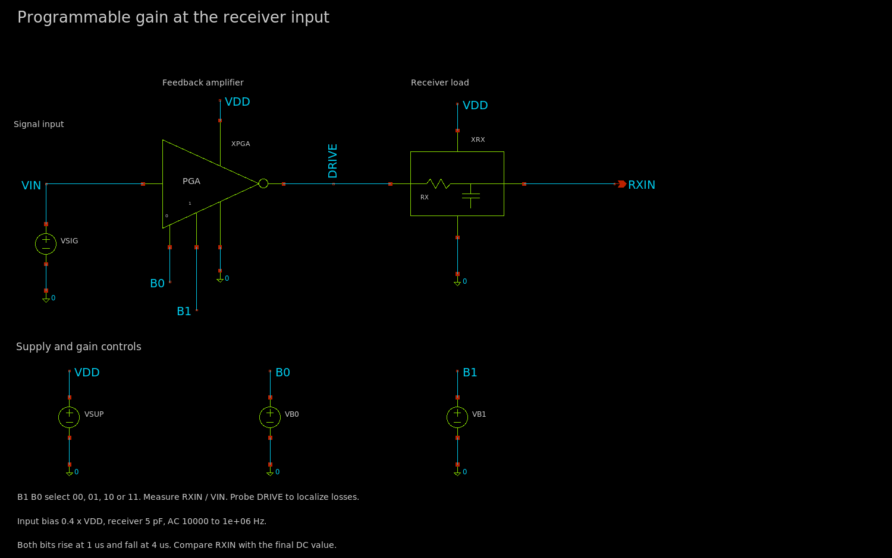
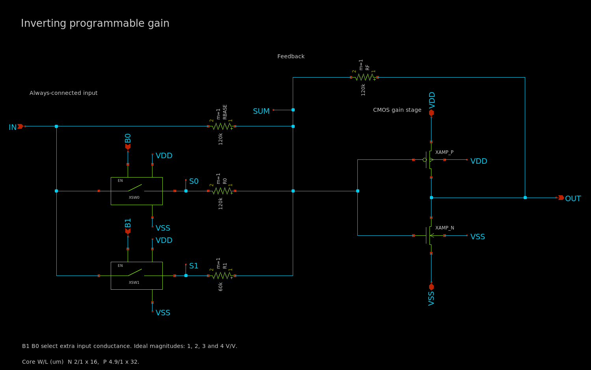
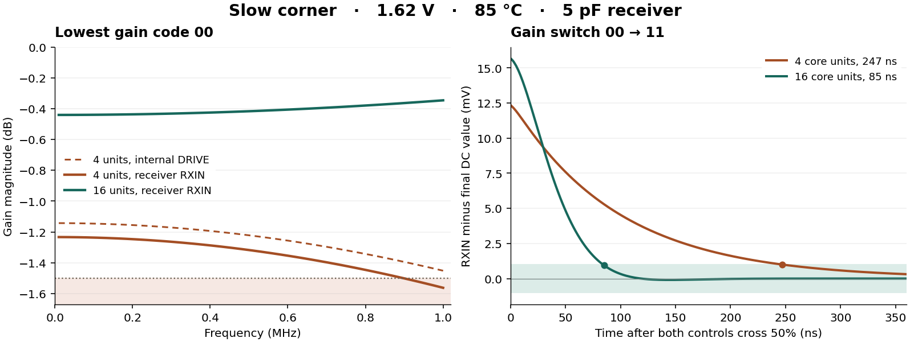

# 在接收端验证四档可编程增益

> 用 SKY130 做一个反相增益级，四档增益幅值为 1、2、3、4 V/V。后级输入有 5 pF。请画出控制位到传输门的接法，测每一档在 10 kHz 至 1 MHz 的增益，再告诉我切换最高档和最低档要多久、电流要多少。

把这句话交给能运行命令的 agent，即可从四张可编辑的 Xschem 原理图开始。默认验收要求为带内增益误差 ≤1.5 dB、总静态电流 ≤100 µA，两个端点间切换后须在 500 ns 内稳定到最终值的 ±1 mV。输入共模为供电的 40%。[完整需求](requirements.example.json)



## 运行并打开你的原理图

在装有 Python 3、Xschem 和 ngspice 的 Linux 上，从仓库根目录执行下列命令。首次运行会下载仓库锁定版本的公开 SKY130 MOS 模型并校验文件。安装方法见[环境配置](../../docs/SETUP.md)。

```sh
python3 examples/sky130-programmable-gain/run.py --out work/gain
python3 examples/sky130-programmable-gain/verify_results.py work/gain
```

打开 `work/gain/RESULTS.md` 查看各码的实测增益、切码时间和超限原因。默认要求下会选中 `candidate`。在带图形桌面的同一台机器上，可以分别打开测试台、放大级、传输门和接收电路。

```sh
sh work/gain/candidate/open.sh bench
sh work/gain/candidate/open.sh stage
sh work/gain/candidate/open.sh switch
sh work/gain/candidate/open.sh receiver
```

若已有电流镜案例的运行结果，可在第一条命令加 `--models work/mirror/models --reuse-lut work/mirror/characterization`。换规格时复制 `requirements.example.json`，修改预算、频带或负载，传入 `--requirements 新文件 --out 新目录`。若两版均超限，程序仍会写出测量报告，并以状态码 1 结束。没有 EDA 环境时，可从工作流成功运行的 `sky130-programmable-gain` 工件取得 `gain/` 与 `gain-20ua/`，用同一版本仓库的复算命令读取解压目录。复算只需 Python。[仿真工作流](https://github.com/w1213ph/virtuoso-circuit-skills/actions/workflows/sky130-prelayout.yml)

## 先读码表，再看后级



常接 120 kΩ 输入电阻和 120 kΩ 反馈电阻决定最低档。B0 接入另一条 120 kΩ 支路，B1 接入 60 kΩ 支路。两位同时为零时，常接支路仍能传输信号。理想运放近似下，四档的增益幅值为 `1 + B0 + 2 × B1`。实际传输门导通电阻、CMOS 放大级的有限增益及接收负载都会改变结果。需求文件里的四个目标值用于确定增益容差与驱动预算。换成其他标称档位时，还需重新设计输入电阻比。

| B1 B0 | 导通的附加输入支路 | 理想增益 (V/V) | 候选版慢角 1 MHz 接收端幅值 (dB) |
|---|---|---:|---:|
| 00 | 无 | −1 | −0.346 |
| 01 | 120 kΩ | −2 | 5.341 |
| 10 | 60 kΩ | −3 | 8.471 |
| 11 | 120 kΩ 和 60 kΩ | −4 | 10.757 |

`DRIVE` 是放大级输出。信号再经过 2.2 kΩ 到达 `RXIN`，此处接有 5 pF、偏置返回电阻和下一级 MOS 的栅极。测试台在每个码读取实际控制位及本地反相器产生的互补电平，从输入到 `RXIN` 的复数交流响应计算增益。初版慢角 `00` 码的 1 MHz 响应，在 `DRIVE` 为 −1.452 dB，经过接口后为 −1.563 dB，超过 ±1.5 dB 的容差。候选版同一接收端读数为 −0.346 dB。

## 怎么取尺寸，改善了什么

先用开源工艺扫描 TT、SS、FF 三组 N/P MOS 特性，共 12,600 个工作点。在 TT、L = 1 µm、|VDS| = 0.65 V、VBS = 0 V 下，按输入共模查得 N、P 的 gm/ID 分别为 12.73、13.04 V⁻¹，电流密度分别为 2.46、0.503 µA/µm。把两侧的静态电流配平后，每组用一只 2/1 µm NMOS 和两只 4.9/1 µm PMOS。按最高频率、最大噪声增益 5 和接收电容初估跨导下限为 157 µS。计入两倍余量并按二的幂取整，初版用 4 组，候选用 16 组。两版采用相同的开关、偏置和接收电路。

| 三组工况汇总 | 初版，4 组 | 候选，16 组 | 验收要求 |
|---|---:|---:|---:|
| 四档增益的最坏带内误差 | 4.303 dB | **1.284 dB** | ≤1.5 dB |
| 双向切码的最慢建立时间 | 323.8 ns | **188.4 ns** | ≤500 ns |
| 含后级与偏置的最大静态电流 | 26.15 µA | **78.54 µA** | ≤100 µA |
| 放大器与两组开关的 MOS 总栅面积 | 49.54 µm² | **191.14 µm²** | 供比较 |
| 正式检查通过数 | 34/42 | **42/42** | 全部 |

三个工况为 TT / 1.80 V / 27 °C、SS / 1.62 V / 85 °C、FF / 1.80 V / −40 °C。每个工况的每个码检查低频反相、41 个频点中的最大增益误差及总电流，另检查 `00 → 11` 和 `11 → 00` 两次建立。切码时输入比原共模高 8 mV，两位的边沿均为 2 ns。从最后一个控制位跨过 50% 算起，测量接收端最后一次越出 ±1 mV 后的恢复时间。每个终值由同一电路在该输入与最终码下单独做直流求解。



慢角从最低档升到最高档，建立时间从 247.1 ns 缩短到 85.1 ns，反向从 120.9 ns 增到 126.9 ns。把电流上限收紧到 **20 µA** 并保留其余条件，两版均只通过 **30/42** 项，报告给出 `review_required`。若在默认计划里漏掉慢角 `11` 码的正式增益测量，通用检查器会列出缺少的工况、码和接收节点，即使其余读数全都达标。[测试计划与覆盖检查](../../docs/TOOLS.md)

面积需同时看无源器件。如果 5 pF 全部由片上单层 MiM 实现，按 2 fF/µm² 估算，极板约 2,500 µm²。放大器的四只信号电阻共 420 kΩ，若选 2 kΩ/□ 的高阻多晶硅，电阻体合计约 210 方块。接收晶体管另有 2 µm² 栅面积。这些是前仿选型用的估算。本例的电阻、电容采用标称值，结论覆盖上述三组工况和两次同步切码。迁移到目标芯片时，按实际接口补测源阻抗、无源偏差、控制位偏斜、噪声和失真。[SKY130 器件数据](https://skywater-pdk.readthedocs.io/en/main/rules/device-details.html)
