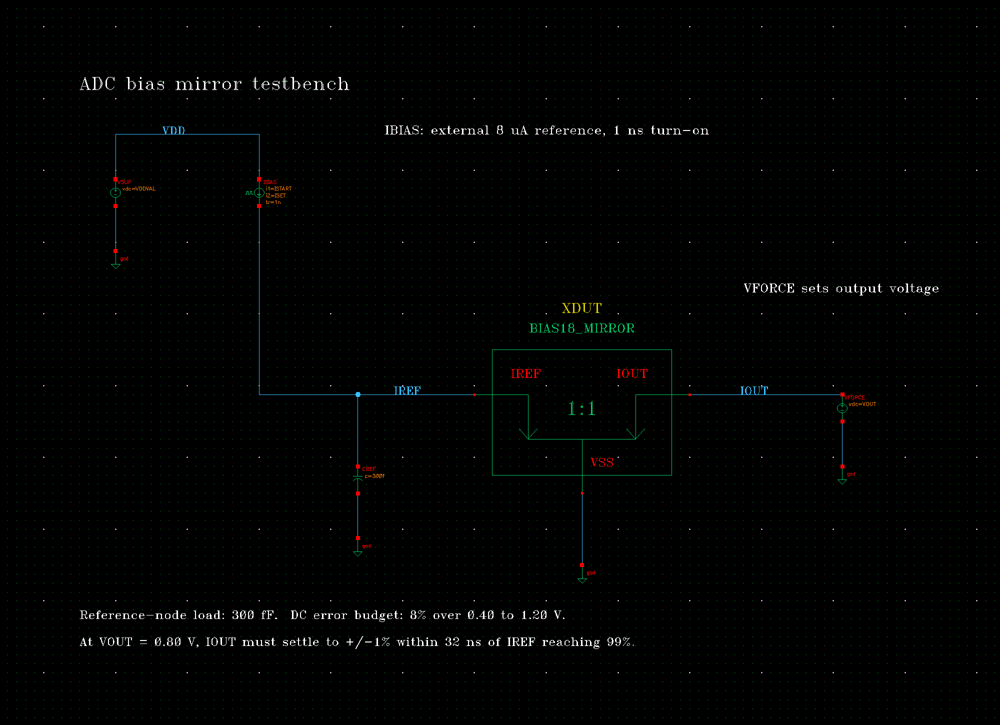
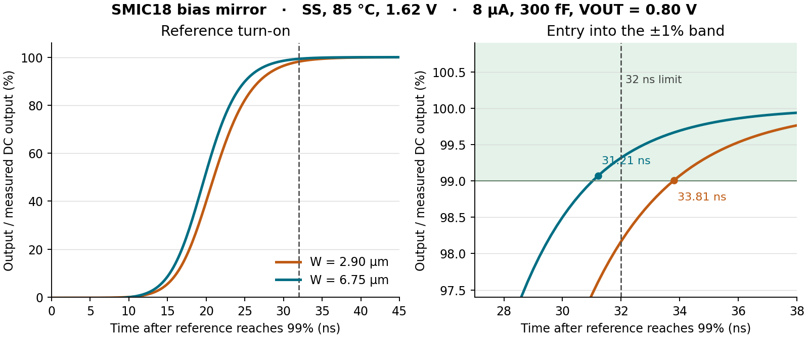
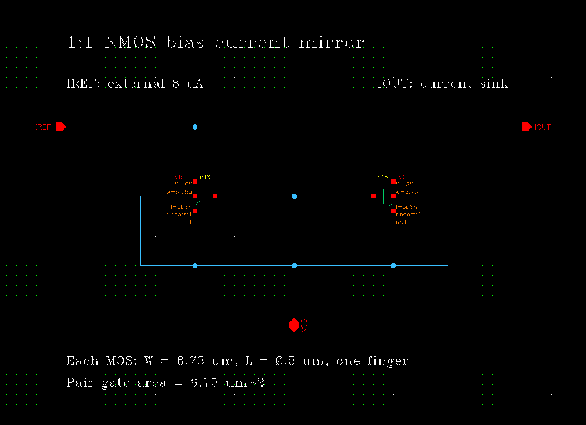

# 在 Virtuoso 给 ADC 搭一条 8 µA 偏置支路

> 用 SMIC18 给 ADC 复制外部 8 µA 参考，参考端接 300 fF。输出在 0.40–1.20 V 时电流误差最多 8%，开启后 32 ns 内稳定。请打开满足要求且两管总栅面积最小的方案，并告诉我为什么选它。

两只四端 NMOS 构成 1∶1 吸电流镜。左管的栅漏短接，确定公共栅压，右管从 IOUT 吸电流。外部电路提供 IREF，两管的源和体接 VSS。测试台用电流脉冲开启参考，在 IREF 接 300 fF，用 VFORCE 设置输出电压并读取电流。图中 IREF 向左、IOUT 向右、VSS 向下引出。[可修改的需求](fast-bias.example.json) · [原生 symbol](images/symbol.png)



## 打开工程和波形

将上面那句话和本机 SMIC18 工艺信息交给有命令行权限的 agent。也可以在装有 IC6.1.8、SI、Spectre 和授权 SMIC18 模型的 Linux 主机上，从仓库根目录运行。复制配置后填入能解析工艺库及 analogLib、basic 的 `cds_lib`、Spectre 模型入口 `model_file` 和实际 `pdk_revision`。相对文件路径从配置文件所在目录解析，命令可以用 PATH 中的名字或完整路径。[本机配置样例](cadence.example.json)

```sh
cp examples/smic18-bias-mirror/cadence.example.json bias.local.json
# 填好 bias.local.json 后，选择一个新输出目录
python3 examples/smic18-bias-mirror/bias.py run --config bias.local.json --out work/bias-first
python3 examples/smic18-bias-mirror/bias.py verify --config bias.local.json --out work/bias-first
sh work/bias-first/open.sh
```

- **看图**。最后一条命令在选中候选的独立工程启动 Virtuoso，以只读模式打开核心、symbol 和父级。要编辑，在这个会话的 Library Manager 中打开 `BIAS18_BENCH / BIAS18_MIRROR / schematic` 或 `TB_BIAS18_MIRROR / schematic`，选择编辑模式。每个候选各用一个目录。
- **看慢角开启**。在同一库打开 `TB_BIAS18_MIRROR / maestro`，选择本次历史记录中的 `SS_TRAN`。输出 `VREF_NODE` 是电容节点电压，`IOUT_SINK` 是正方向定义为吸电流的输出。切换到 `SS_DC`，取 0.80 V 点的直流输出电流作稳态基准。在本例中该值为 8.192 µA。TT 和 FF 也各有 DC、TRAN 两项测试。
- **换自己的需求**。复制需求文件，改参考电流、参考端负载、最大误差或建立时限，给 `run` 加 `--requirements 你的文件.json`，换用一个新输出目录。先看 `RESULTS.md` 里的最差工况，再到 `summary.json` 找器件工作点与选中理由。程序退出码 0 表示有尺寸达标，1 表示搜索范围内无解，2 表示输入或工程证据有误。保留完整运行目录，可在只有 Python 的机器上用 `verify --out 目录` 从原始数据复算，带上现场配置还会重新核对模型依赖。

## 同一测试台上，哪些尺寸通过了

先在 TT、27 °C、1.80 V，SS、85 °C、1.62 V，FF、−40 °C、1.80 V 三组条件分别扫描实际 SMIC18 NMOS。参考管宽 2 µm，每个工况取两档管长、三档漏源电压、两档体偏和 181 个栅压，共 6,516 个工作点。用 TT、VDS = 0.65 V、VBS = 0 的查表行，由 W = IREF/(ID/W) 估计宽度，按 0.05 µm 取整，再在实际接法下回读两管的工作点。

| 单管 W/L (µm) | 两管 ΣWL (µm²) | TT 参考管实际 gm/ID (V⁻¹) | 三工况最大电流误差 | 三工况最慢建立 | 32 ns 结果 |
|---|---:|---:|---:|---:|---|
| 2.90 / 0.50 | 2.90 | 15.26 | 5.009% | 33.81 ns | 慢角超限 |
| 6.00 / 1.00 | 12.00 | 15.05 | 3.798% | 36.61 ns | 慢角超限 |
| 1.30 / 0.50 | 1.30 | 11.82 | 3.936% | 39.21 ns | 慢角超限 |
| 3.05 / 1.00 | 6.10 | 12.20 | 2.992% | 39.81 ns | 慢角超限 |
| **6.75 / 0.50** | **6.75** | **18.24** | **6.370%** | **31.21 ns** | **三组均达标** |

两支初始方案的 gm/ID 都接近 15。保持 0.50 µm 管长，把查表目标提高到 18 V⁻¹，所选行的电流密度从 2.75 降到 1.19 µA/µm。相同参考电流需要更宽的管。慢角实际参考节点电压由 0.560 降到 0.503 V，参考管跨导由 107.1 增到 130.4 µS，实测建立缩短 2.60 ns。代价是两管栅面积增加 3.85 µm²，最大电流误差也从 5.009% 增至 6.370%。最慢建立在 SS，最大误差在 FF。





两只管均为单指、单倍，两管总栅面积按 2 × W × L 计算。搜索覆盖 0.50、1.00 µm 两种管长，四档目标 gm/ID 为 12、15、18、20 V⁻¹，单管允许宽度为 0.50–20.00 µm。先测两种管长的初始尺寸，再按面积从小到大实测。满足全部硬指标后，大于已选面积的候选可以跳过。32 ns 需求下共测五版。把时限收紧到 1 ns 后，程序实测全部七个合法尺寸，最快一版的三工况最慢建立仍为 30.61 ns，报告返回无解。[各工况测值、搜索记录及 Maestro 结果](native-review.json)

## 如何复算

直流扫描输出电压 0–1.50 V，间隔 10 mV。从 151 个采样点中取 0.40–1.20 V，计算各点 |IOUT/IREF − 1| 的最大值。开启测试固定 VOUT = 0.80 V，从实测 IREF 上升至 99% 的时刻计时。取输出电流进入并持续留在本工况直流稳态值 ±1% 内的首个采样点。波形每 0.2 ns 保存一次，默认观测到 300 ns。选中方案还剩 0.79 ns 时间余量，适用范围为上述三个确定性前仿工况。

验收回读两个原理图的 Check & Save、全部 MOS 端子及 SI 网表，核对父级三条引线的首段方向，并查看原生全图和局部。Maestro 在另一进程重开保存的设置，运行六项测试。复核程序在保存的设置中核对电流方向，在原生结果数据库确认六个 IOUT_SINK 表达式均已得到波形，再逐项检查实际网表的扫描变量、起止值和步长，从 Maestro 的 PSF 重新计算指标，并与直接 Spectre 对照。本次使用 SMIC18 V1.11_3 和 Spectre 15.1。直接 Spectre 的扫描与电路前仿均为零警告。六项 Maestro 运行各有一条 `SFE-884`，来自 ADE 和模型重复定义 gmin。该站点无图形 SI 初始化时还报告工艺菜单函数 `ciwMenuInit` 缺失，随后完成网表导出，两条求解路径的达标判断一致。

这个案例验证外部参考驱动下的偏置复制和开启。随机失配、完整 ADC 和生产良率需要各自的验收。ΣWL 衡量晶体管栅面积，实际版图还会用到有源区、接触、隔离与布线空间。现场生成的 OA、模型特性表和原始历史保存在本机工程。
