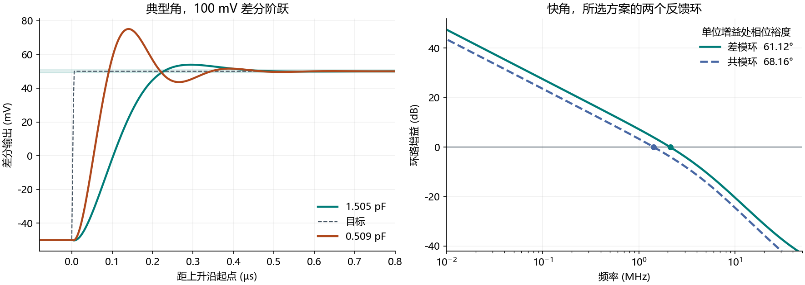

# 1.8 V、每侧 2 pF 的两级全差分运放

在有 Cadence 和 SMIC18 的环境中，可以直接把下面的需求交给 agent。

> 帮我在 SMIC18 设计一个 1.8 V 两级全差分运放，每个输出对地接 2 pF，低频差模增益要超过 80 dB。比较满足要求的方案，选总功耗小的，给我能打开的图、双环稳定性和阶跃波形，也说说哪个器件最占面积。

这组条件下，八个候选中有四个通过三组工况。按**三个工况中最高的静态总功耗**选出的方案采用 1.00 µm 管长，每侧补偿电容约 1.505 pF。最小带载增益为 81.97 dB，最高静态总功耗为 22.30 µW。


## 从空目录交付可编辑工程

在有 Virtuoso IC6.1.8、SI、Spectre 和已授权 SMIC18 工艺的 Linux 主机上填写站点配置，下面的命令从仓库根目录运行。实例使用该工艺的四端 `n18`、`p18`、高阻多晶硅电阻 `rhrpo` 和 `mim2`。三个工况分别加载同角的 MOS、电阻、MIM 模型段。此案例在 SMIC18 V1.11_3 上验证。[站点配置示例](../smic18-bias-mirror/cadence.example.json)

```sh
python3 examples/smic18-ota-sizing/ota.py run --config cadence.local.json --out work/fdota
python3 examples/smic18-ota-sizing/ota.py verify --config cadence.local.json --out work/fdota
sh work/fdota/open.sh
```

首次运行会生成四张器件图、重扫 8,688 个 MOS 工作点、搭建八套完整候选，并为选中方案保存和运行 Maestro。已有本机完整器件表时，给两条 Python 命令都加上 `--devices work/fdota-devices`。程序先从原始器件扫描复算，再按 TT 电流密度取尺寸，各管的几何尺寸在三个工况保持一致。[gm/ID 扫描和管长预算](README.md)

打开脚本会显示整机原理图、功能 symbol 和带载测试台。Library Manager 中的库名为 `FDOTA18_BENCH`。进入 `FDOTA18_OTA` 可以下钻四个子电路，其中 `FDOTA18_OUTPUT` 内有两条实体串联 RC 补偿支路。要重看保存的测试，在同库打开 `TB_FDOTA18_OTA / maestro`，选择测试和对应的历史。每个工况有增益、直流工作点、差模稳定性、共模稳定性、启动与阶跃五项测试。

## 尺寸怎样落到电路上

第一级是 NMOS 差分对和 PMOS 有源负载。第二级每侧由 PMOS 共源管驱动，NMOS 电流源下拉。偏置支路由电源通过电阻驱动二极管连接的 NMOS，上电时随电源自行建立。共模检测由两组实际差分对分别比较 OUTP、OUTN 与外部 VCM，合并检测电流后调节第一级 PMOS 负载的栅压。功耗从 VDD 总电流计算，包含偏置、两个检测支路和两个输出支路。外部共模基准由测试台提供。

所选设计的输入管 W/L 为 0.85/1 µm，第一级负载为 3.50/1 µm，输出 PMOS 为 10.10/1 µm，输出 NMOS 电流源为 2.65/1 µm。每侧约 18.55 kΩ 的调零电阻与一只 27.5 × 27.5 µm 的 MIM 电容串联。检查程序从已保存的图核对每只 MOS 的四端连接，再从 SI 网表核对有效 W、L、栅指数量、并联倍数及电阻串接关系。图中的 W/L 注释记录生成时的尺寸，手工改图后须重新核对器件属性和网表。


## 哪些指标决定通过

本例把输入共模定为 0.6 VDD，输出共模目标定为 0.5 VDD。每侧接一只 2 pF 对地电容。除严格大于 80 dB 的低频增益外，示例工程判据为差模、共模相位裕度各至少 55°，静态输出共模偏差不超过 25 mV，18 只 MOS 在该工作点均有饱和余量。电源从零开始，用 1 µs 升至额定值。单位增益下测双向 100 mV 差分阶跃，两次都须在 1 µs 内进入并保持在目标 ±1 mV 内。共模参考再上跳 20 mV，增量须在 1 µs 内进入并保持在目标 ±2 mV 内。

| MOS / R / MIM 同角 | 电源、温度 | 1 Hz 差模增益 | 差模 / 共模相位裕度 | 静态总功耗 | 差分上升 / 下降建立 | 共模步进建立 |
| --- | --- | ---: | ---: | ---: | ---: | ---: |
| TT | 1.80 V，27 °C | 82.10 dB | 65.53° / 72.43° | 22.05 µW | 0.422 / 0.423 µs | 0.300 µs |
| SS | 1.62 V，85 °C | 81.97 dB | 67.24° / 74.60° | 16.42 µW | 0.558 / 0.557 µs | 0.458 µs |
| FF | 1.80 V，−40 °C | 82.03 dB | 61.12° / 68.16° | 22.30 µW | 0.346 / 0.345 µs | 0.216 µs |

三工况差模单位增益频率约 1.14–2.12 MHz，静态输出共模偏差最大 16.66 mV。测开环增益时保持内部共模反馈闭合，从 1 Hz 起扫频，以实际两输入之差归一化输出。测稳定性时两个反馈环均闭合，分别通过外部差模探针和共模反馈支路中的零伏探针做 Spectre STB。短接共模探针后的分层连接已与普通整机的独立 SI 网表核对。测量程序从复数波形寻找单位增益交越，与 Spectre 打印的相位裕度交叉复算。

将所选设计的补偿板缩到 16 × 16 µm，每侧约 0.509 pF，同一 TT 工况仍有 82.10 dB 增益，但差模相位裕度降到 42.94°，100 mV 上升阶跃的过冲从 3.91 mV 增至 25.06 mV。这一版保存在结果里，可在同一负载下直接比较。将管长改为 1.50 µm 并保留大补偿和低电流，最低增益升到 84.71 dB，最高功耗也升到 24.02 µW。



## 面积主要花在哪里

| 片内器件 | 按原生器件尺寸累计 | 解释 |
| --- | ---: | --- |
| 18 只 MOS | 栅面积 49.05 µm² | 每只按有效 W × L 计 |
| 两只 MIM | 极板面积 1,512.50 µm² | 两侧各 756.25 µm²，决定补偿和相位裕度 |
| 三只电阻 | 电阻条面积 4,193.70 µm² | 单是 1.067 MΩ 偏置电阻就占 4,052.64 µm²，由 24 段 84.43 × 2 µm 电阻条串联 |

若芯片面积吃紧，优先检查偏置电阻的宽度选择、可用的高阻器件和外部偏置条件，修改后重测启动和工艺角。表中数值按器件本体几何量计，测试台上的两只负载电容另计。实际占地还包含隔离、接触孔、间距和连线。

## 怎样复核交付物

`summary.json` 中的 `selected` 指向选中目录，`candidates` 保留全部八组，包括不达标组的波形和逐项判据。每个候选内 `oa` 保存可编辑原理图、端子回读和原生 SI 网表，`tt`、`ss`、`ff` 保存五项分析的输入与原始 PSF。选中工程还有可重新打开的 Maestro、已计算的差模增益、功耗、环路增益和阶跃输出，以及独立的仿真历史。退出码 0 表示有满足全部判据的候选且交付复核通过，1 表示所有候选至少有一项超限，2 表示输入、原生运行或证据异常。


## 输入噪声会怎样改变选型

如果传感器允许 OTA 在 10 Hz 到 100 kHz 内贡献 40 µV RMS 的输入等效噪声，原先的低功耗选型会超限。将管长从 1.00 µm 改为 1.50 µm，再按实测电流密度重新取宽度，三工况最差噪声从 54.95 降到 39.85 µV RMS。总 MOS 栅面积从 49.05 增至 108.75 µm²，最高功耗从 22.30 增至 24.02 µW。两版最差噪声都在 SS、85 °C、1.62 V；该工况的功耗分别为 16.42 和 17.02 µW。表内噪声上限是可替换的示例设计预算。[八种几何的逐角测量和器件面积](noise-review.json)

| 输入等效噪声上限，10 Hz 至 100 kHz | 同时满足已有硬指标和噪声预算 | 在达标者中选择 |
|---|---:|---|
| 60 µV RMS | 4 / 8 | 1.00 µm 管长，低电流，大补偿，最差 54.95 µV RMS |
| 40 µV RMS | 2 / 8 | 1.50 µm 管长，低电流，大补偿，最差 39.85 µV RMS |
| 30 µV RMS | 0 / 8 | 搜索范围内没有可交付候选 |

每组尺寸在 TT、SS、FF 运行一次原生 Spectre noise。差模反馈打开、CMFB 闭合，实际输入共模为 0.6 VDD，每侧负载 2 pF。噪声输出为 OUTP 减 OUTN，输入参考为测试台的 VD。每条频谱从 1 Hz 到 1 GHz 共 541 点。程序逐点将输出电压噪声除以独立 AC 分析得到的差分增益，与 Spectre 输入等效噪声核对，并将全部器件噪声功率加总核对输出。用另一套计算从输出频谱和 AC 增益复算 24 个积分结果，最大相对差为 1.53 × 10⁻⁷。

原低功耗方案在最差角的输入差分对占带内总噪声功率的 83.22%。这支持把下一次尺寸实验放在输入级。本轮两种管长改变了多个器件，只能把整机的下降量归于整组尺寸变化。单独改变输入对、保持其它器件固定，才能量出输入对几何的独立收益。

从仓库根目录在已完成的原生工程上运行。首次运行写入新目录，`verify` 从原生证据复算；`evaluate` 可更换频带和预算。命令返回 0 表示存在满足全部硬指标的候选，1 表示本次搜索全超限，2 表示证据或执行异常。

```sh
python3 examples/smic18-ota-sizing/ota_noise.py run --config cadence.local.json --ota work/fdota --out work/fdota-noise
python3 examples/smic18-ota-sizing/ota_noise.py verify --config cadence.local.json --ota work/fdota --out work/fdota-noise
python3 examples/smic18-ota-sizing/ota_noise.py evaluate --config cadence.local.json --ota work/fdota --out work/fdota-noise --band-hz 10 100000 --limit-uv 40
python3 skills/paper-to-virtuoso/scripts/check_prelayout.py check --plan work/fdota-noise/portable/plan.json
```

最后一条可在只有 Python 的机器上运行，输入为整个 `portable` 目录。该计划核验全部候选的噪声，有超限项即返回 1；具体选中哪组还取决于完整电路的其他硬指标，见 `summary.json`。保存的 Maestro 覆盖原有五类分析，新增噪声使用同一原生 SI 网表直接运行 Spectre。完整输入共模范围、大摆幅失真、OTA 失配和产品指定的全部 PVT 组合，仍需按实际应用补测。
