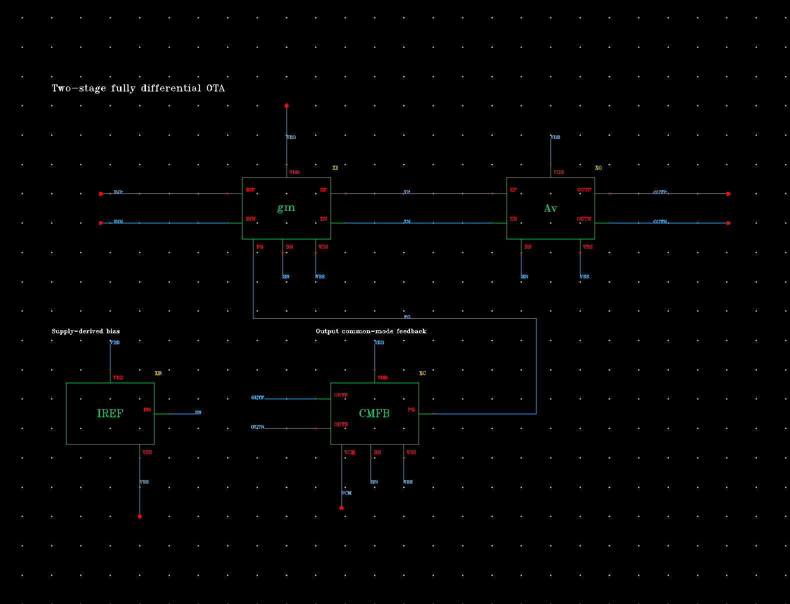
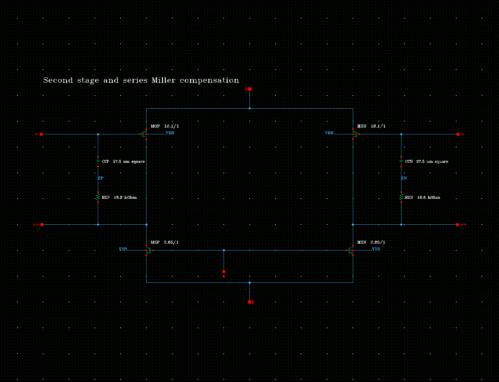
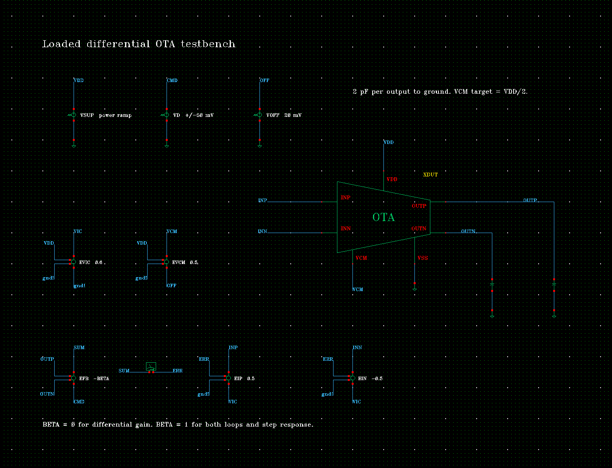
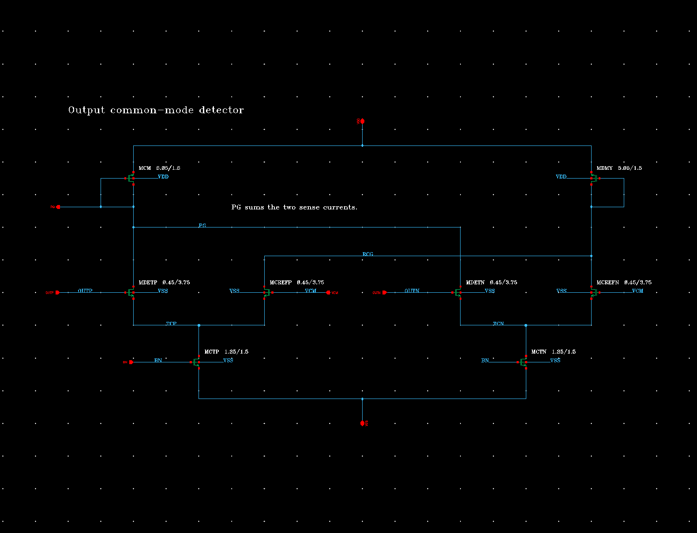
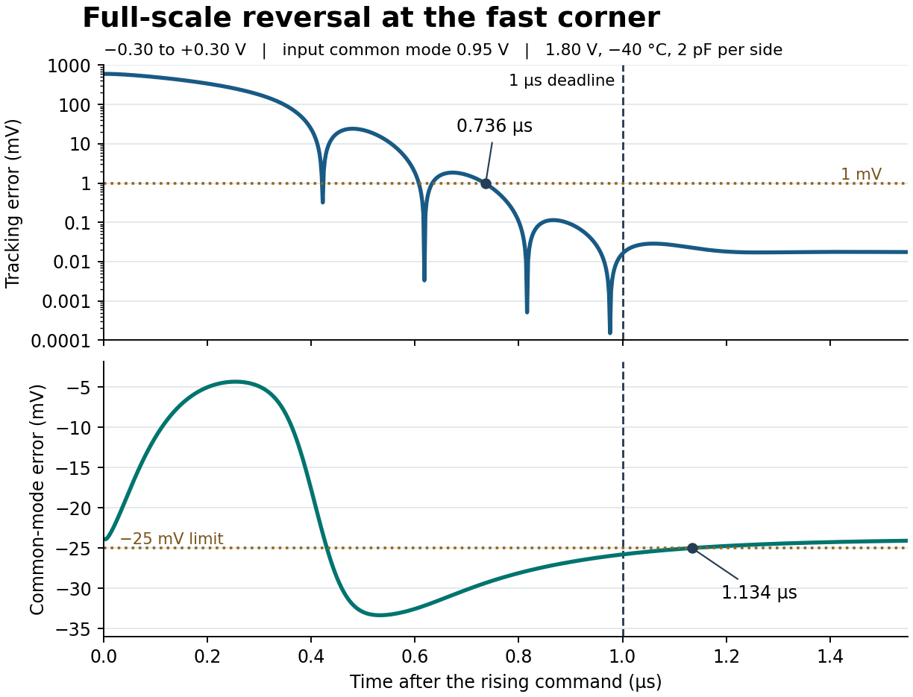
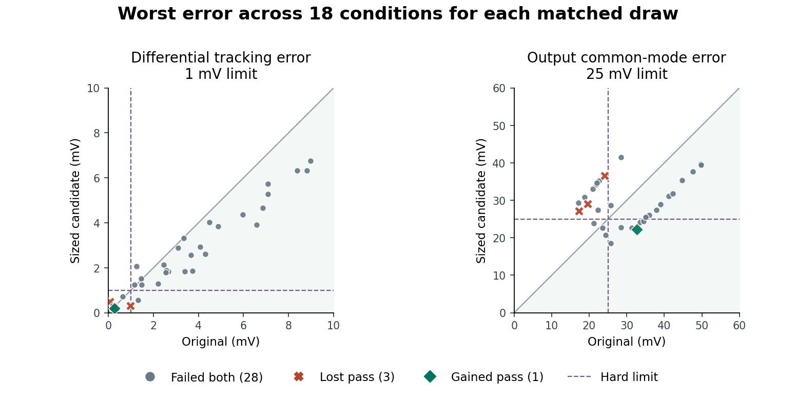

# 1.8 V、每侧 2 pF 的两级全差分运放

在有 Cadence 和 SMIC18 的环境中，可以直接把下面的需求交给 agent。

> 帮我在 SMIC18 设计一个 1.8 V 两级全差分运放，每个输出对地接 2 pF，低频差模增益要超过 80 dB。比较满足要求的方案，选总功耗小的，给我能打开的图、双环稳定性和阶跃波形，也说说哪个器件最占面积。

这组条件下，八个候选中有四个通过三组工况。按**三个工况中最高的静态总功耗**选出的方案采用 1.00 µm 管长，每侧补偿电容约 1.505 pF。最小带载增益为 81.97 dB，最高静态总功耗为 22.30 µW。



## 从空目录交付可编辑工程

在有 Virtuoso IC6.1.8、SI、Spectre 和已授权 SMIC18 工艺的 Linux 主机上填写站点配置，下面的命令从仓库根目录运行。实例使用该工艺的四端 `n18`、`p18`、高阻多晶硅电阻 `rhrpo` 和 `mim2`。三个工况分别加载同角的 MOS、电阻、MIM 模型段。此案例在 SMIC18 V1.11_3 上验证。[站点配置示例](../smic18-bias-mirror/cadence.example.json)

```sh
python3 examples/smic18-ota-sizing/ota.py run --config cadence.local.json --out work/fdota
python3 examples/smic18-ota-sizing/ota.py verify --config cadence.local.json --out work/fdota
sh work/fdota/open.sh
```

首次运行会生成四张器件图、重扫 8,688 个 MOS 工作点、搭建八套完整候选，并为选中方案保存和运行 Maestro。已有本机完整器件表时，给两条 Python 命令都加上 `--devices work/fdota-devices`。程序先从原始器件扫描复算，再按 TT 电流密度取尺寸，各管的几何尺寸在三个工况保持一致。[gm/ID 扫描和管长预算](README.md)

打开脚本会显示整机原理图、功能 symbol 和带载测试台。Library Manager 中的库名为 `FDOTA18_BENCH`。进入 `FDOTA18_OTA` 可以下钻四个子电路，其中 `FDOTA18_OUTPUT` 内有两条实体串联 RC 补偿支路。要重看保存的测试，在同库打开 `TB_FDOTA18_OTA / maestro`，选择测试和对应的历史。每个工况有增益、直流工作点、差模稳定性、共模稳定性、启动与阶跃五项测试。

## 尺寸怎样落到电路上

第一级是 NMOS 差分对和 PMOS 有源负载。第二级每侧由 PMOS 共源管驱动，NMOS 电流源下拉。偏置支路由电源通过电阻驱动二极管连接的 NMOS，上电时随电源自行建立。共模检测由两组实际差分对分别比较 OUTP、OUTN 与外部 VCM，合并检测电流后调节第一级 PMOS 负载的栅压。功耗从 VDD 总电流计算，包含偏置、两个检测支路和两个输出支路。外部共模基准由测试台提供。

所选设计的输入管 W/L 为 0.85/1 µm，第一级负载为 3.50/1 µm，输出 PMOS 为 10.10/1 µm，输出 NMOS 电流源为 2.65/1 µm。每侧约 18.55 kΩ 的调零电阻与一只 27.5 × 27.5 µm 的 MIM 电容串联。检查程序从已保存的图核对每只 MOS 的四端连接，再从 SI 网表核对有效 W、L、栅指数量、并联倍数及电阻串接关系。图中的 W/L 注释记录生成时的尺寸，手工改图后须重新核对器件属性和网表。



## 哪些指标决定通过

本例把输入共模定为 0.6 VDD，输出共模目标定为 0.5 VDD。每侧接一只 2 pF 对地电容。除严格大于 80 dB 的低频增益外，示例工程判据为差模、共模相位裕度各至少 55°，静态输出共模偏差不超过 25 mV，18 只 MOS 在该工作点均有饱和余量。电源从零开始，用 1 µs 升至额定值。单位增益下测双向 100 mV 差分阶跃，两次都须在 1 µs 内进入并保持在目标 ±1 mV 内。共模参考再上跳 20 mV，增量须在 1 µs 内进入并保持在目标 ±2 mV 内。

| MOS / R / MIM 同角 | 电源、温度 | 1 Hz 差模增益 | 差模 / 共模相位裕度 | 静态总功耗 | 差分上升 / 下降建立 | 共模步进建立 |
| --- | --- | ---: | ---: | ---: | ---: | ---: |
| TT | 1.80 V，27 °C | 82.10 dB | 65.53° / 72.43° | 22.05 µW | 0.422 / 0.423 µs | 0.300 µs |
| SS | 1.62 V，85 °C | 81.97 dB | 67.24° / 74.60° | 16.42 µW | 0.558 / 0.557 µs | 0.458 µs |
| FF | 1.80 V，−40 °C | 82.03 dB | 61.12° / 68.16° | 22.30 µW | 0.346 / 0.345 µs | 0.216 µs |

三工况差模单位增益频率约 1.14–2.12 MHz，静态输出共模偏差最大 16.66 mV。测开环增益时保持内部共模反馈闭合，从 1 Hz 起扫频，以实际两输入之差归一化输出。测稳定性时两个反馈环均闭合，分别通过外部差模探针和共模反馈支路中的零伏探针做 Spectre STB。短接共模探针后的分层连接已与普通整机的独立 SI 网表核对。测量程序从复数波形寻找单位增益交越，与 Spectre 打印的相位裕度交叉复算。

将所选设计的补偿板缩到 16 × 16 µm，每侧约 0.509 pF，同一 TT 工况仍有 82.10 dB 增益，但差模相位裕度降到 42.94°，100 mV 上升阶跃的过冲从 3.91 mV 增至 25.06 mV。这一版保存在结果里，可在同一负载下直接比较。将管长改为 1.50 µm 并保留大补偿和低电流，最低增益升到 84.71 dB，最高功耗也升到 24.02 µW。


## 面积主要花在哪里

| 片内器件 | 按原生器件尺寸累计 | 解释 |
| --- | ---: | --- |
| 18 只 MOS | 栅面积 49.05 µm² | 每只按有效 W × L 计 |
| 两只 MIM | 极板面积 1,512.50 µm² | 两侧各 756.25 µm²，决定补偿和相位裕度 |
| 三只电阻 | 电阻条面积 4,193.70 µm² | 单是 1.067 MΩ 偏置电阻就占 4,052.64 µm²，由 24 段 84.43 × 2 µm 电阻条串联 |

若芯片面积吃紧，优先检查偏置电阻的宽度选择、可用的高阻器件和外部偏置条件，修改后重测启动和工艺角。表中数值按器件本体几何量计，测试台上的两只负载电容另计。实际占地还包含隔离、接触孔、间距和连线。

## 怎样复核交付物

`summary.json` 中的 `selected` 指向选中目录，`candidates` 保留全部八组，包括不达标组的波形和逐项判据。每个候选内 `oa` 保存可编辑原理图、端子回读和原生 SI 网表，`tt`、`ss`、`ff` 保存五项分析的输入与原始 PSF。选中工程还有可重新打开的 Maestro、已计算的差模增益、功耗、环路增益和阶跃输出，以及独立的仿真历史。退出码 0 表示有满足全部判据的候选且交付复核通过，1 表示所有候选至少有一项超限，2 表示输入、原生运行或证据异常。



## 输入噪声会怎样改变选型

如果传感器允许 OTA 在 10 Hz 到 100 kHz 内贡献 40 µV RMS 的输入等效噪声，原先的低功耗选型会超限。将管长从 1.00 µm 改为 1.50 µm，再按实测电流密度重新取宽度，三工况最差噪声从 54.95 降到 39.85 µV RMS。总 MOS 栅面积从 49.05 增至 108.75 µm²，最高功耗从 22.30 增至 24.02 µW。两版最差噪声都在 SS、85 °C、1.62 V；该工况的功耗分别为 16.42 和 17.02 µW。表内噪声上限是可替换的示例设计预算。[八种几何的逐角测量和器件面积](noise-review.json)

| 输入等效噪声上限，10 Hz 至 100 kHz | 同时满足已有硬指标和噪声预算 | 在达标者中选择 |
|---|---:|---|
| 60 µV RMS | 4 / 8 | 1.00 µm 管长，低电流，大补偿，最差 54.95 µV RMS |
| 40 µV RMS | 2 / 8 | 1.50 µm 管长，低电流，大补偿，最差 39.85 µV RMS |
| 30 µV RMS | 0 / 8 | 搜索范围内没有可交付候选 |

每组尺寸在 TT、SS、FF 运行一次原生 Spectre noise。差模反馈打开、CMFB 闭合，实际输入共模为 0.6 VDD，每侧负载 2 pF。噪声输出为 OUTP 减 OUTN，输入参考为测试台的 VD。每条频谱从 1 Hz 到 1 GHz 共 541 点。程序逐点将输出电压噪声除以独立 AC 分析得到的差分增益，与 Spectre 输入等效噪声核对，并将全部器件噪声功率加总核对输出。用另一套计算从输出频谱和 AC 增益复算 24 个积分结果，最大相对差为 1.53 × 10⁻⁷。

原低功耗方案在最差角的输入差分对占带内总噪声功率的 83.22%。这支持把下一次尺寸实验放在输入级。本轮两种管长改变了多个器件，只能把整机的下降量归于整组尺寸变化。单独改变输入对、保持其它器件固定，才能量出输入对几何的独立收益。

从仓库根目录在已完成的原生工程上运行。首次运行写入新目录，`verify` 从原生证据复算；`evaluate` 可更换频带和预算。命令返回 0 表示存在满足全部硬指标的候选，1 表示本次搜索全超限，2 表示证据或执行异常。

```sh
python3 examples/smic18-ota-sizing/ota_noise.py run --config cadence.local.json --ota work/fdota --out work/fdota-noise
python3 examples/smic18-ota-sizing/ota_noise.py verify --config cadence.local.json --ota work/fdota --out work/fdota-noise
python3 examples/smic18-ota-sizing/ota_noise.py evaluate --config cadence.local.json --ota work/fdota --out work/fdota-noise --band-hz 10 100000 --limit-uv 40
python3 skills/paper-to-virtuoso/scripts/check_prelayout.py check --plan work/fdota-noise/portable/plan.json
```

最后一条可在只有 Python 的机器上运行，输入为整个 `portable` 目录。该计划核验全部候选的噪声，有超限项即返回 1。完整的选型见 `summary.json`。保存的 Maestro 覆盖原有五类分析，新增噪声使用同一原生 SI 网表直接运行 Spectre。

## 从输入共模和输出摆幅检查接口

选用 40 µV RMS 方案 `l150-i06-c275` 后，再要求输入共模覆盖 0.95–1.10 V、差分输出覆盖 ±0.30 V。三个工况均覆盖输入要求，快角的差分输出范围超限。把输出要求收窄到 ±0.20 V，三组工况均通过本次静态检查。[各边界、相邻失败点和判据](range-review.json)

| 工况 | 输入共模连续通过的采样区间 | 差分输出指令连续通过的采样区间 | 间隔 |
|---|---:|---:|---:|
| TT，27 °C，1.80 V | 0.630–1.800 V | −0.360 至 +0.360 V | 22.50 mV |
| SS，85 °C，1.62 V | 0.66825–1.620 V | −0.78975 至 +0.78975 V | 20.25 mV |
| FF，−40 °C，1.80 V | 0.6075–1.800 V | −0.225 至 +0.225 V | 22.50 mV |

输入共模下限首先受尾电流源 `XDUT.XI.MTAIL` 的饱和余量限制。快角输出指令为 +0.2475 V 时，差分跟踪误差仅 0.0144 mV，输出平均电平却比目标低 28.54 mV，超过允许的 25 mV。下节用同一输出负载和控制环路定位这项误差。

输入共模扫描时差模开环、CMFB 闭合，使用 ±100 nV、±50 nV 的两种差分微扰估计增益。两种斜率须在 1% 内一致，标称点另核对原生 1 Hz AC 增益。输出摆幅扫描时输入共模固定在 0.6 VDD，差模单位负反馈和 CMFB 同时闭合。测量要求所有 MOS 的饱和余量非负、输出留在电源轨内、输出共模误差不超过 25 mV。差分跟踪误差上限为 1 mV，正反向扫点的同一输出偏差上限为 0.5 mV。共计 24 条原生 DC 扫描、2,424 个工作点。对导出的 726 组输入或输出条件另行重算，得到相同边界。

从仓库根目录在已有站点配置和原生 OTA 工程上运行。首次运行写入新目录，各角保存原始 PSF 和逐点 `*-points.csv`。名义要求在快角失败会返回 1。最后一条只读回放较小摆幅，返回 0。证据错误返回 2。

```sh
python3 examples/smic18-ota-sizing/ota_range.py run --config cadence.local.json --ota work/fdota --out work/fdota-range --candidate l150-i06-c275
python3 examples/smic18-ota-sizing/ota_range.py verify --config cadence.local.json --ota work/fdota --out work/fdota-range
python3 examples/smic18-ota-sizing/ota_range.py evaluate --config cadence.local.json --ota work/fdota --out work/fdota-range --vdiff-v -0.20 0.20
```

以上是两条分别扫描的静态范围。输出差分范围指 OUTP − OUTN，实际边界落在最后通过点与相邻失败点之间。输入上限量到电源轨。两轴同时贴近边界时的工作区、大信号动态失真、此 OTA 的器件失配和产品完整 PVT 仍需单独验收。

## 定位共模误差并修正检测管尺寸

在快角、输出差分指令为 +0.30 V 时，原电路的两只检测管电流分别为 1.179 µA 和 0.014 µA，输出共模比目标低 44.90 mV。仅在诊断台将两只检测管的栅极驱动改为实际输出的算术平均值，保留误差放大器、偏置、执行管和两侧负载，共模误差降到 7.54 mV。零指令时两台架的输出、控制电压及八只共模支路器件的电流一致到规定容差。这组对照将大部分误差定位到检测器处理差分摆幅时的响应。

因此只改两对检测与参考 NMOS 的宽度、长度，保持匹配关系。对于每组几何，在三个工况分别按照原参考支路的实际 VDS、VBS 扫描 181 个 VGS 点，读取目标支路电流附近的 gm/ID。原信号通路、偏置、尾管和全部无源器件沿用原尺寸。宽度从 1.30 降至 0.45 µm、长度仍为 1.50 µm 时，快角端点共模误差仍达 32.76 mV。长度增加到 4.50 µm 后，慢角在端点的尾管饱和余量变为 −9.47 mV。

宽长为 0.45/3.00 µm 时，单独检查输入范围和输出范围均通过。快角的粗扫只量到 0.2925 V，下个点是 0.315 V。因此在 ±0.30 V 内用 7.5 mV 步长正反向各测 81 点，同时保留原粗扫在区间内的每个点。再将 3 个输入共模、3 个差分指令和 3 个工况交叉，27 个预留点通过 25 个。失败的两点都是快角、输入共模 0.95 V、指令 ±0.30 V，输出共模误差为 −25.61 mV。用这组结果和 4.50 µm 的慢角失败选定一个中间管长 3.75 µm，并在测试前冻结余下的联合工况。[逐尺寸、逐工况的测量汇总](cmfb-review.json)

**0.45/3.75 µm 这一组通过了 693/693 个联合工况。** 输入共模从 0.95 到 1.10 V 每 15 mV 取一点，差分指令从 −0.30 到 +0.30 V 每 30 mV 取一点，每组均正反向实测。693 个不同条件中，27 个用于复查首轮，另外 666 个在选定管长后首次检验。尺寸固定时从 10 Hz 到 100 kHz 的最差输入噪声为 39.855 µV RMS，总 MOS 栅面积从 108.75 降到 107.70 µm²。MIM 极板合计 1,512.50 µm²，电阻条合计 4,227.82 µm²，仍是本例主要面积开销。

| 工况 | 低频差模增益 | 差模 / 共模相位裕度 | 静态功耗 | 联合网格最大共模绝对误差 | 联合网格最小 MOS 饱和余量 |
|---|---:|---:|---:|---:|---:|
| TT，27 °C，1.80 V | 84.81 dB | 64.31° / 79.33° | 23.15 µW | 8.02 mV | 97.87 mV |
| SS，85 °C，1.62 V | 84.82 dB | 65.98° / 80.71° | 16.99 µW | 7.75 mV | 5.31 mV |
| FF，−40 °C，1.80 V | 84.71 dB | 60.47° / 76.37° | 23.99 µW | 23.87 mV | 139.49 mV |

快角共模误差到 25 mV 上限仅余 1.13 mV。慢角在输入共模 0.95 V、差分指令 +0.30 V 时，检测对尾管 `MCTN` 的饱和余量只有 5.31 mV。表中增益、稳定性、功耗和带内噪声在规定的标称输入工作点测量，网格列为静态联合工况的最差读数。两侧负载均为 2 pF。另一套计算逐点回读了 2,934 个 DC 点，并由输出频谱和差模增益重算 6 个噪声积分，最大相对差为 1.26 × 10⁻⁷。[完整数值与复验范围](cmfb-review.json)



从仓库根目录运行，使用已完成的 `ota.py` 原生工程和一个新输出目录。第一条完成两轮建图与前仿，第二条从已保存的 OA、SI 网表、Spectre 原始数据和 Maestro history 复算。返回 0 表示联合工况及配套电气预算通过，1 表示电路未达到要求，2 表示运行或证据异常。第三条在已配置 Cadence 的图形会话里打开通过联合验收的电路、symbol 和测试台。

```sh
python3 examples/smic18-ota-sizing/ota_cmfb.py run --config cadence.local.json --ota work/fdota --out work/fdota-cmfb
python3 examples/smic18-ota-sizing/ota_cmfb.py verify --config cadence.local.json --ota work/fdota --out work/fdota-cmfb
work/fdota-cmfb/open.sh
```

只回看首次选型可在 `verify` 后加 `--first-search-only`。该组数据返回 1，保留首次 25/27 的失败结论。可编辑 Maestro 为三种工况各保留增益、工作点、差模与共模稳定性、上电与阶跃五项。噪声、静态范围和联合网格用相同原生网表直接运行 Spectre。

## 满摆幅建立与局部失配

**以 1 µs 满摆幅建立和下列局部失配要求验收，这组尺寸未通过，仍应留在前仿阶段。** 上一节的 693 个静态工况全部通过。本节沿用相同的 OTA、偏置、补偿和每侧 2 pF 负载，检查输出翻转时能否及时稳定，以及同一组器件失配能否覆盖全部接口条件。

满摆幅测试台把差分指令从 −0.30 V 翻到 +0.30 V，再翻回 −0.30 V，边沿为 5 ns。每个方向从指令边沿起计时，要求输出差分跟踪误差进入 ±1 mV，输出平均值进入半电源的 ±25 mV，且直到下个边沿前都留在窗内。电源在 1 µs 内爬升，六组工况都通过了翻转前的启动检查。

| 工况 | 输入共模 0.95 V，上升 / 下降 | 输入共模 1.10 V，上升 / 下降 |
|---|---:|---:|
| TT，27 °C，1.80 V | 0.730 / 0.729 µs | 0.726 / 0.725 µs |
| SS，85 °C，1.62 V | 0.986 / 0.985 µs | 0.980 / 0.981 µs |
| FF，−40 °C，1.80 V | **1.134 / 1.135 µs** | 0.892 / 0.893 µs |

快角、输入共模 0.95 V 时，两次翻转的差分误差分别在 0.736 和 0.735 µs 稳定，共模恢复较慢。相反方向的两次波形都出现了约 33.35 mV 的共模偏移。下图取上升沿，图中竖虚线为采样期限。



**失配以一个样本在全部 18 个条件下同时达标为通过。** 检查三个工况、两种输入共模以及 −0.30、0、+0.30 V 三种输出指令。18 只 MOS 使用 PDK 的统计器件，几何、端子顺序、无源器件和外部激励均经原生网表回读。先对照普通器件和统计器件的无扰动工作点，再核对每只 MOS 对应的局部向量、跨工况的样本配对及电路输出随抽样的变化。

| 随机种子 | 全部硬指标 | 差分跟踪通过 | 输出共模通过 | 全部 MOS 饱和余量通过 | 输出在轨内且供电功耗为正 |
|---|---:|---:|---:|---:|---:|
| 64211 | **1/32** | 11/32 | 11/32 | 23/32 | 32/32 |
| 97337 | **0/32** | 6/32 | 8/32 | 26/32 | 32/32 |

第一批中只开启输入差分对的失配，TT 的差分跟踪仍只有 8/32 通过。只开启共模反馈级的八只 MOS，FF 的输出共模通过 10/32，SS 的饱和余量通过 22/32。这三组对照均取输入共模 0.95 V，关闭全部 MOS 局部失配时三个工况各通过 32/32。全器件启用时，最坏跟踪误差为 11.32 mV，最坏共模误差为 +52.69 mV，最小饱和余量为慢角 `MCTP` 的 −10.29 mV。抽样范围限于这些角段与 MOS 局部扰动。端点失配、满幅建立和产品良率各有自己的验证条件。[逐批计数、分组对照与最差样本坐标](robust-review.json)

要重现这组结果，在已有 `ota_cmfb.py` 结果旁指定一个新目录运行。两条命令都打印每个建立时间、两个样本分母和各器件组的通过数。退出码 1 对应这次实际测得的电路超限，2 表示需要检查运行环境或证据。

```sh
python3 examples/smic18-ota-sizing/ota_robust.py run --config cadence.local.json --ota work/fdota --cmfb work/fdota-cmfb --out work/fdota-robust
python3 examples/smic18-ota-sizing/ota_robust.py verify --config cadence.local.json --ota work/fdota --cmfb work/fdota-cmfb --out work/fdota-robust
```

在配置好 Cadence 的图形环境进入 `work/fdota-robust/fullscale-oa`，运行 `virtuoso -restore open.il` 查看原理图、symbol 和标有 ±300 mV 的测试台。通过 Library Manager 打开 `FDOTA18_BENCH / TB_FDOTA18_OTA / maestro`，选择 `FF_FULL_950` 的 `DIFF_V` 和 `CM_V` 查看快角失败。六个可编辑瞬态测试各有自己的输入共模设置。失配工程位于同级 `oa`，样本原始数据按 `mismatch/<工况>-<输入共模毫伏>-<种子>-<分组>/psf/` 保存。例如慢角最差共模样本是 `ss-1100-97337-all/psf/mc-004_cm_sweep.dc`，使用 −0.30 V 的扫点。

## 匹配面积与共模偏置的取舍

**放大输入对、略微加宽共模反馈负载后，满摆幅建立和带内噪声都改善了。整机失配仍然超限。** 在选尺寸时未使用的 32 个样本里，原图有 3 个通过全部要求，改型有 1 个。这组尺寸保留为诊断工程，当前前仿结论为 **FAIL**。[分项结果与改变判定的样本](matching-review.json)

先把两个输入 NMOS 各自的 W/L 从 1.30/1.50 改为 1.95/2.25 µm，保持宽长比和外围电路，只给这两只管开启失配。零差分指令、TT、输入共模 0.95 V 下，32 个配对样本的有符号差分误差标准差从 3.823 降至 2.547 mV。两管总栅面积从 3.900 增至 8.775 µm²，标准差之比 0.666，与局部随机失配按面积平方根的倒数变化相符。三个工况、三个指令下，这 32 个样本各自的最坏跟踪误差均下降。开启全部 18 只 MOS 失配后，单靠这项改动，开发集中通过全部条件的样本仅由 1 增至 3 个。

保持放大的输入对，每次只改变共模反馈级的一对管。下表中的宽度均指单管，尾管和二极管连接 PMOS 负载的沟道长均为 1.50 µm。静态检查用 18 个工况，动态检查在每侧 2 pF 的负载上对六种工况各测一次上升沿和一次下降沿。

| 共模反馈级几何 | 静态通过 | 满摆幅工况通过 | 最大静态共模误差 | 最小饱和余量 |
|---|---:|---:|---:|---:|
| 尾管 1.35 µm，负载 5.05 µm | 18/18 | 5/6 | 23.86 mV | 5.33 mV |
| 尾管减至 1.25 µm | 14/18 | 4/6 | 30.27 mV | 17.43 mV |
| 尾管增至 1.45 µm | 8/18 | 2/6 | 37.86 mV | −4.98 mV |
| 负载减至 4.85 µm | 14/18 | 4/6 | 34.04 mV | 2.72 mV |
| **负载增至 5.25 µm** | **18/18** | **6/6** | **19.67 mV** | **8.13 mV** |

按预先规定的顺序，冻结首个同时满足两项检查的几何。它在完整的 693 个联合静态条件中正反扫均通过，最大静态共模误差 19.67 mV。快角、低输入共模下满摆幅的上升/下降联合建立时间由原图的 1.134/1.135 µs 降至 0.738/0.737 µs。最慢一条为慢角低共模下降沿 0.987 µs，距离 1 µs 限值余 13 ns。三角的最差带内输入噪声从 39.85 降至 32.34 µV RMS，最高功耗为 23.995 µW，最低差模和共模相位裕度分别为 60.36° 和 76.87°。

整机 MOS 栅面积从 107.700 增至 113.175 µm²，距 114.19 µm² 预算还余 1.015 µm²。MIM 极板合计 1,512.50 µm²，电阻条合计 4,227.82 µm²。新旧尺寸都按实际工作点补扫了输入管和共模负载的特性。TT 输入管 gm/ID 由 15.23 变为 15.16 V⁻¹，靠近实际偏置电流的栅电容从 10.06 增至 21.82 fF。放大输入对也增加了前级所见电容。[器件扫点和各角数据](matching-review.json)

| 同一批样本，原图 → 冻结改型 | 差分 ≤1 mV | 共模 ≤25 mV | 所有管饱和余量 ≥0 | 五项联合通过 | 保住 / 新增 / 丢失 / 均失败 |
|---|---:|---:|---:|---:|---:|
| 开发，种子 64211，32 个 | 11 → 12 | 11 → 8 | 23 → 27 | 1 → 2 | 0 / 2 / 1 / 29 |
| 独立验证，种子 152219，32 个 | 5 → 6 | 13 → 9 | 23 → 27 | **3 → 1** | **0 / 1 / 3 / 28** |

独立样本中有 27 个的最坏差分误差变小，整批最坏值从 8.96 降到 6.75 mV。原本通过的第 6、13、31 号样本在改型后仍满足差分要求，但最坏共模误差分别达到 36.64、27.20、29.12 mV。新增通过的第 20 号样本则从 32.64 降到 22.21 mV。两版在这批样本中的输出轨限和供电方向均通过。图中每点代表同一个样本，横轴为原图，纵轴为改型，对角线下方表示该项误差变小。



单独分析 1 mV 的跟踪要求时，从每个样本的各端点误差中扣除该样本在 TT、输入共模 0.95 V、零指令下的有符号误差。独立组改型的参考误差为 −6.13 到 +6.55 mV，扣除后最大剩余误差为 0.386 mV。这给出了该批样本需要的修调范围，以及理想扣除后的误差规模。下一版需把修调支路实际画进电路，核算总面积、注入噪声、功耗和建立时间，同时单独处理输出共模超限。下次选型须另留未使用的样本。

从仓库根目录运行。输入采用前面三步生成的工程目录，`--out` 使用新目录。程序在测量前登记独立种子，在读取独立样本前冻结几何，再检查真实随机向量在新旧电路及各工况间的对应关系。默认种子用于重现本例。做新的设计验证时，在 `run` 或 `screen` 中通过 `--validation-seed` 指定另行预留的种子，`qualify` 和 `verify` 会沿用该次输入。`run` 和 `verify` 的退出码 0 表示全部要求通过，1 表示电路有实测超限，2 表示运行条件或证据有误。

```sh
python3 examples/smic18-ota-sizing/ota_matching.py run --config cadence.local.json --ota work/fdota --cmfb work/fdota-cmfb --robust work/fdota-robust --out work/fdota-matching
python3 examples/smic18-ota-sizing/ota_matching.py verify --config cadence.local.json --ota work/fdota --cmfb work/fdota-cmfb --robust work/fdota-robust --out work/fdota-matching
```

在 `work/fdota-matching/qualification/fullscale-oa` 运行 `virtuoso -restore open.il`。打开 `FDOTA18_BENCH / TB_FDOTA18_OTA / maestro` 中的 `FF_FULL_950` 对照 `DIFF_V` 与 `CM_V`。打开 `FDOTA18_INPUT` 和 `FDOTA18_CMFB` 的 schematic 可读回两对管的尺寸。要定位第 6 个独立样本，在 `qualification/candidate-152219` 下各工况的 `psf/mc-006_cm_sweep.dc` 中检查差分输出和两路输出平均值。在相同输入共模与工况下，可从 `qualification` 中同名工况目录调出原图的结果。

## 真实 PDK 器件的四位失调修调

在差分对两侧串入带 MOS 旁路的电阻，再给同一个样本在室温校准一次，可以测出修调范围、误差和成本。三个实体方案分别比较了码间空隙、满摆幅建立和输出平均值。最后一组的差分跟踪有 26/32 个开发样本达标，所有静态要求同时满足的有 6/32 个。[原理图、测量曲线、失败点和复跑命令](TRIM.md)
