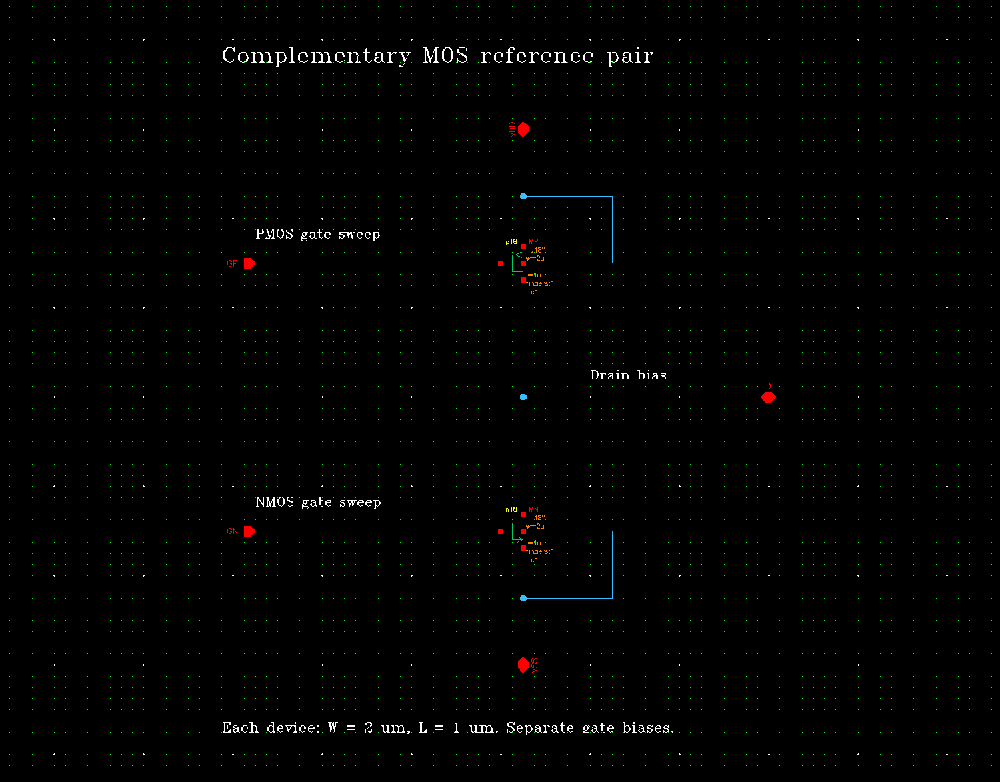

# 180 nm 两级全差分运放先选多长的管

设计目标是 1.8 V 供电、差分低频增益大于 80 dB、每侧驱动 2 pF，并尽量省电。第一步在 SMIC18 实测互补 MOS 的电流密度、跨导和输出电导，比较四档沟道长度。此处可单独运行四张可编辑的 Virtuoso 器件图与六次 Spectre 扫描。完整运放使用这些起始尺寸，测量带载增益、差模和共模环路、阶跃及总功耗。[直接生成完整运放和 Maestro 测试台](OTA.md)



## 为什么要在级间电压下查表

以 NMOS 差分输入、PMOS 有源负载和 PMOS 共源第二级为起点。暂取输入对源端电位为 VDD/4，输出共模为 VDD/2，目标 gm/ID 为 15 V⁻¹。这些是用来比较管长的偏置假设。实际输入共模、摆幅和建立指标会决定最终偏置。

1. 先扫第二级 PMOS 和 NMOS 负载。在 VDD/2 的输出电位下查到 PMOS 所需的 |VGS|，反算第一级输出须达到的栅压。
2. 用这个级间电位重扫第一级的管。对 NMOS 输入管同时施加源端抬高产生的体偏置，保留有源负载的输出电导。
3. 在一条支路中，估算增益为 `(gm/ID)信号管 ÷ [(gds/ID)信号管 + (gds/ID)负载管]`。这一步假设两管通过相同的直流电流。对两个对称半电路构成的差分通路，将两级的增益换成 dB 后相加。各工况分别查到接近目标 gm/ID 的工作点。

## 哪些尺寸值得进入整机

SMIC18 V1.11_3、Virtuoso IC6.1.8、Spectre 15.1。每种工况有 16 条器件曲线、每条 181 个偏置点，三组共 8,688 个工作点。下表是从这些工作点估算的低频增益。表征管宽统一为 2 µm，每管单指、单倍。

| 四类管共用的 L | TT，27 °C，1.80 V | SS，85 °C，1.62 V | FF，−40 °C，1.80 V |
|---|---:|---:|---:|
| 0.36 µm | 71.47 dB | 71.42 dB | 70.64 dB |
| 0.60 µm | 77.73 dB | 77.94 dB | 77.45 dB |
| 1.00 µm | 82.07 dB | 82.16 dB | 81.50 dB |
| 1.50 µm | 84.81 dB | 84.87 dB | 84.35 dB |

1.00 µm 是这四档中首个在三组偏置预算里均超过 80 dB 的管长，最小余量只有 1.50 dB。TT 下，第一级和第二级分别贡献 40.61 和 41.47 dB，级间电位为 1.28 V。后续把 1.00 µm 和 1.50 µm 两组接入同一完整电路测量，在低电流、大补偿这一组，最低实测增益分别为 81.97 和 84.71 dB。[整机与面积取舍](OTA.md)

面积也有明确代价。举例取输出 PMOS 支路 5 µA，TT 实测 ID/W 从 L = 1.00 µm 时的 0.357 µA/µm 降到 L = 1.50 µm 时的 0.244 µA/µm。按这两行起算，单管 W 约从 14.0 增到 20.5 µm，单管栅面积从约 14.0 增到 30.8 µm²。5 µA 是取尺寸的算例。最终电流须结合 2 pF 接法、所需的输出步幅和建立时间确定。

## 用自己的 Cadence 环境重建和复算

需要可使用的 SMIC18 `n18`、`p18`、`basic` 库和对应 Spectre 模型，以及 Python 3、Virtuoso IC6.1.8 和 SI。复制并填写站点配置中的 `cds_lib`、`model_file`、`pdk_revision` 和工具路径，从仓库根目录执行。生成器只在新输出目录中创建库与运行结果。[站点配置示例](../smic18-bias-mirror/cadence.example.json)

```sh
python3 examples/smic18-ota-sizing/characterize.py run --config cadence.local.json --out work/fdota-devices
python3 examples/smic18-ota-sizing/characterize.py verify --config cadence.local.json --out work/fdota-devices
```

打开 `work/fdota-devices/summary.json` 可以找到每一条被选中的工作点、端电压、电流密度、两级分别的增益和工艺标识。对应的电路输入和原始 PSF 保存在 `tt/input`、`tt/output` 以及其他工况的同名目录。复算会重建扫描条件，回读 OA 导出的连接、SI 网表和模型指纹，并从原始 PSF 重选工作点。返回 0 表示这份器件表与增益预算复核成功，输入或证据错误返回 2。

从 `work/fdota-devices/oa` 启动独立的 Virtuoso，打开 `FDOTA18_DEVICE_TB / TB_FDOTA18_PAIR_L100 / schematic` 就是上图。尾缀 L036、L060、L150 分别对应另三档管长。图中每只器件的四端连线和 CDF 尺寸都经过原生回读。第二次扫描使用的体偏置和漏偏置可在各自的 `input.scs` 中查看。
