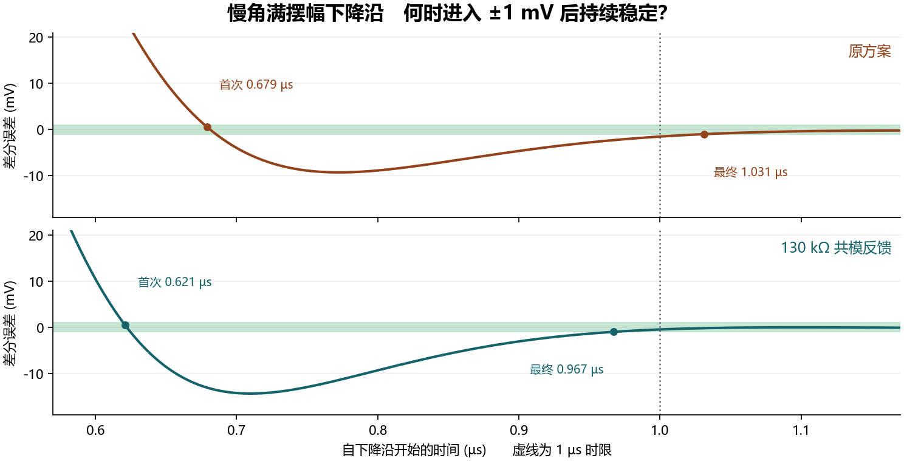

# 满幅下降沿究竟多久稳定

同一只两级全差分 OTA，在慢角下降沿开始后 0.679 µs 已经碰到目标的 ±1 mV 误差带，随后又偏离了 9.258 mV。直到 1.031 µs 才一直保持在带内，错过 1 µs 时限。改型把最终建立时间缩到 0.967 µs，但首次进带后的最大偏差增至 14.349 mV。若下一级在第一次穿过目标时采样，两版都会误判。[公开输出采样](recovery-waves.csv)



在仓库根目录运行下面一条命令即可重复计算。输入是同一慢角、1.10 V 输入共模、2 pF 单侧负载下两版电路的差分输出。文件保留下降沿前 1 ns 至观察窗末尾的 1,999 个连续采样点，间隔 2 ns。程序核对时间列，也会报告直到窗口末尾仍未稳定的情况。

```sh
python examples/smic18-ota-sizing/replay_recovery.py
```

## 补偿电容与共模反馈各解决什么

打开 `FDOTA18_OUTPUT / schematic`。两条输出支路各有一只串联调零电阻的 Miller 电容 CCP、CCN。把两片 MIM 的边长从 27.5 µm 减为 26.5 µm，CDF 回读的单只电容从 1.50494 pF 降到 1.39748 pF。保留原共模连接时，这一项改动已让 12 个满摆幅边沿通过。

再看 `FDOTA18_CMFB / schematic`。原方案用两只独立的二极管接法 PMOS 汇集检测电流。改型让 MCM 的栅跟随参考侧 MDMY 的栅漏节点 RCG，在 RCG 与驱动输入负载的 PG 节点之间接一只高阻多晶硅电阻 RREC。原图中两只 PMOS 的共栅线水平贯通，RREC 垂直连接两个节点。独立测试库已核对保存后的端子、实际 PDK 器件、CDF、普通核心与测试台的原生网表，并从 Virtuoso 打开原理图、顶层 symbol 和父级测试台目视检查。[原理图生成](ota_views.py) · [尺寸与网表回读](ota_native.py)

每侧负载 2 pF，差分指令在 −0.30 V 与 +0.30 V 间翻转。前仿使用 TT 1.80 V / 27 °C、SS 1.62 V / 85 °C、FF 1.80 V / −40 °C。每个角分别测 0.95 V 和 1.10 V 输入共模的两个边沿。差模、共模相位裕量的门槛均为 55°，本表的裕量在各角标准偏置测得。

| 原生电路 | 12 个边沿中达标数 | 最慢建立 | 最低差模裕量 | 最低共模裕量 |
|---|---:|---:|---:|---:|
| 原方案，27.5 µm 方形极板 | 10 | 1.031 µs | 62.60° | 76.63° |
| 只把极板改为 26.5 µm | 12 | 0.969 µs | 60.97° | 75.60° |
| 26.5 µm，增加 130 kΩ 共模反馈 | 12 | 0.967 µs | 60.98° | 57.96° |
| 26.5 µm，150 kΩ | 12 | 0.967 µs | 60.98° | **53.76°** |
| 26.5 µm，220 kΩ | 12 | 0.963 µs | 60.98° | **40.58°** |
| 26.5 µm，390 kΩ | 12 | 0.951 µs | 60.98° | **15.74°** |

130 kΩ 采用三段 41.05 × 1 µm 的电阻条，增加 123.15 µm²，总电阻条面积为 4,411.43 µm²。两片 MIM 极板合计从 1,512.50 降到 1,404.50 µm²。34 只 MOS 的总栅面积为 113.322 µm²，预算为 114.19 µm²。上述量分别估算电阻条、极板和栅的规模，完整占地还与器件外围、间距和布线有关。

## 其他指标和逐样本结果

130 kΩ 原图在三个角、11 个输入共模电压及 21 个差分指令组合上，正反向各扫一遍，693 个独立工况全部通过。36 个保持实际闭环偏置的增益测点中，最低为 84.24 dB，AC 与直流微扰斜率最大相差 0.001 dB 以内。标准偏置下最差输入噪声为 36.31 µV RMS（10 Hz 至 100 kHz），最大核心功耗为 24.00 µW，预算分别为 40 µV 和 25.22 µW。[各角与分组实测值](recovery-review.json)

两套可编辑原图都用各自的 32 组开发抽样，在 TT、0.95 V 输入共模且差分指令为零时，从 16 个实际码中选一个，再固定到全部 18 项静态工况。原方案的差分跟踪、共模、饱和余量、功耗四项分别有 26、9、26、28 个样本通过，联合通过 6 个。130 kΩ 方案分别有 26、30、18、28 个通过，联合通过 9 个。两边使用了同一个开发种子。新增工艺电阻改变了统计清单，两组完整指纹没有重合。因果比较使用下面单独的配对夹具。

在 130 kΩ 原图中，所有出现负饱和余量的模拟管均为共模检测的尾管。MCTP 影响 9 个样本，最差 −8.49 mV。MCTN 影响 11 个，最差 −6.72 mV，两组有重合。分组试验对同一批样本只开启某一组局部失配，然后测量负、零、正三个差分指令下的输出共模。以两端共模误差之差的一半表示奇对称分量时，它与两尾管的零指令归一化电流差在 SS 和 FF 的全失配试验中均呈负相关，相关系数约 −0.998。各组偏差会相互作用。[分组实测与电流回读](ota_recovery_diagnose.py)

### 同一批器件上，反馈改动带来了什么

两臂都采用 26.5 µm 极板并保留相同的工艺实例。统计测试台中的两个受控电压源选择 PMOS 栅连接，并让 RREC 接入或让其两端电位相等。先在两臂各 18 个无随机变化工况对照原生电路，输出共模的最大差异为 0.0001641 mV，各工况最小饱和余量的最大差异为 0.000054 mV。再以桥接臂的 TT 零指令选择每颗的最佳码，两个臂、全部工况始终使用这一份冻结码。每项对照都核实了包含 34 只 MOS 的完整随机向量。受控源仅用于这项直流对照。[配对夹具与核对代码](ota_recovery_pair.py)

| 同一批 32 组开发向量，各样本须覆盖全部 18 点 | 原共模接法 | 130 kΩ 桥接 |
|---|---:|---:|
| 差分跟踪 ≤ 1 mV | 26 | 26 |
| 输出共模误差 ≤ 25 mV | 9 | 30 |
| 18 只模拟管的饱和余量均 ≥ 0 | 21 | 18 |
| 两输出在电源轨内，供电功率为正 | 32 | 32 |
| 核心功耗 ≤ 25.22 µW | 28 | 28 |
| **所有静态指标同时通过** | **3** | **9** |

逐颗配对后，1 个样本在两臂都通过，8 个新通过，2 个从通过变为失败，21 个两边都失败。这里能归因到反馈接法的净改善是 6 个开发样本。新批次通过率仍待独立抽样验证。

这一版需要继续前仿改型。后续实验按实际慢角偏置查 gm/ID 曲线，给 MCTP、MCTN 增加饱和余量，逐颗重查功耗与校准残差，并保留快角双环裕量和差分跟踪的退步样本。[尺寸选择、同码对照与全码诊断](HEADROOM.md)

## 在本地 Virtuoso 工程重做

从四位修调案例生成额定基线和开发统计目录。沿用同一份合法可用的工艺模型、Virtuoso、SI 与 Spectre 配置。以下是从仓库根目录执行的 shell 命令。[上游原图、测试台与命令](TRIM.md#在自己的授权工艺环境复跑)

```sh
case_dir=examples/smic18-ota-sizing
set -- --config cadence.local.json --ota work/fdota --cmfb work/fdota-cmfb --matching work/fdota-matching --nominal work/trim --out work/recovery
for design in cap r130 r150 r220 r390
do
  python3 "$case_dir/ota_recovery.py" run "$@" --stage screen --design "$design" || exit 1
done
for stage in nominal operating statistics handoff
do
  python3 "$case_dir/ota_recovery.py" run "$@" --stage "$stage" --design r130 || exit 1
done
python3 "$case_dir/ota_recovery_diagnose.py" run --config cadence.local.json --nominal work/recovery/r130-nominal --statistics work/recovery/r130-statistics --out work/recovery/r130-diagnosis
python3 "$case_dir/ota_recovery_pair.py" run --config cadence.local.json --baseline work/trim --recovery work/recovery/r130-nominal --statistics work/recovery/r130-statistics --out work/recovery/paired
python3 "$case_dir/ota_trim_decision.py" --nominal work/recovery/r130-nominal --operating work/recovery/r130-operating --statistics work/recovery/r130-statistics
```

各测量命令的 `verify` 动作从原生网表、归档波形和仿真记录重新计算。最终判定命令对本例返回 `rework`。

要自己拖游标量慢角下降沿，在 `work/recovery/r130-handoff/fullscale-oa` 工程打开 `FDOTA18_BENCH → TB_FDOTA18_OTA → maestro`，载入保存的 `Interactive.0` 历史，选 `SS_FULL_1100`，画出 `DIFF_V` 和 `CM_V`。在 schematic 中可查看 ±300 mV 激励、每侧 2 pF 负载及修调码 7。六个 Maestro 测试均运行并保存了两条输出，直接 Spectre 和原生 Maestro 得出的两路边沿判据一致。

## 换一种工艺和电路

同一套建立时间函数也在 SKY130 的单端 ADC 采样驱动器上回放了 12 个 ngspice 边沿。这里观察传输门后的采样电容，目标是 100 ns 内进入半个 LSB。原方案在 SS、FF 的上升采样到截止仍未进带，候选在这两个角分别用 81.625 ns、49.625 ns 稳定。保持阶段的 20 ns 最大误差由驱动器原验收程序另行测量。[采样驱动器、工程包及复算入口](../sky130-adc-driver/README.md)
