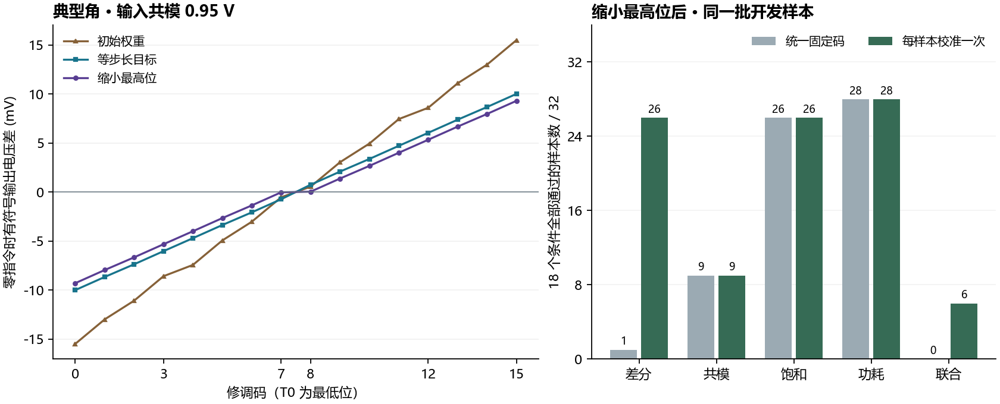

# 全差分 OTA 的四位失调修调

后续实验沿用本页的四位控制、2 pF 负载和逐样本校准，进一步定位了慢角下降沿反复越界的原因，并测量了五个补偿与共模反馈方案。[建立时间与失配对照](RECOVERY.md)

如果放大器接到 ADC，每次上电允许校准一次，在室温选好的修调码到了高温还能用吗？本例用原生 Virtuoso 原理图、实际 SMIC18 工艺模型和 Spectre 前仿检验这个问题。最后一组在同一批 32 个开发样本中，把差分跟踪合格数从 1 个提高到 26 个。把输出平均电压、饱和余量、电源和功耗一并计入后，共有 6 个样本合格。**当前前仿结论为继续改型。** [各码、各角和判据的数值](trim-review.json)



## 在图上怎样调

打开 `FDOTA18_INPUT / schematic`。信号从上方差分对进入，每只输入管的源极经过四段电阻接入公共尾电流源。每段电阻旁边有一只真实 NMOS 旁路开关。右侧四个 CMOS 反相器提供互补驱动。外部只需提供 T3、T2、T1、T0 四个静态逻辑电平，T0 为最低位。某位为高时，正侧对应的电阻被旁路，负侧保留该段。反向切换时两侧互换。片上的负责修正的器件共 8 个电阻和 16 只 MOS，加上原 OTA 共 34 只 MOS。

在 `TB_FDOTA18_OTA / schematic` 左下方可见 EB0 至 EB3。其增益设为 0 或 1，向相应输入脚施加地或实际电源电压。例如 7 对应 T3…T0 = 0111。仿真逐点读取四个输入脚与四个片内互补节点，三组设计的最大电平误差约为 0.000101 mV。码选择由外部测量程序完成。如系统要求自主上电校准，还需为测量、搜索和存码电路单列功耗、面积及测试条件。[原理图生成器](ota_trim_views.py) · [实际码和控制电压的回读](ota_trim.py)

## 三次选择电阻的依据

测量保持每侧输出接 2 pF。每个电阻组扫描全部 16 码，覆盖 TT、SS、FF、两个输入共模电压以及 −0.30、0、+0.30 V 三个差分指令。选码只使用 TT、输入共模 0.95 V、零差分指令下的测量。未加随机失配时，三个候选在此处均选 7。下表的最大间隙取六种工况中最差值，按实际校正量排序计算。

| 单侧四段电阻，按 T0 至 T3 排列 | 典型角零指令可调范围 | 最大码间隙 | 联合静态通过 | 1 µs 内满摆幅边沿通过 |
|---|---:|---:|---:|---:|
| 1200、1900、3200、6000 Ω | ±15.488 mV | 2.528 mV | 693/693 | 9/12 |
| 750、1250、2220、4150 Ω | ±10.005 mV | 1.968 mV | 691/693 | 8/12 |
| 750、1250、2220、3650 Ω | ±9.298 mV | 1.399 mV | 693/693 | 10/12 |

第一组的间隙大于两倍静态差分容差，处于间隙中间的误差可能无法调进 ±1 mV。第二组缩小并重新分配了各位权重，慢角、高输入共模、+0.30 V 指令的差分误差仍达到 −1.0023 mV。第三组只缩小最高位电阻，典型角下 7 号码的零指令残差从 −0.739 mV 降至 −0.031 mV。它在慢角、高输入共模只能覆盖约 ±7.26 mV，且快角的 7、8 号码交叉。逐码实测可以发现此处的非单调性。慢角两种输入共模下的下降沿分别在 1.027 和 1.031 µs 建立，仍超过 1 µs 要求。

三组均使用 1.65/1.90 µm 的输入对和 5.15/1.50 µm 的共模负载。开关及其互补驱动增加 2.952 µm² 栅面积，全机为 **113.322 µm²**，预算为 114.19 µm²。第三组新增电阻条面积 **60.46 µm²**，全机电阻条合计 4288.28 µm²，补偿电容极板合计 1512.50 µm²。以上数值从已保存的有效 CDF 和两份 SI 层次网表核对，分别反映栅、条带和极板的规模。布线、间距、保护环以及校准控制器需另行估算。

满摆幅的两个失败点可以从波形进一步区分。慢角、输入共模 0.95 V 和 1.10 V 的下降沿，输出平均值分别在 0.363 和 0.419 µs 内回到容差内。超出 1 µs 的是差分输出，分别需要 1.027 和 1.031 µs。下一次改动应分别检验慢角的差分恢复，以及随机样本的输出共模偏差。

## 如何量有失调放大器的增益和噪声

带修调残差的高增益放大器，断开差模反馈、强制两输入等电位，可能会让输出离开实际工作点。第二组在典型角用这个测试台读到 33.96 dB。先测出负载和反馈均连接时的直流输入差，再用该输入差建立开环小信号测试，实测为 **84.38 dB**。真实闭环跟踪、功耗、建立时间以及失配试验都沿用原来的输入指令。

程序逐一复核每路输出和偏置节点的直流变化量。必要时，按实测微扰斜率修正数值偏差，每次记录最终输入偏置。对每个角的 11 个输入共模点及常用偏置点，分别用两档微扰核对直流斜率，再与 1 Hz 差分 AC 比较。三组均完成各自的 36 点检查。第三组的最大增益差小于 0.001 dB，最大输出或偏置节点偏移约 0.040 mV。噪声使用同一偏置和差分输出，积分频带为 10 Hz 至 100 kHz。[工作点和有限差分检查](ota_trim_ac.py)

| 第三组的标准偏置，输入共模为 0.6 VDD | 增益 | 差模 / 共模相位裕量 | 输入噪声 | 核心功耗 |
|---|---:|---:|---:|---:|
| TT，1.80 V，27 °C | 84.41 dB | 66.17° / 79.54° | 32.56 µV RMS | 23.16 µW |
| SS，1.62 V，85 °C | 84.54 dB | 67.61° / 80.91° | 36.31 µV RMS | 16.99 µW |
| FF，1.80 V，−40 °C | 84.25 dB | 62.60° / 76.63° | 28.51 µV RMS | 23.99 µW |

## 校准之后还有哪些限制

启用全部 34 只 MOS 的局部统计模型。每个样本先在参照条件实测 16 码，保存误差绝对值最小的物理码。其余工况均使用该码。程序逐个核对实例对应的随机参数向量，并比较同一器件、同一抽样、全程固定 7 号码的对照。每组还对 0、7、15 号码执行了 18 次普通与无扰动统计器件的跨条件电气对照。[校准与固定码的复验](ota_trim_stats.py)

| 每个样本须通过全部 18 个条件 | 第三组统一码 7 | 第三组按样本校准一次 |
|---|---:|---:|
| 差分误差 ≤ 1 mV | 1/32 | 26/32 |
| 输出平均值距半电源 ≤ 25 mV | 9/32 | 9/32 |
| 18 只模拟管均有饱和余量 | 26/32 | 26/32 |
| 两输出在电源轨内，电源提供正功率 | 32/32 | 32/32 |
| 核心功耗 ≤ 25.22 µW | 28/32 | 28/32 |
| 所有静态要求同时满足 | **0/32** | **6/32** |

第三组未校准时的最坏差分误差为 6.895 mV，校准后为 1.875 mV。第二组校准后的差分通过数为 21/32，联合通过数也为 6/32。两组使用已见开发种子 64211。电阻及电容随机变化、自动上电校准和独立新批次的统计资格仍待验证。

另一组诊断使用上次未加修调的 18 管电路及已见种子 152219。在 SS、输入共模 1.10 V，关闭局部变化时 32/32 样本的共模达标。仅开启四只检测及参考管时为 32/32，仅开启两只共模负载时为 27/32，仅开启两只尾管时为 20/32，全部开启时为 20/32。各组结果来自同一批抽样，其误差会相互作用。下一项有依据的改动是检查共模尾电流对检测节点和执行管的影响，同时保住快角的输出平均值与慢角的满摆幅建立。[分组实验证据](ota_cm_groups.py)

## 在自己的授权工艺环境复跑

先完成已有的工艺表征、基准 OTA、共模修正和匹配实验，取得下列三个输入目录。示例站点配置需要能够打开本机 PDK、Virtuoso、SI 和 Spectre。以下命令在仓库根目录执行，输出应指向新目录。[前置工程与命令](OTA.md#匹配面积与共模偏置的取舍)

```sh
case_dir=examples/smic18-ota-sizing
set -- --config cadence.local.json --ota work/fdota --cmfb work/fdota-cmfb --matching work/fdota-matching
python3 "$case_dir/ota_cm_groups.py" run "$@" --out work/trim-groups
python3 "$case_dir/ota_trim.py" run "$@" --bank centered --out work/trim
python3 "$case_dir/ota_trim_ac.py" run "$@" --nominal work/trim --out work/trim-operating
python3 "$case_dir/ota_trim_stats.py" run "$@" --nominal work/trim --out work/trim-statistics
python3 "$case_dir/ota_trim_decision.py" --nominal work/trim --operating work/trim-operating --statistics work/trim-statistics
```

把对应命令的 `run` 换成 `verify`，可从已保存的证据回放判定。`wide` 和 `balanced` 可在各自的新目录复跑前两组参数。进入 `work/trim/fixed-code-oa` 后执行 `virtuoso -restore open.il`，可打开选中码的测试台、顶层原理图和 symbol。`work/trim-statistics/frozen.json` 保存每个样本的码，`summary.json` 保存具体超限的指标。

最后一条命令核对三份报告来自同一版电路，给出逐项结论。本例返回 `rework` 和退出码 1，原因是满摆幅建立和开发样本的联合静态要求超限。程序返回 0 表示可以转入预留样本验证，返回 2 表示证据缺失或对应关系有误。[判定代码](ota_trim_decision.py)
