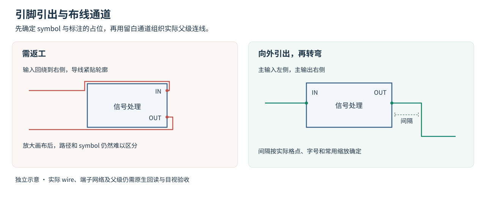

# Schematic 的十条绘图要求

1. **电气连接优先。** 使用实际 PDK、引脚和 CDF；不得为了排版改拓扑、参数、模型或仿真设置。展示坐标与电气清单分开保存。
2. **按信号流组织。** 主输入优先在左、主输出在右，电源在上、VSS/地在下。偏置、核心、输出级、CMFB 分区，测试台与核心分层。在父级核对实际朝向，避免镜像后输入跑到右边又绕回左侧。
3. **对齐与对称。** 差分对和对应负载同排、镜像、等距；尾电流和电流镜归属清楚。镜像后用实际变换重算 G/D/S/B 锚点，不能只看器件中心。
4. **主要拓扑用实体 wire。** 差分支路、反馈、补偿、尾电流和镜像直接画出；跨模块、电源、共用偏置可用标签。不能让整张图靠同名标签推理连接。
5. **布线无歧义。** 优先水平/垂直，消除异网交叉、穿器件和密集绕行。导线与 symbol 边沿保持可见间隔，出 pin 后向外走一段再转弯。不同网的端点、折角和短线不能接触。
6. **格点与间距。** 先回读目标 DBU、连接格点和符号 pin。1.5 可作器件排布起点，不是统一连接格点。留出引脚逃逸、参数文字和 T 形分支的空间。
7. **标注清楚。** 实例名、关键参数、网络名和端口方向不压图形/导线/文字；使用一致字体层级。参数标注来自当前 CDF；不能留下已经过期的“目标值”。
8. **层次适度。** 复杂电路按功能拆分，端口命名与方向一致；展开关键机制，重复阵列用数量/位宽表达。不要让一个 symbol 占满父级。
9. **保存并回读。** Check & Save 后读取全部 master、属性、端子网络、端口方向和有效端序；重排要比较前后电气签名与原生网表。
10. **目视验收。** 看全图、关键局部、实际直接父级和常用缩放。检查通过不代替画面检查；导出图后必须实际查看。

## CTDSM18 的关键改进

先做紧凑功能 symbol，再按它的真实大小移动父级实例和重拉引出路径。只缩小 symbol 而保留原来实例坐标，会留下很空的父级；只把全部坐标等比缩小，会让文字、引脚和折线堆叠。

参考 `assets/ctdsm18-layouts.json` 中三个父级的坐标与端点表达。它只是排版参考。新工程必须从当前保存电路读出实例/连接，用目标 master 的真实 pin 重算路径，保留手工 Note、标注和用户修改。

## 已确认的细节

- Symbol pin 通常是矩形，锚点可取矩形中心。Schematic port 可能是带文字和箭头的实例，应取其实际原点/连接点；包含文字的 bbox 中心会偏移。
- 预留 pin 箭头/实例图形的整个占位区域，不只避开一个坐标；否则别的网可能擦到其图形并被错误连接。
- 新图与本次重排范围内的异网交叉需消除。即便数据库将某处识别为不连接，也应调整位置、通道或辅助短线，解决读图歧义。历史图中的交叉语义仍须按原生网络回读核对。
- 同网优先 T 接，避免四向焊点跨线。删除对象时先检查 `dbIsId`，因为删除 wire 可能连带释放关联 label。
- Native Check 警告要逐条处理。确为观察用途的数字输出可使用正确的 noConn/接收接口，不为隐藏错误任意加电容或改变端口方向。

## 晶体管级工程排版

具体的分组、目标/实测注释、同名短线取舍和原生注释模板，见[工程原理图](engineering-schematic.md)。symbol 仍按既有规则。

## 先定边界，再安排走线

批量搭建前，先完成一个有代表性的 symbol 和实际父级片段，包含主通路、供电、控制及必要反馈。按本页检查并修正，再复用到同类模块。完整图生成后重新审查所有实例和通道。

取实际父级变换后的可见轮廓、pin 图形、pin 名及动态实例标注作为占位。选择框单独维护，不能用它代替可见轮廓和文字范围。

1. 先确定主信号、反馈与辅助控制各自的通道，移动功能组解决拥挤。成对支路保留对应行和一致的引出长度。
2. 从实际 pin 锚点沿端口外法向引出，再在留白通道转弯。除连接该 pin 的短段外，导线避开边界、功能图及标注。不要紧贴边框平行走线，也不要绕着边框描一圈。
3. 间隔按目标连接格点与父级字号取值。可从若干格点起步，再按实际常用缩放调整。间隔小到视觉上与边框粘连时继续加大；给粗线预留相应空间。
4. 同网分支用明确 T 接点。异网交叉先调整实例和路由顺序，辅助使能、时钟或公共偏置可用成对的短引线和一致网标。保留主信号、局部反馈及电流镜的实体关系。
5. 控制线避开采样节点、器件参数及其他 pin 的逃逸区域。多条竖线与横线连续相交、折角压线、线从实例名穿过，都要返工。
6. 重拉完整路径后检查端点、折角、分支和网标归属，再做逐端回读、Check & Save、前后原生网表比较与实际父级目视。

差分源或巴伦靠近成对主信号通路，对应共模/偏置支路就近放置。避免两条信号长距离上绕后折返、横跨大片空白，或用过长连线把小器件分散开。短线网标与同名节点逐端核对，尤其检查共模支路是否误接到信号节点。

通用图示见下图。图中蓝色表示功能轮廓，绿色表示通路，虚线仅标注检查间隔。该图为独立绘图示意。

## 供电线的视觉层级

优先让 VDD 与 VSS/地的供电主干略粗于普通信号线，同时保留清楚的连接点、引脚和网络名。粗细只表达图面层级，版图金属宽度仍依据电流、压降、可靠性和工艺规则确定。VCM、VREF、偏置和时钟按其真实用途归类。

**指定网络独立加粗在本仓库中尚待原生验证。** 在目标版本的专用测试库先确认支持的对象属性/API及局部作用范围。保存后重新打开，检查真实 wire/net 归属、参数/连接与网表，目视全图、局部和导出图后才启用。不要猜测 `schCreateWire` 的数值参数含义。

如果目标环境仅支持全局显示修改，记录该限制并保留当前线宽。用清楚的上下供电主干、短分支和电源网标表达供电。普通 drawing 覆盖线、重复导线、总线替代、临时高亮均不能作为已完成的电源 wire 加粗证据。
