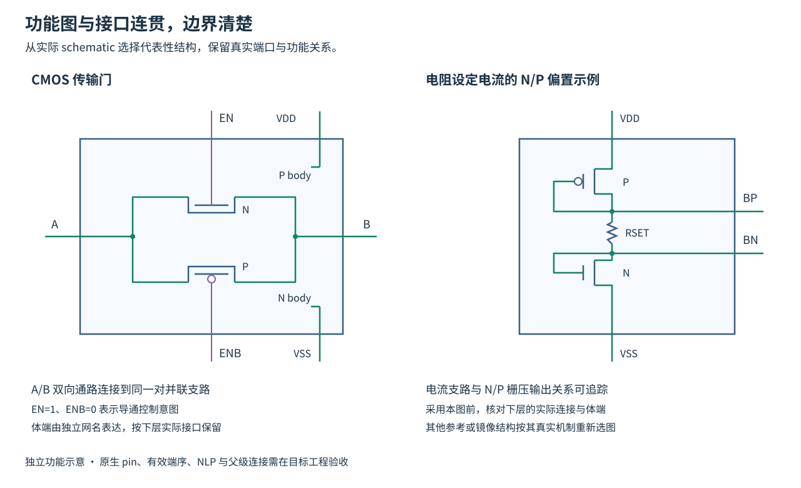
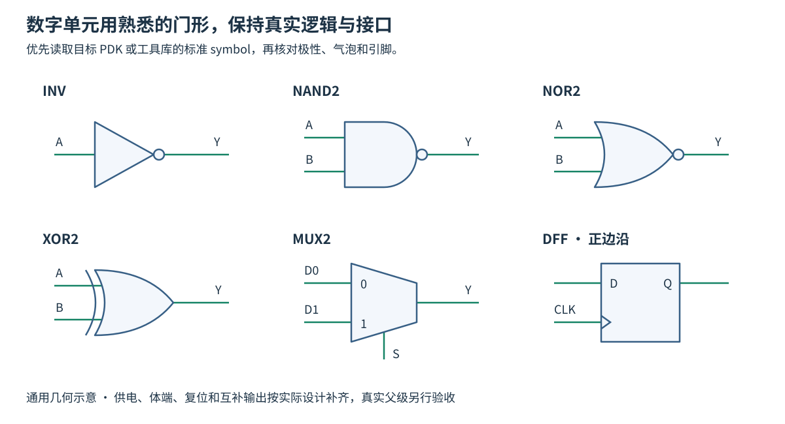

# 紧凑、直观的原生 symbol

目标是在父级常用缩放下一眼辨认功能。先安排端口和功能关系，最后定大小；不把所有模块都做成大矩形加标题。

| 功能 | 保留的关键图形 |
|---|---|
| OTA | 差分正负、输出极性、级联增益、实际前馈关系 |
| 比较器 | 差分输入、再生/保持、输出缓冲、时钟或使能 |
| 积分器 | 1/s 或放大器、反馈电容、复位开关及其极性 |
| FIR DAC | 差分分支、抽头/权重、求和节点、抽头数量 |
| C²MOS/DFF | 主从级、时钟极性、复位/初始化、Q/QB 与延时 |
| 环路滤波器 | 积分器级数、前馈、求和、局部反馈和 DAC 返回路径 |
| 普通门/开关 | 采用可辨认的逻辑门或触点形状，不能用通用大空框替代 |
| 偏置/参考 | 参考输入或发生支路、N/P 偏置生成或镜像关系、实际输出；按需要显示启动/使能 |
| CMOS 传输门 | 同一 A/B 之间的互补开关通路、EN/ENB 对应关系、实际供电/体端接口 |

18 个参考图形在 `assets/ctdsm18-symbols.json`。它包含所有图元，不只保存包围框。`render_symbols.py` 与 `emit_symbols.py` 从同一份数据生成 SVG 和原生 SKILL，避免两套画法逐渐分叉。

## 可见边框、端口和尺寸

- 复杂模块采用清楚、闭合、紧凑的可见边框。标准逻辑门可用自身完整轮廓界定边界。原生 `instance/drawing` 选择框独立核对。
- 主输入优先左侧，主输出右侧；双向 A/B 通路按父级主信号方向安排。电源上、地下，辅助控制按作用位置分组。对称反馈、双向接口等特殊安排须说明原因。
- Pin 落在轮廓边界或短引脚末端，相关功能图延伸到对应 pin。端口悬在空白处、内部通路与外部 A/B 脱节时，应重新组织图形。
- 先排功能图与各侧端口，再用真实字体、总线名称、NLP 展开文本确定宽高。端口多就调整组间距或适当放大轮廓；不要靠压小字体或堆挤名字容纳。
- 大片无用途空白应收紧，pin 名/功能图拥挤应扩展或简化细节。门形和反相泡保持比例。symbol 和父级共同试排，检查常用缩放下的辨认、布线和阅读。
- 简单门的主体、pin、供电位置、可见边界及选择框一起确定。门体缩放后重新检查剩余空间，消除保留旧框导致的大片空白。输出 pin 与门体输出中心线对齐，避免内部引线多绕台阶。详细接口说明按 [工程注释](engineering-schematic.md#模块接口说明放在独立留白区) 放在 schematic 留白区。
- 所有 pin 移动、旋转和镜像都按实际 transform 检查父级。左右布局与电气方向、有效端序分别维护。

## 偏置图应解释输出从哪里来

先读取实际 schematic，确认参考电流/电压从哪里产生，哪些支路建立 N/P 栅压，哪些支路作镜像、级联或分配。BN/BP 的具体含义从真实连接确认。

简单偏置可采用少量代表性 MOS、二极管连接或电阻参考的缩略图，把相应栅压/电流节点连到输出 pin。多输出偏置可采用参考核→局部生成→分配的功能图，并在对应输出处注明类型。仅当实际电路包含启动、关断或内部反相时才画入。

一段电阻折线加上“mirror bias”无法说明 N/P 输出关系时，继续补清关键支路。抽象比例与数值必须有实际电路依据；下层 schematic 保留完整实现。

## 传输门图应能沿 A/B 连续追踪

A、B 是同一双向传输通路的两端，通常在左右同一水平轴。可用清楚的传输门图形，或在紧凑边框内画连接到同一 A/B 的 NMOS、PMOS 并联支路。两端都需接入功能图，不能把 A/B 放在外侧、内部另外画一对悬空开关。

EN 接 NMOS 控制，ENB 接 PMOS 控制时，标清互补关系。理想控制意图是 EN=1、ENB=0 导通，EN=0、ENB=1 关断；实际导通范围和动态误差由器件与信号电平验证。若下层没有反相器，保留两个独立控制 pin。供电/体端 pin 按真实接口保留，A/B 的双向电气语义也须保留。

父级采样、复位或钳位支路沿实际信号方向摆放，控制线使用独立通道；按 [drawing.md](drawing.md) 消除贴边和异网交叉。

此图演示可读性和边界，偏置采用电阻与二极管连接 MOS 的独立结构示例。只有实际连接相符时才采用这一图形，体端按目标 PDK 核对。原生 pin、NLP、网络与父级验收按以下要求执行。

## 数字标准单元优先采用通行门形

先读取目标 PDK 或工具库的同功能 symbol，核对门类型、输入数量、反相位置及真实端口。可复用已认可的图形风格；实际 master 和 CDF 映射仍按电路定义处理。

默认使用易识别的轮廓，同一工程保持一套约定。具体项目采用标准矩形逻辑符号时，保留正确的功能标记并保持一致。

| 功能 | 通行的可辨识画法 |
|---|---|
| BUF / INV | 三角门体；INV 在输出处加正圆反相泡 |
| AND / NAND | 输入侧平直、输出侧半圆的 D 形门体；NAND 输出加反相泡 |
| OR / NOR | 输入侧凹弧、输出侧收尖的曲线门体；NOR 输出加反相泡 |
| XOR / XNOR | OR 门形加输入侧附加弧线；XNOR 输出加反相泡 |
| MUX | 通行梯形或有明确选择含义的框形；数据输入、输出与选择端位置清楚 |
| DFF / 锁存器 | 矩形内标 D/Q，边沿触发器加时钟三角；低有效端有反相标记，按实际电路区分边沿和电平敏感 |

原生曲线/圆弧优先保持平滑。门体不可粗略替换成削角多边形；反相泡与输出中心线同轴、与门体及引出线连续。A/B 等输入从各自 pin 延伸到门体，输出从门尖/圆弧或反相泡引出。功能名采用简短标注，供电/体端 pin 放在清楚的位置。

审图时逐项核对门形、气泡、时钟标记、引脚数量与实际真值/时序关系。原生接口缺少某种曲线时先找受支持的图元或库中已认可形状，生成后放大检查。

图示为本仓库绘制的通用几何参考。实际门形还需在目标 PDK 与真实父级确认，供电/体端和复位接口按真实设计补齐。

厂商资料可用于交叉核对符号、接口和功能表。例如 TI 的二输入 NAND 手册同时给出功能图与 H/L/X 输入输出表，后续使用者可按相应器件查阅。[TI SN74HC00 数据手册，第 8.2、8.6 节](https://www.ti.com/lit/ds/symlink/sn74hc00.pdf)

## 三份接口信息分别检查

1. **几何位置**：名称、侧边、坐标、相对布局及父级走线。
2. **电气语义**：input/output/inputOutput、极性、总线范围和位序。电源/传输节点的方向从实际电路约定取得，不由左右位置推断。
3. **有效端序**：实际 netlisting 顺序、CDF 仿真映射和 subckt 声明一致。不得用字母排序或坐标排序替换原有位置式端序。

同一接口集合还不够；保存后用 `schGetPinOrder`、`schSymbolToPinList` 及原生网表检查。需要改方向时先确认电气驱动关系，不能为消除提示而随意改为 inputOutput。

## 原生对象要求

- 图元放在适合的 device 图层；选择框独立使用 `instance/drawing`，不要让装饰框代替选择框。
- Pin 创建真正的 net、terminal、pin figure；pin 名字使用原生 pin-name label。
- 实例名使用 `[@instanceName]` 的原生 `NLPLabel`，cell 标签使用 `[@cellName]`；普通静态文字不能替代动态标签。
- 本参考字体为 `roman`；不改全局表单/UI 字体。图形小并不意味着把字缩到无法读。
- 在参考技术中 DBU=160，pin 半尺寸 .0125；目标技术不同需重新确认量化。小数坐标能写入不代表已精确保留。

## Pin 改动的父级联动

列出所有直接父级，包括测试台。先保存已保存状态和手工修改，再变换新 pin 坐标、同步实例与完整引出路径；不能只把线末端平移一小段，留下绕行或短路。逐端网络和原生网表必须与重排前一致，然后检查每个父级的真实显示。

SVG 预览不包含真实 OA 语义，PNG 也不证明端子连接。复杂差分图可作功能抽象，晶体管级拓扑以下层 schematic 为准；不能画出与实际功能相反的极性或不存在的通路。
